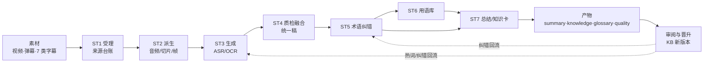

# 单任务处理计划（Plan：一个 task 怎么从素材走到产物）

> 本目录是一组**可落地、可验收**的设计文档，回答同一个问题：
> **「视频 + 弹幕 + 原生字幕/AI字幕/截图字幕/ASR字幕/本地截图字幕/本地ASR字幕」进来之后，我们这个项目该怎么一步步处理单个 task，产出「视频总结 + 用语库」。**
> 每份文档都自带流程图、数据契约、实现步骤表与可执行验收命令，验收证据统一落 `docs/evidence/singletask/`。

---

## 文档地图

| 文档 | 工作项 | 解决什么 | 关键产出 |
|---|---|---|---|
| [00-总览与契约](single-task/00-总览与契约.md) | ST0 | 唯一契约源：阶段表、来源模型、产物 schema、G1–G6 门禁、兼容规则 | 契约（先读这篇） |
| [01-素材受理与来源台账](single-task/01-素材受理与来源台账.md) | ST1 | 7 类字幕怎么进系统、怎么校验、台账怎么记；弹幕怎么解析成结构 | `subs/manifest.json` v0 |
| [02-媒体预处理与派生资产](single-task/02-媒体预处理与派生资产.md) | ST2 | 探测、抽音、切片计划、抽帧与去重、派生资产缓存 | `work/probe.json`、`chunks.json`、`frames.json` |
| [03-字幕生成-ASR与截图OCR](single-task/03-字幕生成-ASR与截图OCR.md) | ST3 | 本地/云端 ASR 与截图 OCR 怎么生成、热词怎么注入、时间轴怎么诚实标注 | `subs/asr.srt`、`subs/ocr.srt` |
| [04-字幕质检与融合](single-task/04-字幕质检与融合.md) | ST4 | 可信梯、基底/补齐、去重与冲突裁决、时间轴归一、G1/G2 | `subs/fused.srt`、`manifest.json` v1 |
| [05-知识库术语纠错](single-task/05-知识库术语纠错.md) | ST5 | 知识库注入、最长匹配、保护规则、逐条留痕、G3 | `terms_applied.json` |
| [06-用语库产出与晋升](single-task/06-用语库产出与晋升.md) | ST6 | 用语库怎么挖、怎么验证据、怎么审阅、怎么晋升成知识库新版本（热词回流） | `output/glossary.json`、`.md` |
| [07-总结与知识卡生成](single-task/07-总结与知识卡生成.md) | ST7 | 输入装配、预算抽样、结构化输出、时间戳约束、幻觉防护、降级 | `output/summary.md`、`knowledge.md` |
| [08-验收矩阵与实施路线](single-task/08-验收矩阵与实施路线.md) | ST8 | 样片与 mock 基建、逐阶段验收命令、P0/P1/P2 排期、回归与回退 | 验收矩阵、路线图 |

---

## 端到端流程（简版）

详见 [ST0 §3](single-task/00-总览与契约.md)。

---

## 怎么读 / 怎么用

1. **先读 00**：所有字段名、阶段名、门禁编号只在 00 定义一次，其余文档只引用。若发现冲突，以 00 为准并回写。
2. **按 ST 顺序读实现步骤**：每份文档的 §5 是实现步骤表（编号、改动文件、依赖、能否独立验收）；§6 是验收命令（命令 + 期望数值 + 证据路径）。
3. **开工顺序看 08 §7**：P0 = ST1→ST2→ST4→ST3（mock 优先），P1 = ST5→ST6→ST7→前端，P2 = 本地引擎/场景切分等增强。顺序是依赖排序，不是重要性排序。
4. **验收只认证据**：`docs/evidence/singletask/STn/` 下必须有 `README.md` + 原始命令输出 + 产物快照；无证据视为未完成。

---

## 当前状态

| 项 | 状态 |
|---|---|
| ST0 契约 | ✅ 已完成（本目录 00） |
| ST1–ST8 文档 | ✅ 已产出（细节以实现步骤与验收命令为准） |
| 代码实现 | ⬜ 未开始（P0 待开工） |
| 验收证据 | ⬜ 待按 08 矩阵逐项产出 |

---

## 与既有文档的关系

- `docs/视频处理流程图.md`：**当前 v1 实现**的真实流程图；本文档描述的是**目标设计**，落地后需同步该图。
- `docs/overview.md` / `docs/architecture.md` / `docs/api.md`：现状说明；本计划落地时按其"兼容与迁移"章节增量更新。
- `reference/MoonDigest-全流程详解.md`、`reference/MAW-总结.md`：外部参考（提示词、降级链、LLM 协议），设计里引用它们时都标了"参考设计"。**这两份文档不在本仓库内**（`reference/` 已被 `.gitignore` 忽略，仅供作者本机查阅），因此本文档的契约与验收均不依赖它们；外部读者可忽略这几处引用。

> 返回上级：[README](../../README.md)
