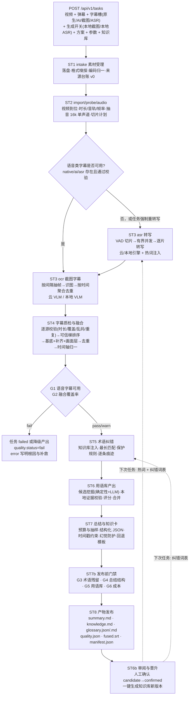

# ST0 · 单任务处理总览与契约（单任务流水线设计）

> 本文件是整个「单任务处理」设计的**唯一契约源**：阶段名、来源模型、产物路径、JSON Schema、门禁编号、工作项编号都在这里定义一次，其余文档只引用、不复述。
> 读者：实现者（照 ST1–ST8 落地）、验收者（照门禁 G1–G6 判定）、后续接手者（先读本文件）。
> 依据：`backend/internal/**`（现实现）、`reference/MoonDigest-全流程详解.md`（提示词与降级链）、`reference/MAW-总结.md`（LLM 协议与工程契约）。

---

## 1. 一句话目标

**把一个任务定义为「视频 + 弹幕 + 多来源字幕」的可信归并问题，产出三件套：`summary.md`（视频总结）、`knowledge.md`（知识卡）、`glossary.json/.md`（用语库），并且每一步都能单独跑、单独验收、失败可解释、可断点续跑。**

输入七类素材（本设计必须全部支持）：

| # | 素材 | 说明 | 现状 |
|---|---|---|---|
| 1 | 视频 | 上传文件或直链 | ✅ 已支持 |
| 2 | 弹幕 | XML/JSON/TXT | ✅ 已支持（但只做字符串拼接） |
| 3 | 原生字幕 | 平台人工字幕（上传） | ✅ 已支持（无校验） |
| 4 | AI 字幕 | 平台 AI 字幕（上传） | ✅ 已支持（无校验） |
| 5 | 截图字幕 | 画面文字/OCR 结果（上传） | ⚠️ 现名 `vision`，语义含糊，无质量校验 |
| 6 | ASR 字幕 | 外部转写结果（上传） | ❌ 无槽位（kind 只认 native/ai/vision/danmu） |
| 7 | 本地截图字幕 | **本任务**用本地模型识图生成 | ⚠️ 只能选一个 vision 方案，无法区分云/本地 |
| 8 | 本地 ASR 字幕 | **本任务**用本地模型转写生成 | ⚠️ 只能选一个 asr 方案，无法区分云/本地 |

产出（本设计新增后 3 项）：

```
output/summary.md      视频总结（分析时间 + 概述 + 按主题分节 + 时间戳）
output/knowledge.md    知识点卡片（目录 + 卡片条目 + 时间戳）
output/glossary.json   用语库（机读，可审阅、可晋升知识库）
output/glossary.md     用语库（人读，按类型分组、带证据时间戳）
output/quality.json    质检报告（门禁结果 + 指标 + 降级原因）
subs/fused.srt         融合后的统一稿（已有）
subs/manifest.json     来源台账（每份字幕的可信度与使用决策，新增）
```

---

## 2. 现状盘点：三个结构性缺陷

现有实现见 `docs/视频处理流程图.md`（import → audio → asr → frame → vision → fuse → summary），痛点集中在**可信度**，不在功能数量：

**缺陷 A：字幕进来不校验，谁对谁错没人知道。**
`pipeline.Run` 把上传字幕直接 `subtitle.ParseFile` 后进融合（`backend/internal/pipeline/pipeline.go:174-193`），没有时长交叉校验、没有覆盖率、没有乱码率。外部给来一份**别的视频的字幕**、或只覆盖前 3 分钟的字幕，会被当成正文一路送进总结——MoonDigest 用「字幕时间轴 vs 视频时长」这个极廉价的校验挡掉了绝大多数脏数据（`reference/MoonDigest-全流程详解.md` 过程 ④ 4.3），我们一条都没有。

**缺陷 B：融合是"拼"，不是"选"。**
`subtitle.Fuse`（`backend/internal/subtitle/fuse.go:16-51`）只按 native > ai > asr 取基底，ASR 覆盖率 < 30% 就整段追加，vision 全部追加，最后**按文本完全相等去重**（`fuse.go:93-105`）。后果有三：同一段话在 native 与 ASR 里措辞略不同就变成两条；ASR 分片是 110 秒一条的大块（切片大小见 `backend/internal/media/ffmpeg.go:83`，整片文本被写成单条 cue 见 `backend/internal/pipeline/pipeline.go:241`），把整块文本挂在一个时间点上，时间轴精度被毁；vision 一行行画面文字混进对白流，读者分不清"人说的"还是"屏幕上写的"。

**缺陷 C：术语纠错是全局盲替换，用语库根本没有。**
`subtitle.ApplyTerms`（`fuse.go:127-148`）对每条字幕遍历所有别名做 `strings.ReplaceAll`：没有最长匹配（`云雾之湾` 的别名 `云雾` 会把 `云雾之湾` 拆坏）、没有词边界、没有保护规则、没有逐条痕迹。而「用语库」这个最该沉淀的资产完全缺失：`knowledge.md` 是知识点卡片，不是词典；没有任何环节把视频里的专有名词抽出来回流到知识库，于是**同一个 UP 主的第 2 个视频，仍然从零开始错。**

其余待改：弹幕只 `strings.Join` 前 200 条（`backend/internal/pipeline/danmu.go:80-88`），丢了时间与热度结构；总结只发一次 prompt、无预算/抽样/结构校验（`pipeline.go:478-481`），模型返回 JSON 解析失败就退化成一个"统一稿节选"模板（`pipeline.go:588-595`），用户拿到的东西质量不可控。

---

## 3. 目标流水线总览

十个阶段（stage），权重之和 100，每个阶段都有**磁盘产物**与**幂等键**（断点续跑只重跑未完成阶段，见 `backend/internal/db/repo.go:450` `ResetNonDoneStages`）。



### 3.1 阶段契约（本设计新增后的唯一阶段表）

| # | stage | 权重 | 触发条件 | 主产物 | 幂等键 | 新增? |
|---|---|---|---|---|---|---|
| 1 | `intake` | 5 | 必做 | `subs/manifest.json`(v0)、`upload/**` | 上传文件 sha256 集合 | ✅ 新增 |
| 2 | `import` | 5 | 必做 | `upload/video` | 视频 sha256 | 沿用（权重 10→5） |
| 3 | `audio` | 10 | 必做（无音轨则 skipped） | `work/audio.wav`、`work/probe.json` | audio sha256 | 沿用 |
| 4 | `asr` | 20 | 条件：无可用语音字幕或强制重转写 | `subs/asr.srt` | asr 方案 id + audio sha + 热词 sha | 沿用（语义细化） |
| 5 | `frame` | 5 | 条件：需要 OCR 或回看 | `work/frames/`、`work/frames.json` | 间隔 + 上限 + 视频 sha | 沿用（10→5） |
| 6 | `vision` | 12 | 条件：截图字幕生成开关 | `subs/ocr.srt` | 方案 id + 帧集 sha + 提示词版本 | 沿用（15→12，产物改名 ocr.srt） |
| 7 | `fuse` | 10 | 必做 | `subs/fused.srt`、`subs/manifest.json`(v1) | 各源内容 sha 组合 | 沿用（算法重写） |
| 8 | `glossary` | 8 | 条件：用语库开关开 | `output/glossary.json/.md` | fused sha + 提示词版本 | ✅ 新增 |
| 9 | `summary` | 20 | 必做 | `output/summary.md`、`output/knowledge.md` | fused sha + 偏好 + T + 用语库 sha | 沿用 |
| 10 | `quality` | 5 | 必做 | `output/quality.json` | 全产物 sha | ✅ 新增 |

合计：5+5+10+20+5+12+10+8+20+5 = **100**。

> 兼容规则：v1 任务（`stage_profile='v1'`）沿用旧权重 `import10/audio10/asr25/frame10/vision15/fuse10/summary20`，保证历史任务进度仍能到 100；v2 新任务用上表。实现见 `backend/internal/db/progress.go:10-18` 改造为按 profile 选表。

### 3.2 每阶段"跳过"的语义（必须写进 stages.message）

- `skipped` = 该阶段按设计**不需要**（例如已有可信原生字幕，无需 ASR）；必须写明原因（`message` 字段），不许空跳。
- `degraded` 不是阶段状态；它记在 `output/quality.json.degradations` 与阶段 `message` 里。**阶段状态只有 pending/running/done/failed/skipped 五种**，与现有实现一致（`backend/internal/db/repo.go` 的 `FinishStage`）。

---

## 4. 输入契约

### 4.1 来源模型（把 8 类素材收成一个结构）

一份字幕 = 一个 `SubtitleSource`，**不再用单一 kind 表达所有信息**：

```go
// backend/internal/subtitle/source.go（新增）
type SubtitleSource struct {
    SourceID string // 唯一键：<kind>:<channel>:<seq>，例 native:upload:1 / asr:generate:1
    Kind     string // native | ai | asr | ocr | danmu
    Channel  string // upload（用户上传）| generate（本任务生成）
    Producer string // platform | user | external-tool | cloud-api | local-model | unknown
    Engine   string // 具体引擎：bilibili-ai / deepseek-asr / whisper-cpp-q5 / ollama:qwen2.5-vl / ...
    Format   string // srt | vtt | ass | ssa | txt | xml | json
    Lang     string // zh | en | ja | mixed | unknown
    Cues     []Cue
    Path     string            // 相对任务目录
    Meta     map[string]string // 上传原名 / profile_id / 生成时刻 / 参数
}
```

`Kind` 取值与用户口径的映射：

| 用户口径 | Kind | Channel | Producer（默认） | 上传字段 / 开关 |
|---|---|---|---|---|
| 原生字幕 | `native` | upload | platform | `subtitle_native` |
| AI 字幕 | `ai` | upload | platform | `subtitle_ai` |
| 截图字幕 | `ocr` | upload | external-tool | `subtitle_ocr`（旧名 `subtitle_vision` 兼容） |
| ASR 字幕 | `asr` | upload | external-tool | `subtitle_asr`（新增） |
| 本地截图字幕 | `ocr` | generate | local-model / cloud-api | `generate_ocr_subtitle=1` + `vision_profile_id` |
| 本地 ASR 字幕 | `asr` | generate | local-model / cloud-api | `generate_asr_subtitle=1` + `asr_profile_id` |
| 弹幕 | `danmu` | upload | user | `subtitle_danmu` |

- `Producer` 可由上传方显式覆盖：`<字段>_producer`、`<字段>_engine` 可选表单字段（例如上传的是自己用 whisper.cpp 跑的结果 → `producer=local-model, engine=whisper-cpp-q5`）。缺省按上表。
- 生成类来源的 `Producer` 由**方案**决定：`profiles.extra.engine_kind` ∈ {cloud, local}（JSON 字段，不改表结构），`Engine` 取方案的 `name`/`model`。
- 兼容：DB 里历史 `kind='vision'` 读时归一成 `ocr`，写时一律写 `ocr`；下载路径同时认 `ocr.srt` 与 `vision.srt`。

### 4.2 可信梯（Trust Ladder）

排序数值越小越可信；**最终基底的选取规则**见 ST4。默认梯次：

| tier | 来源 | 依据 |
|---|---|---|
| 1 | `native:upload` | 平台人工字幕：语义最准、断句最像人 |
| 2 | `ai:upload` | 平台 AI 字幕：断句偏碎但基本准确 |
| 3 | `asr:upload` | 外部转写：可能已人工校对 |
| 4 | `ocr:upload` | 外部画面文字：不覆盖旁白，只补画面 |
| 5 | `asr:generate` (cloud-api) | 本任务云 ASR |
| 6 | `ocr:generate` (cloud-api) | 本任务云识图 |
| 7 | `asr:generate` (local-model) | 本地模型：术语与长句更易错 |
| 8 | `ocr:generate` (local-model) | 本地 VLM |
| — | `danmu:upload` | **不进正文**，只作语境/热度/用语证据（见 ST6） |

**降级修正**（tier 计算后再叠加，写进 manifest 的 `tier_adjust`）：
- 时长校验 `fail`（too-long 或覆盖率低于阈值）→ **降 2 档**
- 覆盖率 < 40% → 降 1 档
- 乱码率 > 2% 或 4-gram 重复率 > 5% → 降 2 档
- 解析结果为空或时间轴全为 0 → 直接 `rejected`，不参与排序

### 4.3 任务参数（新增项加粗）

| 参数 | 默认 | 说明 |
|---|---|---|
| `screenshot_interval` | 60 | 截图间隔（秒）；OCR 质量与成本的主旋钮 |
| `screenshot_mode` | simple | 沿用；后续可加 `scene` 场景切分 |
| `reading_depth` T | 2 | 总结阶段回看轮数 |
| `summary_preference` | 空 | 总结方向偏好 |
| **`generate_ocr_subtitle`** | 0 | 是否生成本地截图字幕（旧名 `generate_vision_subtitle` 兼容） |
| **`generate_asr_subtitle`** | 0 | 是否生成本地 ASR 字幕（旧名 `generate_ai_subtitle_via_asr` 兼容） |
| **`glossary_enabled`** | 1 | 是否产出用语库 |
| **`glossary_max_terms`** | 60 | 用语库上限（1..200） |
| **`glossary_domain`** | 空 | 领域提示（"葡萄酒/光学/游戏…"），空则由模型自判 |
| **`trust_override`** | 空 | 形如 `native:upload=1,asr:upload=2`，手工改梯次（排障用） |

### 4.4 失败语义分层（沿用并显式化）

| 情况 | 处理 | 不许做的事 |
|---|---|---|
| 某份上传字幕解析失败 | 该源 `rejected`，其余继续，`quality.degradations` 记录 | 不许把整任务判失败 |
| 无任何语音类字幕且 ASR 不可用 | `G1 fail`：任务 failed，error 写明"无可用字幕，且 ASR 通道不可用/未配置" | 不许拿空字幕去总结 |
| 有画面字幕、无语音字幕 | 允许"仅画面"降级产出，`summary` 开头显式声明"本视频无对白字幕，结论仅基于画面文字"，`quality.status=degraded` | 不许假装听过对白 |
| 总结模型截断 | 保留半篇 + `quality` 标 `degraded` + 建议调大输出上限 | 不许丢半篇 |
| 用语库生成失败 | `glossary` 阶段 failed，但 **summary/knowledge 照常产出**，任务 `degraded` | 不许因用语库失败丢掉总结 |

---

## 5. 产物契约

### 5.1 目录布局（相对 `/data/task/{taskId}/`）

```
upload/video                       原始视频
upload/subs/{kind}_{seq}_{orig}    上传的字幕（原名保留便于追溯）
upload/danmu_{orig}                弹幕原文件
work/audio.wav                     16k 单声道 PCM
work/chunks/chunk_000.wav          ASR 切片（含 4s 重叠）
work/frames/frame_00001.jpg        抽帧
work/probe.json                    媒体探测结果
work/frames.json                   帧清单（index/time/path/sha）
subs/asr.srt                       生成的字幕（asr:generate）
subs/ocr.srt                       生成的字幕（ocr:generate）
subs/fused.srt                     融合统一稿（正文权威）
subs/manifest.json                 来源台账（权威，含所有决策）
output/summary.md                  视频总结
output/knowledge.md                知识卡
output/glossary.json               用语库（机读，审阅状态权威）
output/glossary.md                 用语库（人读渲染，可从 json 重新生成）
output/quality.json                质检报告
output/cost.json                   成本明细（DB cost_summary 同源）
```

### 5.2 `subs/manifest.json`（`toutetsu.subtitle-manifest.v1`）

```json
{
  "schema": "toutetsu.subtitle-manifest.v1",
  "task_id": "17950...-49904",
  "video": {"duration": 1292.0, "width": 1920, "height": 1080, "fps": 29.97, "has_audio": true, "probed_at": "2026-11-19T12:00:00+08:00"},
  "sources": [
    {
      "source_id": "native:upload:1",
      "kind": "native", "channel": "upload", "producer": "platform", "engine": "bilibili",
      "file": "upload/subs/native_1_native.srt", "format": "srt", "lang": "zh",
      "cues": 312, "chars": 8213, "first_sec": 1.2, "last_sec": 1288.0,
      "checks": {"parsed": true, "monotonic": true, "overlap_ratio": 0.03,
                 "coverage": 0.91, "too_long": false, "garbage_ratio": 0.001,
                 "dup_ngram_ratio": 0.02, "avg_cue_chars": 26.3},
      "tier": 1, "tier_adjust": 0, "trust_score": 0.93,
      "decision": "primary", "reason": "最高可信梯且时长校验通过"
    }
  ],
  "fuse": {
    "primary": "native:upload:1",
    "gap_fill": ["asr:generate:1"],
    "screen_layer": ["ocr:generate:1"],
    "dropped_duplicates": 47,
    "conflicts": [{"at": 412.5, "winner": "native:upload:1", "loser": "asr:generate:1", "similarity": 0.62}],
    "coverage_after": 0.97, "cues_after": 341
  },
  "terms": {"kb_refs": ["3:2"], "aliases_loaded": 128, "hits": 12, "leftover": 0, "applied_at": "..."}
}
```

### 5.3 `output/glossary.json`（`toutetsu.glossary.v1`）

**用语库 = 本视频产出的、带证据与审阅状态的领域用语词典；它不是知识库（知识库是长期资产），但可以晋升为知识库的一个版本。**

```json
{
  "schema": "toutetsu.glossary.v1",
  "task_id": "17950...-49904",
  "domain": "葡萄酒/新西兰酒展",
  "generated_at": "2026-11-19T12:30:00+08:00",
  "generator": {"model": "deepseek-v4.1", "prompt_version": "glossary-v1", "fused_sha": "ab12...", "source_tiers": ["native:upload:1"], "danmu_used": true},
  "terms": [
    {
      "term": "云雾之湾",
      "type": "brand",
      "aliases": ["2万1云", "两湾一云", "云雾万"],
      "reading": "Cloudy Bay",
      "definition": "新西兰马尔堡产区的代表性酒庄，以长相思白葡萄酒著称。",
      "evidence": [
        {"t": 742.0, "text": "我们之前测过了几款云雾之湾", "source": "native:upload:1", "match": "term"},
        {"t": 1301.5, "text": "卷云和2万1云", "source": "asr:generate:1", "match": "alias"}
      ],
      "occurrences": 7,
      "first_seen": 742.0,
      "confidence": 0.88,
      "status": "candidate",
      "origin": "llm+rule",
      "kb_ref": null
    }
  ],
  "rejected": [{"term": "啊", "reason": "无实义，出现 218 次"}],
  "stats": {"candidates": 96, "kept": 42, "rejected": 54, "llm_terms": 31, "rule_terms": 18, "danmu_terms": 4, "merged": 11}
}
```

字段硬约束（G5 校验）：
1. `term` 非空、去重、长度 2..40 字符。
2. `type` ∈ {brand, place, person, product, term, slang, event, other}。
3. `evidence` 至少 1 条，且**每条必须在对应来源字幕里真的能检索到**（本地校验，模型不许编造时间）；`t ≤ video.duration`。
4. `occurrences` 必须等于本地统计的 term+alias 命中数（本地为准）。
5. `confidence` ∈ [0,1]，`status` ∈ {candidate, confirmed, rejected}。
6. 与知识库同名条目冲突时，`kb_ref` 必填且 `status` 不得为 `confirmed`（需人工裁决）。

### 5.4 `output/quality.json`（`toutetsu.quality.v1`）

```json
{
  "schema": "toutetsu.quality.v1",
  "task_id": "...",
  "status": "pass",
  "gates": [
    {"id": "G1", "name": "语音字幕可用", "status": "pass", "detail": "native:upload:1 覆盖率 0.91", "evidence": "subs/manifest.json#/sources/0"},
    {"id": "G2", "name": "融合覆盖率", "status": "pass", "detail": "0.97 ≥ 0.90"},
    {"id": "G3", "name": "术语残留", "status": "pass", "detail": "别名残留 0 条"},
    {"id": "G4", "name": "总结结构", "status": "warn", "detail": "主题节 3（要求 ≥4 @1292s）"},
    {"id": "G5", "name": "用语库", "status": "pass", "detail": "42 条，证据缺失 0"},
    {"id": "G6", "name": "成本基线", "status": "pass", "detail": "vision_images=22, tokens=6231/4102"}
  ],
  "metrics": {
    "fused_coverage": 0.97, "fused_cues": 341,
    "summary_sections": 3, "summary_timestamps": 41, "timestamps_invalid": 0,
    "term_violations": 0, "glossary_terms": 42, "glossary_evidence_missing": 0,
    "hallucination_flags": 0
  },
  "degradations": ["ASR 使用本地模型 whisper-cpp，专有名词错误率高于云端"],
  "cost": {"asr_seconds": 1292.0, "vision_images": 22, "prompt_tokens": 6231, "completion_tokens": 4102}
}
```

`status` 判定：任一 gate `fail` → `fail`；任一 gate `warn` 或 `degradations` 非空 → `degraded`；否则 `pass`。任务 `status` 与 `quality.status` 的关系：`fail` 的任务除非有降级产出路径，否则 `status=failed`；`degraded` 的任务仍是 `status=done`，但详情页必须显著提示。

### 5.5 `summary.md` / `knowledge.md` 结构要求（G4 校验口径）

`summary.md`：
1. 头信息块：`# 标题` + `- 视频 / 时长 / 任务ID / 分析时间`。
2. `## 分析概述`：3–6 句，必须出现"结论"性表述。
3. `## 分析具体内容`：按主题分节 `### 主题N：<主题名>`，片长 ≥300s 时至少 4 节，<300s 至少 2 节。
4. 每节至少 1 条带时间戳的要点，时间戳格式 `[MM:SS]` 或 `[HH:MM:SS]`；**全文时间戳必须 ≤ 视频时长**，且能落回 fused 的字幕条（±10s 容差）。
5. 信息不足时显式写"字幕未覆盖"，不许编造。

`knowledge.md`：
1. `# 知识卡片：<主题>` + `## 目录`（锚点链接，数量与卡片数一致）。
2. 每张卡片：`## n. 标题` + `- **一句话结论**` + `- **详细说明**`（2–5 条）+ `- **关键词/标签**` + `- **来源时间戳**`（至少 1 个，合法）。
3. 卡片数 3..20。

---

## 6. 门禁总表（G1–G6）

| 编号 | 名称 | 判定条件（fail / warn / pass） | 定义在 |
|---|---|---|---|
| G1 | 语音字幕可用 | 存在 `kind ∈ {native,ai,asr}` 且 `checks` 通过（parsed+非空+时长校验非 fail）的源：有→pass；仅存在画面字幕→warn（降级产出）；都没有→fail | ST4 |
| G2 | 融合覆盖率 | `fuse.coverage_after`：≥0.90 pass；0.60–0.90 warn；<0.60 fail（片长<180s 时阈值降为 0.50/0.30） | ST4 |
| G3 | 术语残留 | 已确认（KB）别名在 fused 中残留条数：0 pass；1–3 warn；>3 fail | ST5 |
| G4 | 总结结构 | 按 §5.5 全项校验：全过 pass；仅缺节数/句数 warn；时间戳非法或 JSON 不可解析 fail | ST7 |
| G5 | 用语库 | 按 §5.3 六条硬约束：全过 pass；置信<0.6 占比>30% warn；证据缺失/重复 term/schema 错 fail | ST6 |
| G6 | 成本基线 | 与同片长基线比较：≤1.5× pass；1.5–2.5× warn；>2.5× warn+提示（不 fail） | ST8 |

门禁实现放 `backend/internal/quality`（新增包），输入是 manifest + fused + summary/knowledge/glossary + cost，输出 `quality.json`。**门禁只判定、不修改产物**（唯二例外：G4 的时间戳越界由 ST7 在生成侧修正，不在门禁侧改文）。

---

## 7. 文档地图与工作项

| 文档 | 内容 | 工作项 | 里程碑 |
|---|---|---|---|
| `00-总览与契约.md`（本文件） | 契约、阶段、门禁、兼容 | ST0 | — |
| `01-素材受理与来源台账.md` | 槽位、格式嗅探、编码、时间轴校验、manifest v0、弹幕结构解析 | ST1 | M1 |
| `02-媒体预处理与派生资产.md` | probe、抽音、VAD 切片计划、抽帧、截帧质量、派生资产缓存 | ST2 | M1 |
| `03-字幕生成-ASR与截图OCR.md` | 云/本地 ASR 适配、热词注入、上下文提示、分片合并、OCR 识图与时间聚合 | ST3 | M2 |
| `04-字幕质检与融合.md` | 指标、可信梯、基底/补齐/画面层、去重、冲突裁决、时间轴归一 | ST4 | M2 |
| `05-知识库术语纠错.md` | 词典加载、最长匹配、保护规则、命中统计、残留校验 | ST5 | M3 |
| `06-用语库产出与晋升.md` | 候选挖掘、LLM 协议（借 MAW）、证据校验、评分、审阅、晋升 KB、热词回流 | ST6 | M3 |
| `07-总结与知识卡生成.md` | 输入装配、预算抽样、结构化输出、时间戳约束、幻觉防护、回退与分支 | ST7 | M4 |
| `08-验收矩阵与实施路线.md` | 每阶段验收命令、样片与 mock、证据规范、P0/P1/P2 排期、回归 | ST8 | M5 |

里程碑定义：

- **M1 素材与来源可信**：manifest 正确、坏字幕被拦、弹幕带时间结构。退出条件：ST1/ST2 验收全过。
- **M2 字幕可信**：融合覆盖 ≥0.90、重复/冲突有裁决记录、ASR 与 OCR 生成链路可跑（真实或 mock）。
- **M3 术语闭环**：术语残留 0、用语库可审阅、可晋升为知识库版本并被下次任务读到（热词+纠错双向生效）。
- **M4 总结可信**：G4 门禁通过、时间戳全部合法、幻觉抽检 0、半篇/失败语义正确。
- **M5 验收与回归**：全链路 e2e（真实 Key 或 mock 双轨）+ 证据归档 + 回归脚本进 CI。

---

## 8. 兼容与迁移（一次说清，避免后续文档各说一套）

| 面 | 变更 | 兼容策略 |
|---|---|---|
| DB `tasks` | 新增 `stage_profile TEXT DEFAULT 'v1'`、`glossary_enabled INT DEFAULT 1`、`glossary_max_terms INT DEFAULT 60`、`glossary_domain TEXT DEFAULT ''` | `ALTER TABLE` 幂等迁移（先查 `PRAGMA table_info`），老任务 `stage_profile='v1'` |
| DB `task_subtitles` | 新增 `source_id TEXT`、`channel TEXT`、`producer TEXT`、`meta TEXT DEFAULT '{}'` | 老行读时按 `kind` 推断默认值补全 |
| DB 新表 | 无（用语库审阅状态写回 `glossary.json`，文件即真源，原子写 temp+rename） | — |
| 阶段名 | 新增 `intake`/`glossary`/`quality`；`vision` 保留但产物改名 `ocr.srt` | 前端阶段列表由 API 返回，不写死；`StageWeights` 按 profile 选表 |
| API | 新 multipart 字段：`subtitle_ocr`、`subtitle_asr`、`generate_ocr_subtitle`、`generate_asr_subtitle`、`glossary_*`、`<字段>_producer/_engine` | 旧字段继续接受（`subtitle_vision`、`generate_vision_subtitle`、`generate_ai_subtitle_via_asr`） |
| 下载 | 新增 `glossary.json`、`glossary.md`、`quality.json`、`manifest.json`；`ocr.srt` 与旧 `vision.srt` 都认 | 白名单扩展（`backend/internal/api/api_tasks.go:160-178`） |
| 新接口 | `PATCH /tasks/{id}/glossary/terms/{term}`（审阅）、`POST /tasks/{id}/glossary/promote`（晋升 KB） | 纯新增 |
| 前端 | 新建页 4 个素材槽 + 用语库开关；详情页产物分区 + 用语库审阅 | 组件级改动，不动路由 |
| 证据 | 新增 `docs/evidence/singletask/STn/` | 不影响既有 `docs/evidence/backend|frontend` |

数据库迁移编号建议：`internal/db/migrate_v2.go`，`Migrate()` 末尾调用，全程幂等（重复启动不报错）。

---

## 9. 全局验收方式（所有文档共用）

1. **可跑的样片**：`backend/testdata/samples/`（仓库内，CI 可用）
   - `sample_60s.mp4`：ffmpeg `testsrc` 合成 60s（含音轨），构建脚本 `scripts/gen-sample.ps1`
   - `sample_native.srt`（12 条，覆盖 0–58s）、`sample_ai.srt`（同内容不同断句）
   - `sample_asr.srt`（含 3 处术语错误 + 2 处重复幻觉）
   - `sample_ocr.srt`（画面文字，稀疏）
   - `sample_bad_duration.srt`（时间轴到 600s，视频只有 60s → 必须被 G1 拦截）
   - `sample_danmu.xml`（30 条，含 `p@ 时间属性、含垃圾弹幕）
   - `sample_glossary_expected.json`（人工标注的 8–12 个应抽出的用语）
2. **可替换的 AI 依赖**：`deepseek.Client` 增加可注入 `HTTPDoer`（或 `pipeline.Deps` 接口化），测试用 `httptest.Server` 返回固定 JSON；**禁止**测试里打真网。
3. **验收证据规范**（沿用 `docs/evidence/**` 现有纪律）：每个 ST 目录内含 `README.md`（结论表）+ 原始命令输出（`.txt`）+ 关键产物（`manifest.json`/`quality.json`/`glossary.json` 等）+ 复现命令。**无产物路径 = 未完成。**
4. **每条验收标准必须写成三件事**：命令、期望（数值/断言）、证据路径。示例：

   ```powershell
   # ST4 融合覆盖率验收（mock 全链路）
   go test ./internal/pipeline/ -run TestFuseCoverage -v
   # 期望：coverage_after >= 0.90，duplicates_dropped > 0，conflicts 记录非空
   # 证据：docs/evidence/singletask/ST4/unittest_output.txt
   ```

5. **CI**：`go vet ./... && go test ./...` 必须全绿；前端 `npm run build` 必须 0 错误（沿用现有自检口径）。

---

## 10. 风险总表

| 风险 | 影响 | 缓解 |
|---|---|---|
| 无真实 ASR/OCR 通道（历史遗留，见 `docs/交接报告.md`） | ST3 只能 mock 验收 | 引擎接口化 + `httptest` 假实现；真实 Key 到位后补 live 证据（沿用 B1 的"降级透明"纪律） |
| 本地模型（whisper.cpp / Ollama VLM）带来新外部依赖 | 部署变重、镜像变大 | P2 才引入；P0/P1 只要求"本地 OpenAI 兼容端点"可用；二进制可选并做探测降级 |
| 融合算法重写引入回归 | 既有 e2e 结论失效 | 保留 v1 `Fuse` 为 `FuseLegacy`，新老对比测试（同一输入覆盖率与条数差异必须可解释） |
| 用语库 LLM 编造术语/时间 | 污染知识库 | §5.3 硬约束 3/4：证据本地校验，时间由本地映射，模型不碰时间 |
| 阶段增多导致进度失真/历史任务不到 100 | 用户困惑 | `stage_profile` 双表；迁移脚本回填 v1 |
| 提示词随版本漂移，产物不可复现 | 无法回归 | 所有 prompt 带 `prompt_version`，写入 manifest/glossary/quality；测试锁定版本号 |

---

## 11. 术语表（全文档统一口径）

| 词 | 含义 |
|---|---|
| **来源（Source）** | 一份字幕 = `SubtitleSource`，由 kind + channel + producer + engine 唯一刻画 |
| **可信梯（Tier）** | 来源可信度排序（1 最可信），由 kind/channel/producer 决定并按校验结果修正 |
| **基底（Primary）** | 融合时作为主时间轴的来源（tier 最小的合格源） |
| **补齐（Gap Fill）** | 基底未覆盖时段由低梯次语音字幕补入 |
| **画面层（Screen Layer）** | 截图字幕/画面文字，作为"屏幕上写了什么"的独立层，不与对白混淆 |
| **统一稿（Fused）** | `fused.srt` 的内容，所有下游（用语库、总结）的唯一正文输入 |
| **用语库（Glossary）** | 单个任务产出的、带证据与审阅状态的领域词典，可晋升为知识库版本 |
| **知识库（KB）** | 长期资产，版本化，条目为 `{standard, aliases, note}`，用于纠错与热词 |
| **晋升（Promote）** | 把用语库中 `confirmed` 的条目合并成某个知识库的新版本 |
| **门禁（Gate）** | G1–G6，机器判定产物是否达标，结果写 `quality.json` |
| **降级（Degraded）** | 产出可用但不满足全部质量条件，必须显式记录原因，不许静默 |
| **阶段 profile** | `tasks.stage_profile`，决定进度权重表与阶段集合（v1/v2） |

---

## 12. 下一步

按 `08-验收矩阵与实施路线.md` 的 P0 顺序开工：ST1（来源台账）→ ST2（媒体派生）→ ST4（质检融合）→ ST5（术语纠错）→ ST7（总结）→ ST6（用语库）→ ST3（生成）→ ST8（验收回归）。**顺序不是重要性排序，而是依赖排序**：没有可信来源与融合，后面的提示词再漂亮也只是把脏字幕包装成漂亮的脏结论。

> 返回上级：[计划索引](../README.md) ｜ 顶层文档：[README](../../../README.md)
