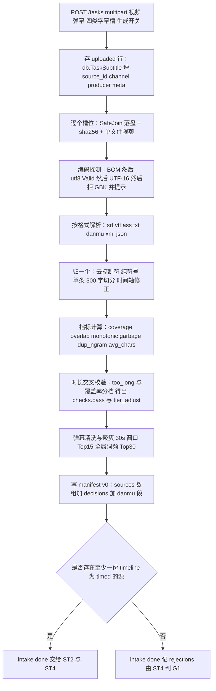

# ST1 · 素材受理与来源台账

> 本文是单任务流水线的**入口**：把「视频 + 弹幕 + 原生字幕 / AI 字幕 / 截图字幕 / ASR 字幕（上传）」与「本地截图字幕 / 本地 ASR 字幕（生成开关）」这七类素材无损收进系统，给每一份字幕一个**可追溯的身份与质量档案**，并在入口把坏字幕拦下来。
> 依赖：[ST0](00-总览与契约.md) 的 §3.1（`intake` 阶段）、§4.1（`SubtitleSource`）、§4.2（可信梯）、§5.2（manifest）、§8（迁移）。
> 下游：ST2 消费 `probe.json` 与 `manifest` 的 `video`；ST4 消费 `checks` 与 `tier`；ST7 消费弹幕聚簇。
> 验收口径：坏时长字幕必须被拦、指标可复算、manifest v0 合法、旧上传字段仍可用；证据落 `docs/evidence/singletask/ST1/`。

## 1. 目标与非目标

**目标**

1. 七类素材**全部有槽位**：上传四类（native / ai / ocr / asr）+ 生成两类（ocr / asr）+ 弹幕，且新旧 API 字段都可用。
2. 每份字幕都有身份：`source_id = kind:channel:seq`，并记录 `channel / producer / engine / format / lang`（00 §4.1）。
3. 入口质检：解析成功率、时长交叉校验、覆盖率、乱码率、重复率、单调性，全部写进 manifest（00 §5.2）。
4. 弹幕结构化：保留时间与用户，做清洗与聚簇，供 ST6 作证据、ST7 作热点；**不进 fused 正文**（00 §4.1）。
5. 失败可解释：单源坏不拖垮任务；全坏才在 G1 判失败（ST4 执行）。

**非目标**

- 不做融合与去重（ST4）、不生成 ASR/OCR（ST3）、不做术语纠错（ST5）。
- 不做平台页解析（视频仍是文件或直链，沿用 00 §9 样片口径）。
- 不改前端交互细节（新建页槽位与校验属于 ST8 的前端工作项，本文只给字段契约）。

## 2. 现状与差距

| 现状（真实代码） | 问题 | 影响 |
|---|---|---|
| `api_tasks.go:77` 只遍历 `native / ai / vision / danmu` 四个 `FormFile` | 没有 `ocr / asr` 上传槽位，也没有 `generate_ocr_subtitle / generate_asr_subtitle` 字段 | 用户的外部 ASR 字幕无处可放，只能硬塞进 `ai` 槽（身份丢失） |
| `db.go:101-108` `task_subtitles` 只有 `kind / orig_name / stored_path / generated` | 无 `source_id / channel / producer / meta` | 无法表达"本地生成 vs 云端生成 vs 外部工具"，可信梯无法计算 |
| `pipeline.go:174-193` 用 `if c, err := subtitle.ParseFile(...); err == nil` 吞掉错误 | 坏文件静默消失，没有任何记录 | 用户传了字幕却"没有字幕"，无法定位 |
| `subtitle/parse.go:20-48` 按扩展名分发 + 内容嗅探 | 无编码处理；无格式校验结果；无异常行计数 | GBK 字幕直接变乱码，且无从得知 |
| `parse.go:190-196` `parseTXT` 把整份文本压成一条 `Start=0, End=0` 的 cue | 纯文本字幕没有时间轴却被当成有时间轴 | 融合后整段挂在 00:00，误导下游与读者 |
| `parse.go:229-253` `ParseDanmu` 只取 `<d>` 文本，返回 `[]string` | 丢掉 `p` 属性里的时间、模式、用户 | 弹幕不能按时间引用，也不能作证据（无 `t`） |
| `danmu.go:80-88` `SummarizeDanmu` 截前 200 条后 `strings.Join` | 无时间、无热度、无聚簇 | ST7 只能用"一堆弹幕文字"，噪声大且不可定位 |
| `pipeline.go:363` `fuse` 完成后只写 `fused.srt` | 没有任何来源台账 | 出了坏结论无法回答"用的是哪份字幕、凭什么" |
| `security.go:20` `SafeJoin`、`:84` `SanitizeFilename` 已存在，但 `api_tasks.go:232` 的 `saveUpload` 未用 `CopyLimited` | 上传未按单文件限额复制 | 大文件绕过总限额的边角风险（B6 已覆盖总限额，此条为加固） |

## 3. 设计

### 3.1 槽位与 API 字段映射

| 用户口径 | kind | channel | producer 默认 | 上传字段 / 开关 | 备注 |
|---|---|---|---|---|---|
| 原生字幕 | `native` | upload | platform | `subtitle_native` | 平台人工字幕 |
| AI 字幕 | `ai` | upload | platform | `subtitle_ai` | 平台 AI 字幕 |
| 截图字幕 | `ocr` | upload | external-tool | `subtitle_ocr`（兼容旧 `subtitle_vision`） | 画面文字/OCR 结果 |
| ASR 字幕 | `asr` | upload | external-tool | `subtitle_asr`（新增） | 外部转写结果 |
| 本地截图字幕 | `ocr` | generate | 由方案 `engine_kind` 决定 | `generate_ocr_subtitle=1` + `vision_profile_id`（兼容旧 `generate_vision_subtitle`） | ST3 生成 `subs/ocr.srt` |
| 本地 ASR 字幕 | `asr` | generate | 由方案 `engine_kind` 决定 | `generate_asr_subtitle=1` + `asr_profile_id`（兼容旧 `generate_ai_subtitle_via_asr`） | ST3 生成 `subs/asr.srt` |
| 弹幕 | `danmu` | upload | user | `subtitle_danmu` | 不进正文，只作证据/热点 |

可选覆盖字段：`<字段>_producer`、`<字段>_engine`（如 `subtitle_asr_producer=local-model` + `subtitle_asr_engine=whisper-cpp-q5`）。缺省按上表；生成类的 `producer` 取 `profiles.extra.engine_kind`（`cloud` 或 `local`），`engine` 取方案 `name/model`。

### 3.2 上传落盘与安全

- 目录：`upload/subs/{kind}_{seq}_{sanitizedOrig}`；同 `kind` 多份按 `seq` 从 1 递增（本次设计允许同 kind 多份，可信梯按 `seq` 与 `producer` 分别计算）。
- 路径：一律 `SafeJoin(uploadDir, name)`（`security.go:20`），文件名先过 `SanitizeFilename`（`:84`）；拒绝 `..`、绝对路径、控制字符。
- 限额：沿用 `LimitBody`（`security.go:49`）+ `MaxUploadBytes`（413 语义不变）；单个字幕文件的独立上限 50MB，用 `CopyLimited`（`:56`）落盘并在超限时删除半成品。
- 元信息：`forms -> db.TaskSubtitle{source_id, channel, producer, meta}`，`meta` 存 `{orig_name, size, sha256, uploaded_at, form_field}`。
- 失败：单文件保存失败 → 该槽位记 `rejected`（原因入 manifest），其余继续；不 500。
- 兼容：旧字段名映射到新 kind（`vision→ocr`），DB 读时归一（00 §8）。

### 3.3 解析与编码

编码探测顺序（不新增第三方依赖为前提）：

1. BOM（UTF-8 / UTF-16LE / UTF-16BE）→ 直接解码（UTF-16 用标准库 `unicode/utf16`）。
2. 无 BOM：`utf8.Valid` 通过 → UTF-8。
3. 否则：若字节含 `\x00` 且偶数位为 0 → 判 UTF-16LE（反之 BE）；仍失败 → 判为"疑似 GBK/GB18030"，**不猜**，返回带提示的错误 `subtitle: 疑似 GBK 编码，请转存 UTF-8 后重试`。
4. 若后续批准引入 `golang.org/x/text/encoding/simplifiedchinese`（纯 Go、无 CGO），则在第 3 步直接解码并记 `meta.encoding=gbk`（风险表见 §7）。

解析器矩阵（沿用 `parse.go` 的能力，补"结果对象"）：

| 格式 | 解析函数 | 时间轴 | 特殊处理 |
|---|---|---|---|
| srt | `parseSRT`（`parse.go:71-103`） | 有 | 去 `<i>` 等标签；空文本丢弃 |
| vtt | `parseVTT`（`:105-133`） | 有 | 跳 `WEBVTT` 头与 `NOTE` 块 |
| ass / ssa | `parseASS`（`:135-175`） | 有 | 按 `Format:` 定位 Text 列；`\\N` 转空格（不保留换行） |
| txt | `parseTXT`（`:190-196`） | **无** | 标记 `timeline=none`，不参与覆盖率与融合；只作"无时间轴的参考资料"（ST4 决定是否用） |
| danmu xml/json | 新增 `ParseDanmuItems` | 有 | 见 §3.8 |

解析结果对象：`ParseResult{Cues, Format, Encoding, Timeline: timed|none, BadLines, EmptyLines, Notes []string}`；`BadLines` 与 `EmptyLines` 必须写进 manifest（可解释）。

### 3.4 归一化

- 单位：`Cue.Start/End` 为秒（`float64`），保留 3 位小数；导出仍走 `FormatSRT`（`parse.go:205-212`）。
- 文本：去 `\u0000-\u001f` 控制符、`\uFFFD`、首尾空白；纯符号/纯标点条丢弃并计数；多条换行合并为单空格。
- 条数与长度：单条 ≤300 字（超出按句末标点与字数上限切分，切分后时间等分，并记 `split_long_cue`）；单源条数上限 20000（超出截断并记 degrade）。
- 时间轴：`Start < 0` 归零；`End <= Start` 且 `Start>0` → `End = Start + 1.5`（记 `fixed_zero_duration`）；`End - Start > 60s` → 记异常但不改（交给 ST4 归一）。
- `timeline=none`（纯 txt）：不计算 coverage/overlap，`checks.timeline=none`，`tier` 不上场（ST4 只把它当"无时间轴资料"）。

### 3.5 时间轴交叉校验（核心）

参考 MoonDigest 过程④ 4.3 的三条判定（时长上限、覆盖率分档、无时长不校验），落实为常量：

| 常量 | 值 | 理由 |
|---|---|---|
| `TooLongMarginSec` | `max(12, 0.15 × duration)` | 参考 MoonDigest 4.3：字幕尾部超过视频时长一个容差即判 `too-long`（站点错答案、URL 过期错文件的主要特征） |
| `CoverageMin600` | 0.18 | 时长 ≥600s 时低于 18% 视为只覆盖开头（AI 字幕常见） |
| `CoverageMin300` | 0.22 | 300–600s 档 |
| `CoverageMin180` | 0.25 | 180–300s 档 |
| `CoverageMinShort` | 0.10 | <180s：片头片尾无字幕占比高，阈值单独放宽并记 `short_form` |
| `DupNgramWarn` | 0.05 | 4-gram 重复率 >5% 判 ASR 幻觉循环（00 §4.2 降 2 档） |
| `GarbageWarn` | 0.02 | 乱码率 >2% 判编码/模型异常（00 §4.2 降 2 档） |

判定 `checks.pass` = `parsed && !empty && !too_long && coverage ≥ 档位阈值`；`tier_adjust` 按 00 §4.2 叠加（fail → −2；coverage<0.40 → −1；dup/garbage 超阈 → −2）。

### 3.6 质检指标（公式必须可复算）

| 指标 | 公式 | 用途 |
|---|---|---|
| `coverage` | 合并所有 `[Start,End]` 区间后的总秒数 ÷ `duration` | G1/G2 与 tier 修正 |
| `overlap_ratio` | Σ 相邻条重叠秒数 ÷ Σ 条时长 | >0.30 记 `suspicious_overlap`（对话字幕不应大量重叠） |
| `monotonic` | 排序后逐条 `Start ≥ 上一条 Start − 0.3` 且 `End ≥ Start` | 判时间轴跳变；false 时 ST4 会重排 |
| `garbage_ratio` | （含 `U+FFFD`/控制符/连续标点 ≥3 的条数 + 纯符号条数）÷ 总条数 | 编码与模型异常 |
| `dup_ngram_ratio` | `1 − unique4gram ÷ all4gram`（按条内字符，去空白与标点） | ASR 幻觉循环与复读 |
| `avg_cue_chars` | 总字符 ÷ 条数 | 断句质量代理（20–40 为常态） |
| `first_sec / last_sec` | 首条 `Start` / 末条 `End` | 与 `too_long` 判定配套 |

实现位置：`backend/internal/subtitle/checks.go`，纯函数、无 IO、可单测（输入 `[]Cue` + `duration`，输出 `Checks`）。

### 3.7 语言识别

- 汉字占比 = `汉字数 ÷ 有效字符数`；阈值 ≥0.30 判 `zh`。
- 假名（`U+3040–U+30FF`）≥0.10 判 `ja`；谚文（`U+AC00–U+D7AF`）≥0.10 判 `ko`。
- 拉丁字母占比 ≥0.60 且汉字 <0.10 判 `en`；两类都达标判 `mixed`；其余 `unknown`。结果写 `lang`，只作展示与 ST4 的排序参考，不参与门禁。

### 3.8 弹幕结构化

- B站 XML：`<d p="t,mode,size,color,ts,pool,uid,rowid,...">文本</d>`，取 `p` 第 1 段为 `t`（秒，float）、第 2 段 `mode`、第 7 段 `uid`（哈希后存）。
- JSON：数组元素取 `{"time"/"t":…, "text"/"content":…, "uid":…}`，字段名做多别名兼容。
- TXT：逐行一条，`t` 缺失 → `t=-1`（只能作词频证据，不能作时间证据）。
- 清洗：沿用 `meaninglessDanmu` 与 `isMeaningless`（`danmu.go:9-59`），新增"复读检测"（同一用户同文本 10 秒内重复只留首次）与"纯表情/纯数字/超短（<2 字）"过滤。
- 聚簇：固定窗口 30s，统计每窗口条数，取条数 Top 15 窗口（不足 15 有多少取多少）；每窗口代表文本 3 条（长度 ≥6 优先、去重）；输出 `DanmuCluster{start,end,count,texts}` 写入 manifest v0 的 `danmu` 段，供 ST7 直接使用。
- 全局词频：清洗后 token 频次 Top 30（仅 CJK 词与 ≥2 字片段），供 ST6 作"弹幕佐证"。
- **硬规则**：弹幕永不进入 `fused.srt` 与人物的对白层（00 §4.1）。

### 3.9 manifest v0 与失败语义

`subs/manifest.json` 在 `intake` 末尾写出（字段见 00 §5.2，v0 只填 `schema / task_id / sources[] / danmu`；`video` 由 ST2 补全为 v1）：

| 情况 | 处理 | 记录 |
|---|---|---|
| 单源解析失败 | 该源 `decision=rejected`，其余继续 | `reason` 与 `checks.parsed=false` |
| 单源 `too_long` 或覆盖率不足 | 保留但 `tier_adjust` 降档，`decision=gap_fill` 或 `rejected`（由 ST4 定） | `reason` 写明具体阈值 |
| 同一 kind 两份（如外部 ASR 与本地 ASR） | 两份都进 `sources[]`，`seq` 区分 | 可信梯由 `producer` 决定 |
| 全部字幕源不可用 | intake 仍 `done`（素材已受理），G1 在 ST4 判 fail | `sources[].decision=rejected` |
| 弹幕解析零条 | `danmu.items=0`，不失败 | `notes` 记原因 |

## 4. 流程图



## 5. 实现步骤

| 编号 | 改动文件 | 要点 | 依赖 | 可独立验收 |
|---|---|---|---|---|
| ST1.1 | 新增 `backend/internal/db/migrate_v2.go`，改 `db.go` | `tasks` 增 `stage_profile / glossary_enabled / glossary_max_terms / glossary_domain`；`task_subtitles` 增 `source_id / channel / producer / meta`；先查 `PRAGMA table_info` 幂等 | ST0 | 是（迁移幂等单测） |
| ST1.2 | 新增 `backend/internal/subtitle/source.go` | `SubtitleSource`、`source_id` 生成、`tier` 计算入口（表在 00 §4.2） | ST1.1 | 是 |
| ST1.3 | 新增 `subtitle/ingest.go` | 编码探测、解析结果对象 `ParseResult`、`BadLines/EmptyLines`、`timeline=none` 标记 | ST1.2 | 是 |
| ST1.4 | 新增 `subtitle/checks.go` | 7 项指标与 `pass` 判定、分档阈值、`tier_adjust` | ST1.3 | 是 |
| ST1.5 | 新增 `subtitle/danmu_parse.go` | `DanmuItem`、XML `p` 属性、JSON 多别名、TXT 降级、清洗与复读检测 | ST1.2 | 是 |
| ST1.6 | 新增 `subtitle/danmu_cluster.go` | 30s 窗口 Top15、代表文本 3 条、全局词频 Top30 | ST1.5 | 是 |
| ST1.7 | 新增 `backend/internal/pipeline/intake.go` | `intake` 阶段：按槽位受理、写 manifest v0、进度上报、失败语义 | ST1.1–ST1.6 | 否（需 DB） |
| ST1.8 | 改 `backend/internal/api/api_tasks.go` | 新槽位 `subtitle_ocr / subtitle_asr`、生成开关新名与旧名兼容、`producer/engine` 覆盖字段、`CopyLimited` 落盘 | ST1.7 | 是（HTTP 单测） |
| ST1.9 | 新增 `backend/internal/subtitle/{ingest,checks,danmu}_test.go` 与 `backend/testdata/samples/*` | 夹具见 00 §9；覆盖 GBK 拒绝、too_long、txt 无时间轴、弹幕聚簇 | ST1.3–ST1.6 | 是 |
| ST1.10 | 接入 `pipeline.go` 阶段序（`intake` 在最前）与 `db.StageWeights` v2 表 | 阶段注册、权重 5、`skipped` 语义（00 §3.2） | ST1.7 | 否（需 ST0 进度改造） |

## 6. 验收标准

| 项 | 命令 | 期望结果 | 证据路径 |
|---|---|---|---|
| ST1-A 解析与编码 | `go test ./internal/subtitle/ -run TestST1_Ingest -v` | SRT 12 条全解析；VTT/ASS 各 1 例；BOM/UTF-16 各 1 例成功；GBK 样例返回含"疑似 GBK"的错误且不产生 cue | `docs/evidence/singletask/ST1/ingest.txt` |
| ST1-B 指标与时长校验 | `go test ./internal/subtitle/ -run TestST1_Checks -v` | `sample_bad_duration.srt`（60s 视频、时间轴到 600s）判 `too_long=true`、`tier_adjust=-2`；正常样例 `coverage ≥0.90`、`pass=true` | `docs/evidence/singletask/ST1/checks.json` |
| ST1-C 弹幕结构 | `go test ./internal/subtitle/ -run TestST1_Danmu -v` | XML 解析出 `t` 与 `uid`；清洗后条数 ≥10 且 ≤原条数；聚簇 ≥1 个窗口且 `count` 非零；TXT 降级 `t=-1` | `docs/evidence/singletask/ST1/danmu.json` |
| ST1-D manifest v0 | `go test ./internal/pipeline/ -run TestST1_Manifest -v` | `schema=toutetsu.subtitle-manifest.v0`；`sources` 数量 = 实际上传 + 生成槽；每源含 `checks / tier / decision`；JSON 可被 `json.Unmarshal` 严格校验 | `docs/evidence/singletask/ST1/manifest.json` |
| ST1-E API 兼容 | `go test ./internal/api/ -run TestST1_Slots -v` | 新字段 `subtitle_ocr / subtitle_asr / generate_*` 生效；旧字段 `subtitle_vision / generate_vision_subtitle` 仍 201；`source_id` 落库可查 | `docs/evidence/singletask/ST1/api_slots.txt` |

```powershell
go test ./internal/subtitle/ -run TestST1_ -v
go test ./internal/pipeline/ -run TestST1_Manifest -v
go test ./internal/api/ -run TestST1_Slots -v
```

## 7. 风险与回退

| 风险 | 触发条件 | 缓解 | 回退 |
|---|---|---|---|
| GBK 字幕不再被接受 | 用户习惯用外部工具导出 GBK | 错误信息明确给出"转 UTF-8"指引；P2 再引入 `golang.org/x/text`（纯 Go） | `SUBTITLE_ALLOW_GBK=1` 启用内置常用字表解码（覆盖率有限） |
| 阈值过严误拦好字幕 | 短视频片头长 | <180s 档 0.10；拦下的是 `pass=false` 而非丢弃，ST4 仍可降档使用 | 调 `CoverageMin*` 常量（集中在 checks.go 顶部） |
| 弹幕体积过大 | 大型直播回放 | 解析上限 20 万条、内存流式处理；聚簇只保留窗口统计 | `DANMU_MAX_ITEMS` 环境变量收紧 |
| 新增槽位打破旧前端 | 旧前端不传新字段 | 全部新字段可空，旧字段映射；`generate_*` 新名缺失时读旧名 | 前端未升级时自动走旧字段 |
| 迁移失败导致启动不了 | 列已存在或类型冲突 | 幂等迁移 + `PRAGMA table_info` 检查；失败只记日志不 panic | 手工 `ALTER TABLE` 脚本随文档附出 |

## 8. 对 00 契约的增补建议

1. `manifest.v0` 的 `schema` 常量建议在 00 §5.2 显式列出（本文用 `toutetsu.subtitle-manifest.v0`，v1 由 ST2 升级）。
2. 建议在 00 §4.1 的 `SubtitleSource` 中显式加 `Timeline string // timed | none`，本文按此实现（`timeline=none` 的纯文本字幕不参与覆盖率）。
3. 建议 00 §4.3 补 `subtitle_max_bytes`（单字幕文件上限 50MB），避免实现各自定值。
4. 建议 00 §9 样片清单补 `sample_gbk.srt`（用于验证"拒绝并提示"路径）。

> 返回上级：[计划索引](../README.md) ｜ 契约源：[ST0](00-总览与契约.md)
