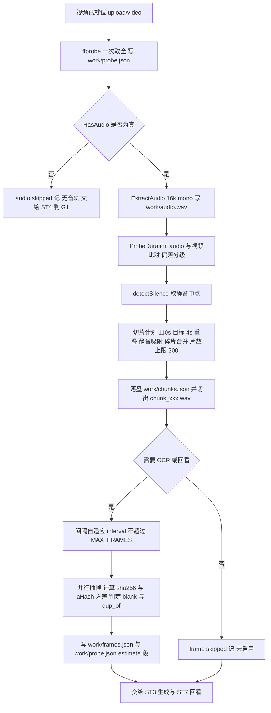

# ST2 · 媒体预处理与派生资产

> 本文定义单任务流水线里"把视频变成可计算的中间物"这一段：ffprobe 探测、抽音、VAD 切片计划、抽帧与近重复帧去重、派生资产清单与成本预估。
> 依赖：[ST0](00-总览与契约.md) §3.1（`import / audio / frame` 阶段与权重）、§5.1（`work/` 目录布局）、§9（样片）。下游：ST3 消费 `audio.wav` 与 `chunks.json`，ST7 消费 `frames/` 与 `probe.json`，ST4 用 `duration` 做时长校验。
> 验收口径：真实 ffmpeg 跑 `sample_60s.mp4`，probe 时长 60±0.5s、切片边界落在静音中点、每片 ≤120s、帧数 ≤`MAX_FRAMES`、近重复帧被标记；证据落 `docs/evidence/singletask/ST2/`。

## 1. 目标与非目标

**目标**

1. 一次探测拿全：时长 / 宽高 / 帧率（含分数形式）/ 音轨 / 声道 / 采样率 / 帧数，写 `work/probe.json`。
2. 抽音固定 16k 单声道 PCM，并做"音轨时长 ≈ 视频时长 ±1s"的一致性校验。
3. 切片**先出计划再切片**：`work/chunks.json`（index/start/end/silence_snapped/chars_est），边界必须落在静音中点，供 ST3 直接消费与断点续跑。
4. 抽帧自适应：间隔放大不超过上限，帧清单 `work/frames.json` 带 sha256 与感知哈希，近重复帧与空帧提前标记，省掉 ST3 的无用识图调用。
5. 任务创建时就能给出成本预估（ASR 秒数 × 单价 + 识图帧数 × 单价），作为 G6 基线。

**非目标**

- 不做场景切分（P2）、不做缩略图/封面临摹、不做音量归一化与降噪（不在本线范围）。
- 不在这里调用任何 AI；只产出确定性的中间物。
- 不改 `import` 语义（视频下载/保存仍在 `import`，本文从"视频已就位"开始）。

## 2. 现状与差距

| 现状（真实代码） | 问题 | 影响 |
|---|---|---|
| `media/ffmpeg.go:31-43` `ProbeDuration` 只取 `format=duration` | 没有宽高/帧率/音轨信息，也没有落盘 | ST7 的 S2 元信息段缺料；无音轨任务无法提前判定 |
| `ffmpeg.go:46-53` `ExtractAudio` 固定 `-ac 1 -ar 16000 -c:a pcm_s16le` | 抽完不校验时长一致性 | 音轨短于视频（片尾静音/截断）时，切片计划按视频时长铺满，最后几片是空音频 |
| `ffmpeg.go:59-80` `detectSilence`（`-30dB:d=0.5`）+ `:88-153` `SplitAudio`（`targetChunk=110 / overlapSec=4`，`:83-84`；切点窗口 `(target-12, target]`，`:100`） | 切点与静音决策全在内存，切完即丢；没有 `chunks.json` | 断点续跑只能整段重切；ST3 无法解释"这片为什么从这里切" |
| `ffmpeg.go:156-190` `ExtractFrames` 等间隔抽帧，帧数上限 `maxFrames` | 超上限直接截断（丢掉片尾）；没有帧清单、无去重、无空帧识别 | 3 小时片按 60s 间隔要 180 帧 > `MAX_FRAMES=120`，片尾 1 小时永远没有画面证据 |
| `pipeline.go:96` `workDir = TmpDir/intermediates/{taskID}`；`api_tasks.go:197-222` 可整体清理 | 无任何中间物清单与幂等键 | 清理后重跑代价不可解释；重跑时无法判断"哪些还能复用" |
| `worker.go:31` 单任务 `ctx` 上限 3 小时 | 长片下抽帧是串行 `ffmpeg` 进程（每帧一次调用） | 3h 片 180 帧 × 约 0.2-0.5s/次 ≈ 1-2 分钟可接受，但必须并行化以免叠加超时 |
| 全仓 | 没有任何成本预估（`pipeline.Cost` 只在执行后累加，`pipeline.go:29-34`） | G6 没有基线可比，超支无法提前发现 |

## 3. 设计

### 3.1 探测（`work/probe.json`）

`ffprobe -v error -print_format json -show_format -show_streams` 一次取全，映射成：

```go
// backend/internal/media/probe.go（新增）
type Probe struct {
	Duration   float64 `json:"duration"`   // 秒，format.duration 优先，缺失时用视频流 duration
	Width      int     `json:"width"`
	Height     int     `json:"height"`
	FPS        float64 `json:"fps"`        // r_frame_rate 解析（"30000/1001" 形式按分数算）
	FPSRaw     string  `json:"fps_raw"`    // 原始字符串，排障用
	NbFrames   int64   `json:"nb_frames"`
	HasAudio   bool    `json:"has_audio"`
	Channels   int     `json:"channels"`
	SampleRate int     `json:"sample_rate"`
	ProbedAt   string  `json:"probed_at"`
}
```

- 帧率解析必须按分数：`30000/1001` → 29.97，禁止截断成 29。
- `Duration <= 0` 或探测失败 → `audio` 阶段直接 `failed`（没有时长就没有一切）；`HasAudio=false` → `audio` 记 `skipped`（`message="无音轨"`），并让 ST4 的 G1 直接判 fail（无对白且无字幕）。
- 幂等键：视频文件 sha256 + `ffprobe -version` 主版本号。

### 3.2 抽音与一致性校验

- 沿用 `ExtractAudio`（`ffmpeg.go:46-53`）的参数不动：16k / 单声道 / `pcm_s16le`（ASR 端要求，见 `docs/交接报告.md` 的降级说明）。
- 抽完用 `ProbeDuration(audio.wav)` 与视频时长比较：偏差 ≤1.0s → `ok`；1–5s → `degrade "音轨比视频短 X 秒，尾部切片按音轨时长"`；>5s → `failed`（多半是音轨损坏或多轨选错）。
- 切片计划一律以 **音轨时长** 为准，不以外层视频时长为准（否则最后一片必为空）。

### 3.3 切片计划（`work/chunks.json`）

```json
{"schema":"toutetsu.chunks.v1","audio_sha256":"...","duration":3841.2,"target":110.0,"overlap":4.0,
 "detector":{"noise_db":-30,"min_silence":0.5},
 "chunks":[{"index":0,"start":0.0,"end":108.4,"silence_snapped":true,"chars_est":665},
           {"index":1,"start":104.4,"end":215.0,"silence_snapped":true,"chars_est":678}]}
```

规则（与 `SplitAudio` 现状一致，只是显式落盘）：

1. `duration ≤ 120s` → 单片 `[0, duration]`。
2. 否则从 `start=0` 起，目标切点 `start+110`；在静音中点集合里取 `(target−12, target]` 内最靠近 target 的点（`ffmpeg.go:100` 的窗口不变）；找不到则用 target。
3. 下一片 `start = end − 4`（重叠 4s，供 ST3 做文本重叠裁剪）。
4. 每片 `end − start ≤ 120s` 硬约束；`end − start < 5s` 视为碎片，与上一片合并（现状 `ffmpeg.go:121-125` 只对"切点过近"兜底，这里补碎片合并）。
5. `chars_est = ⌈(end − start) × 6.13⌉`：系数取自 `docs/evidence/backend/B1/fused.srt` 实测 368 字 / 60s = 6.13 字/秒，用于 ST3 预算与 ST6 候选池规模估计；实测偏差会随语速波动，只作估算。
6. 片数上限 200（3h 片约 98 片，留 2 倍余量）；超限 → 报错并建议先分段（不静默降质）。

### 3.4 抽帧（`work/frames.json`）

- 间隔自适应：`n = ceil(duration / interval)`；若 `n > MAX_FRAMES`（默认 120，见 `docs/configuration.md`），则 `interval' = ceil(duration / MAX_FRAMES)` 并写 `degrade "抽帧间隔自适应 60s→90s（帧数上限 120）"`。**不允许**按现状直接截断片尾帧。
- 并行：`runConcurrently(n, MaxConcurrency)`（`pipeline.go:62-78`）跑 `ffmpeg -ss -frames:v 1`；单片失败只丢该帧并计数。
- 帧清单 `frames.json`：`{index,time,path,sha256,ahash,blank,dup_of}`。
- 空帧：转灰度后计算方差，`var < 8`（近纯色/黑场）标 `blank=true`，ST3 跳过识图但保留时间点（用于 S4 段的时间连续性说明）。
- 近重复：感知哈希 `aHash`（8×8 灰度均值，64 bit）；与上一个"保留帧"汉明距离 ≤6 判近重复，标 `dup_of=<index>`，ST3 跳过识图。阈值 6/64 ≈ 9.4% 位差，可容忍压缩噪声，实测依据见 ST3 的验收（近重复帧识别率）。
- 幂等键：视频 sha256 + `interval'` + `MAX_FRAMES` + `ffmpeg -version` 主版本。

### 3.5 派生资产与断点续跑

| 资产 | 路径 | 幂等键 | 清理后重算代价（3h 片估算） |
|---|---|---|---|
| 探测 | `work/probe.json` | 视频 sha + ffprobe 版本 | <0.2s |
| 音轨 | `work/audio.wav` | 视频 sha + 抽音参数 | 约 1–3 分钟（磁盘 IO 为主） |
| 切片 | `work/chunks/*.wav` + `chunks.json` | 音轨 sha + 参数 | 约 10–20s（`-c copy` 切片） |
| 帧 | `work/frames/*.jpg` + `frames.json` | 视频 sha + `interval'` + 上限 | 约 1–2 分钟（并行） |

阶段 `audio`/`frame` 的 `isDone` 判定（`pipeline.go:109-112`）保持不变，但**必须校验产物存在**：现状 `pipeline.go:146-158` 已对 `audio.wav` 缺失做重跑，`frame` 无对应逻辑（`pipeline.go:262-272` 直接重抽），本文要求 `frame` 也做"清单存在且帧数一致"判定，避免"阶段 done 但帧被清理"的假跳过。

### 3.6 成本预估（G6 基线）

- `est_asr_seconds = round(audio_duration)`；`est_asr_cost = est_asr_seconds × asr_unit_price`，`asr_unit_price` 默认 `0.00022 元/秒`（取自 `reference/MAW-总结.md` §5 实测基准，属参考值，可在 `config` 覆盖）。
- `est_vision_images = 去重后帧数`；`est_vision_cost = est_vision_images × vision_unit_price`（缺省 0，待真实 VLM 单价确定后配置）。
- 预估写入 `work/probe.json` 的 `estimate` 段，并在 `quality.json` 的 G6 基线里使用（ST8 判定）：`实际 ≤1.5×预估` 为 pass。

### 3.7 与下游的接口契约（谁消费什么）

| 消费方 | 消费文件 | 字段 | 缺失时的行为 |
|---|---|---|---|
| ST3 ASR | `work/audio.wav`、`work/chunks.json` | `chunks[].path/start/end`、`overlap` | 缺 `chunks.json` → 就地重建（幂等键不符）后继续；音频缺失 → `asr` 阶段 `failed` |
| ST3 OCR | `work/frames.json` | `frames[].path/time/blank/dup_of` | `blank=true` 与 `dup_of` 非空的帧跳过识图，但保留时间点 |
| ST4 融合 | `subs/manifest.json` 的 `video.duration` | `duration`、`fps` | 缺失 → G1/G2 无法判定，任务 `failed`（不允许无时长硬融合） |
| ST7 总结 | `work/probe.json`、`work/frames/` | `width/height/fps/duration`、近帧路径 | 元信息缺行则 S2 段整行省略（ST7 §3.1） |
| ST8 门禁 | `work/probe.json.estimate` | `est_asr_cost/est_vision_cost` | 缺预估 → G6 只记录不比较（warn） |

**契约原则**：中间物只增不改——ST2 写出的 `probe.json`/`chunks.json`/`frames.json` 一旦落盘，下游只读；需要变更字段必须升 `schema` 版本并在本文登记。

## 4. 流程图



## 5. 实现步骤

| 编号 | 改动文件 | 要点 | 依赖 | 可独立验收 |
|---|---|---|---|---|
| ST2.1 | 新增 `backend/internal/media/probe.go` | `Probe` 结构、`ffprobe -print_format json` 解析、帧率分数、写 `probe.json` | ST0 | 是 |
| ST2.2 | 改 `media/ffmpeg.go` | `ExtractAudio` 后置一致性校验（≤1s ok / ≤5s degrade / >5s fail） | ST2.1 | 是 |
| ST2.3 | 新增 `media/chunkplan.go`，改造 `SplitAudio`` | 切片计划对象与 `chunks.json`、碎片合并、`chars_est`、片数上限 | ST2.2 | 是 |
| ST2.4 | 新增 `media/ahash.go` | aHash 64bit、汉明距离、`blank` 灰度方差判定 | ST2.1 | 是 |
| ST2.5 | 改造 `media.ExtractFrames` | 间隔自适应（不截断片尾）、并行抽帧、帧清单 `frames.json`（sha256/ahash/blank/dup_of） | ST2.4 | 是 |
| ST2.6 | 改 `pipeline/pipeline.go`` | `audio` 读 `probe.json` 判无音轨；`frame` 增加"清单存在且帧数一致"的 `isDone` 校验 | ST2.1–ST2.5 | 否 |
| ST2.7 | 新增 `pipeline/estimate.go`` | 成本预估公式、单价配置项、写入 `probe.json` 的 `estimate` 段 | ST2.3/ST2.5 | 是 |
| ST2.8 | 新增 `backend/testdata/samples/` 与 `scripts/gen-sample.ps1` | 合成 60s 视频（testsrc + sine）与夹具清单（00 §9） | — | 是 |
| ST2.9 | 新增 `media/{probe,chunkplan,ahash,frames}_test.go` | 真实 ffmpeg 用例 + 无 ffmpeg 时 `t.Skip` 并记录 | ST2.1–ST2.5 | 是 |

注：改动 `db.StageWeights` 到 v2（00 §3.1）必须同 PR 更新 `db/progress_test.go:153` 的 `TestStageWeightsSum100`，否则回归必红。

## 6. 验收标准

| 项 | 命令 | 期望结果 | 证据路径 |
|---|---|---|---|
| ST2-A 探测 | `go test ./internal/media/ -run TestST2_Probe -v` | `sample_60s.mp4` → `duration=60±0.5`、`has_audio=true`、`channels=1` 或 2、`fps>0`；`probe.json` 可严格反序列化 | `docs/evidence/singletask/ST2/probe.json` |
| ST2-B 抽音一致性 | `go test ./internal/media/ -run TestST2_Audio -v` | `audio.wav` 时长与视频差 ≤1.0s；人为截断音轨的夹具判 `degrade` 或 `failed`（按偏差档） | `docs/evidence/singletask/ST2/audio_check.txt` |
| ST2-C 切片计划 | `go test ./internal/media/ -run TestST2_ChunkPlan -v` | 每片 ≤120s；相邻片起止满足 `start[i+1] = end[i] − 4`；`silence_snapped=true` 的切片边界落在静音中点 ±0.05s；片数 = ⌈(dur−4)/106⌉ 的 ±1 | `docs/evidence/singletask/ST2/chunks.json` |
| ST2-D 抽帧与去重 | `go test ./internal/media/ -run TestST2_Frames -v` | `sample_60s.mp4` 间隔 60s → 2 帧；人为构造 3h 片（`-t 10800 合成）→ 帧数 ≤120 且间隔放大并记 degrade；同画面重复帧 `dup_of` 命中 ≥1；黑场 `blank=true` | `docs/evidence/singletask/ST2/frames.json` |
| ST2-E 成本预估 | `go test ./internal/pipeline/ -run TestST2_Estimate -v` | 60s 片 `est_asr_cost≈0.0132 元`（60×0.00022）；`probe.json.estimate` 字段齐全；G6 基线可比 | `docs/evidence/singletask/ST2/estimate.json` |

```powershell
go test ./internal/media/ -run TestST2_ -v
go test ./internal/pipeline/ -run TestST2_Estimate -v
powershell scripts/gen-sample.ps1 -Force
```

真实环境说明：本机 `ffmpeg 9.0.2-full_build` 与 `ffprobe` 可用；CI 若无 ffmpeg，相关用例 `t.Skip` 并在证据 README 里写明"跳过项"，**跳过不计入通过**。

## 7. 风险与回退

| 风险 | 触发条件 | 缓解 | 回退 |
|---|---|---|---|
| ffmpeg 版本差异 | 不同机器的 `-ss` 精度/滤镜行为不同 | 记录 `ffmpeg -version` 进 `probe.json`；帧抽失败容错继续 | `FFMPEG_BIN` 环境变量指定路径 |
| 切片边界漂移 | 静音检测不稳定的素材 | `silence_snapped` 落盘可解释；复用 `chars_est` 判断片是否异常 | 关静音吸附（`CHUNK_SILENCE_SNAP=0`）用固定 110s |
| 抽帧耗时叠加任务超时 | 3h 片 + 小间隔 | 间隔自适应 + 并行抽帧（`MaxConcurrency`）+ 上限 200 帧 | 前端限制 `screenshot_interval ≥ 30` |
| 帧被清理后假跳过 | TMP_DIR 清理 | `frame` 阶段 `isDone` 增加产物校验（ST2.6） | 强制重抽开关 `FORCE_REFRAME=1` |
| 成本预估失真 | 语速差异大 | 系数 6.13 字/秒来自单一样片，只作估算；G6 用"实际/预估"比值判定并允许 warn | 单价与系数都进 `config`，可覆盖 |
| 迁移 v2 权重打破既有测试 | `TestStageWeightsSum100` | 同 PR 更新测试与 `stage_profile` 双表 | 回退 `STAGE_PROFILE=v1` |

## 8. 对 00 契约的增补建议

1. 建议 00 §5.1 目录布局补 `work/chunks.json`、`work/probe.json`（`estimate` 段）、`work/frames.json` 三个文件（本文按此实现，00 目前只列了 `audio.wav / frames/`）。
2. 建议 00 §9 的样片清单注明"`sample_60s.mp4` 由 `scripts/gen-sample.ps1` 生成、不入库"，避免误提交二进制。
3. 建议 00 §8 明确"改 `StageWeights` 必须同步改 `db/progress_test.go:153` 的 `TestStageWeightsSum100`"（v1/v2 双表实现后该测试需覆盖两套）。
4. 建议 00 §4.3 增 `asr_unit_price / vision_unit_price` 两个配置项（G6 基线依赖它们，缺省 0.00022 元/秒）。

> 返回上级：[计划索引](../README.md) ｜ 契约源：[ST0](00-总览与契约.md)
