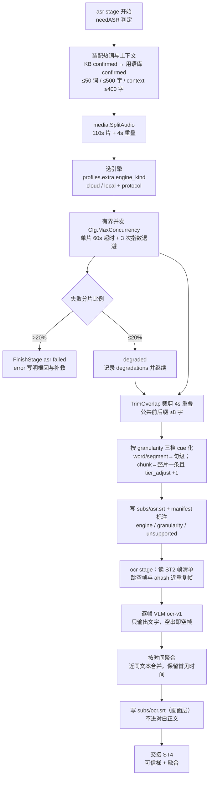

# ST3 · 字幕生成：ASR 与截图 OCR

> 导读：本文件定义工作项 **ST3**——把「没有可用语音字幕」的任务用云/本地 ASR 补出 `subs/asr.srt`，用云/本地 VLM 识图补出 `subs/ocr.srt`，并让两路生成来源以正确的可信梯与时间精度进入 ST4。
> 读者：ST3 实现者与验收者。阶段名、来源模型、可信梯、降级、门禁、术语一律以 [ST0](00-总览与契约.md) 为唯一契约源，本文只引用不复述。

---

## 1 目标与非目标

**目标**

1. 引擎抽象：`profiles.extra.engine_kind ∈ {cloud, local}`（ST0 §4.1）映射到统一的 `asr.Engine`；云适配 `deepseek_asr`（`/v1/tools/asr`）与 `openai_audio`（`/v1/audio/transcriptions`），本地走用户配置的 OpenAI 兼容端点（Ollama / vLLM）。
2. 时间轴可用且诚实：结果必须带 `timestamp_granularity ∈ {word, segment, chunk}`；chunk 级必须在 manifest 与 quality 标注并降档，不许冒充精确。
3. 有界并发与可解释失败：`Cfg.MaxConcurrency` + 单片 60s 超时 + 3 次指数退避；失败分片比例 >20% → 阶段 failed，≤20% → 降级继续。
4. 热词与上下文注入：来源优先级、数量与字数上限、仅对支持参数的协议发送，其余记 unsupported 并由 ST5 纠错兜底。
5. 画面层：抽帧 → VLM（`prompt_version=ocr-v1`）→ 按时间聚合 → `subs/ocr.srt`，只作画面层，不与对白混淆。

**非目标**

- 不改融合算法（ST4）、不做术语纠错（ST5）、不做用语库挖掘（ST6）。
- 不新增 DB 表或迁移；不改阶段权重（沿用 ST0 §3.1 的 `asr=20`、`vision=12`）。
- 不实现 VAD 切片算法本身（属 ST2 的 `media.SplitAudio`，`backend/internal/media/ffmpeg.go:88-153`），ST3 只消费切片。
- 不实现 whisper.cpp CLI（列 P2，见 §7）；不做流式转写；不新增任务参数（见 §8）。

## 2 现状与差距

行号来自本次定点核查（`pipeline.go` / `client.go` / `ffmpeg.go`）；OCR 侧现状见 ST0 §2 缺陷 B。

| 现状（位置） | 问题 | 影响 |
|---|---|---|
| `pipeline.go:239-244` 逐片写 `Cue{Start: chunks[i].Start, End: chunks[i].End}` | 整片 110s 文本只挂一条 cue，一个时间点覆盖近两分钟 | 时间轴精度被毁；ST4 的「±10s 落回」与 ST7 的 `[MM:SS]` 全部失真 |
| `client.go:51-54` `ASRResult` 仅 `Text`+`DurationMs` | 协议层不承载词/句时间戳 | 无法做 segment 级 cue 化，只能退化到 chunk 级 |
| `client.go:57-64` `Transcribe` 仅按 `Protocol` 分发 | 无 `engine_kind`、无 hotword/context 入参 | 云/本地不可区分（违反 ST0 §4.1），热词无通道注入 |
| `pipeline.go:217-244` 分片失败被静默忽略 | `withRetry` 返回 err 时 `results[i]` 留空，仅不计入 cue | 失败分片无声丢失，覆盖率无人知 |
| `pipeline.go:245-250` `len(asrCues)>0` 即 `FinishStage done` | 无失败比例阈值判据 | 14 片挂 10 片仍报成功 |
| `ffmpeg.go:83-85` 切片 110s + 4s 重叠，但 `pipeline.go:239-244` 直接拼接 | 合并时不做重叠裁剪 | 相邻片首尾重复入稿，ST4 只能按文本完全相等去重 |
| `pipeline.go:220-238` `runConcurrently` 无单片超时 | 一个卡死分片拖死整阶段 | 阶段耗时不可控，进度卡在固定百分比 |
| `pipeline.go:208-254` 无参数台账 | `Cost.ASRSeconds` 只累计成功片 | 成本记账与实际调用不一致，G6 不可信 |

## 3 设计

### 3.1 引擎抽象（`backend/internal/asr/`，新增包）

```go
package asr

type Granularity string // word | segment | chunk

type Caps struct{ WordTimestamps, Hotwords, Context bool }

type Request struct {
	AudioPath string
	OffsetSec float64 // 切片在全片中的起点，用于片内时间戳还原
	Lang      string
	Hotwords  []string    // ≤50 个、总字符 ≤500
	Context   string      // ≤400 字
	Want      Granularity // 期望粒度，实际以 Result 为准
}

type Segment struct {
	Start, End float64
	Text       string
}

type Result struct {
	Segments    []Segment
	Text        string      // 兼容 ST0 的纯文本口径
	Granularity Granularity // 实际达到的粒度，只许取低不许上调
	Unsupported []string    // 协议不支持的参数，如 {"hotword","context"}
	Engine      string      // 写入 SubtitleSource.Engine
	Kind        string      // cloud | local，决定 SubtitleSource.Producer
}

type Engine interface {
	Name() string
	Kind() string // cloud | local
	Caps() Caps
	Transcribe(ctx context.Context, req Request) (*Result, error)
}
```

### 3.2 适配器与路由

| 适配器 | 协议 / 端点 | 能力（Caps） | 典型粒度 |
|---|---|---|---|
| `deepseek_asr` | `POST /v1/tools/asr`（`client.go:71`） | hotword 支持（multipart 字段），context 支持 | segment |
| `openai_audio` | `POST /v1/audio/transcriptions` + `response_format=verbose_json`（`client.go:85`） | context 走 `prompt`，hotword 不支持；开 verbose 可拿 word | word / segment |
| `local_openai` | 用户配置 `base_url` 的 OpenAI 兼容端点（Ollama / vLLM） | 启动时探测，Caps 按探测结果 | segment |
| `whisper_cpp_cli` | 本地二进制（P2） | 预留路由分支，P0/P1 不实现 | word |

选路：`profiles.extra.engine_kind=cloud` → 按 `profiles.protocol` 选前两者；`=local` → `local_openai`；字段缺失按 `cloud` 处理（与历史行为一致）。

### 3.3 timestamp_granularity 三档

| 取值 | 判定依据 | cue 化规则 | 标注与降档 |
|---|---|---|---|
| `word` | 引擎返回词级时间戳 | 按句合并：句间静默 ≥0.6s 或累计 ≥30 字断开 | `checks.asr_granularity=word`，tier 不修正 |
| `segment` | 引擎返回句级分段 | 每段直接一条 cue | 同上，tier 不修正 |
| `chunk` | 只有整片文本 | 整片一条 cue，起止=切片边界 | tier_adjust +1（降 1 档）+ degradations 记「ASR 仅 chunk 级时间戳」 |

硬规则：`Result.Granularity` 取实际达到值，不许上调；同时写 manifest `sources[].checks` 与 quality `degradations` 两份；chunk 级来源在 ST4 不得作为唯一基底（由 G2 覆盖率兜底）。

### 3.4 切片并发与失败策略

- 切片沿用 `media.SplitAudio`（`ffmpeg.go:88-153`），110s / 4s 重叠不改。
- 并发 `runConcurrently(len(chunks), Cfg.MaxConcurrency)`（`pipeline.go:62`）；每片 `context.WithTimeout(ctx, 60s)`。
- 重试 `withRetry` 3 次、`1<<i` 秒指数退避（`pipeline.go:55-59`），总等待 ≤7s。
- 统计 `failedChunks / totalChunks`：>20% → `FinishStage(asr, failed)`，error 形如「ASR 分片失败 5/14（>20%）」，任务是否 failed 按 ST0 §4.4 判（还有其它语音源则降级继续）；≤20% → 继续，degradations 记一条，任务至少 degraded。
- 空白片（trim 后为空）不计失败、不计成本秒数，单独计数 `emptyChunks`。
- 401/403 与 429(余额) 属永久失败，立即中止整阶段，不再浪费剩余分片。

### 3.5 4s 重叠裁剪（`asr/merge.go`）

```
TrimOverlap(chunks, texts):
  for i := 0; i < len(texts)-1; i++:
      a := TrimSpace(texts[i]); b := TrimSpace(texts[i+1])
      if a == "" or b == "": continue          # 空白片直接丢弃，不参与裁剪
      for L := min(len(a), len(b), 40); L >= 8; L--:
          if suffix(a, L) == prefix(b, L):
              texts[i+1] = b[L:]
              shift := overlapSec * L / len(b)  # 片首被裁，起点按字数比例后移
              chunks[i+1].Start += shift        # 误差 ≤ 4s，属 segment 级可接受
              break
  返回 pieces(chunk 边界 + 裁剪后文本)
```

- 阈值 8 字：中文口语 8 字以下重合（「然后」「对」）属正常重复，不裁。
- 只裁后片片首，不动前片尾部，保证前片时间戳绝对不动。
- 裁剪量与原文落 `work/asr.raw.json`，防误裁真重复时人工可回看。

### 3.6 热词语料与注入（`asr/hotword.go`）

- 来源优先级（高→低）：① 任务已选知识库中 `status=confirmed` 条目的 `standard`；② 用语库 `glossary.json` 中 `status=confirmed` 的 `term` + `aliases`；③ 任务标题/简介里的专名（仅在无 KB 时启用）。
- 上限：hotword ≤50 个且总字符 ≤500；context ≤400 字（任务标题 + KB 领域 + `glossary_domain`）。
- 截断按优先级填充，超限即停，不随机丢弃；大小写不敏感去重。
- 仅当 `Caps.Hotwords` / `Caps.Context` 为真时写入请求，否则记 `Result.Unsupported` 并在 manifest `terms.unsupported` 记账，由 ST5 术语纠错兜底（ST0 §7）。
- 幂等键含热词 sha（ST0 §3.1）：热词变化必须触发重跑。

### 3.7 OCR 识图与时间聚合（`backend/internal/ocr/`，新增包）

- 抽帧复用 ST2 的 `work/frames.json`（`ffmpeg.go:155` `ExtractFrames`），ST3 不再自己抽帧。
- 过滤：按 `sha` 去重、按 ST2 的 ahash 跳近重复帧、跳空白帧（纯黑/纯色，ST2 标记）。
- 逐帧 VLM，`prompt_version=ocr-v1`，system 只允许输出画面文字，无文字输出空串；并发 = `Cfg.MaxConcurrency`，单帧超时 60s，失败帧跳过并计数。
- 聚合：按 t 升序，近同文本（归一化后编辑距离 ≤0.2 或一方为另一方前缀）合并；保留首见时间，跨度取连续出现帧区间；单帧文本时长取 `screenshot_interval`（ST0 §4.3，默认 60s）。
- 产物 `subs/ocr.srt`，`Kind=ocr, Channel=generate, Producer=cloud-api|local-model, Engine=<profile name>`；只进 manifest 的 `fuse.screen_layer`（ST0 §5.2），不混入对白正文。
- ASR 与 OCR 两路生成来源最终由 ST4 合成**统一稿**（`subs/fused.srt`）；ST3 只保证「来源填得对、精度标得实」，改稿与裁决权在 ST4。

### 3.8 常量表

| 常量 | 值 | 来源 | 理由 |
|---|---|---|---|
| `chunkTarget` | 110s | 沿用 `ffmpeg.go:83` | 硬限 120s 留 10s 余量，不动 |
| `overlapSec` | 4.0s | 沿用 `ffmpeg.go:84` | 切片已产生重叠，ST3 只负责裁掉 |
| `chunkTimeout` | 60s | 新增 | 110s 音频正常 <20s，留 3× 余量 |
| `retryMax` | 3 | 沿用 `pipeline.go:55-59` | `1<<i` 秒退避，总等待 ≤7s |
| `failureRatio` | 0.20 | 新增 | 丢 1/5 片仍可由其它来源补齐，超过即不可信 |
| `trimMinLen` | 8 字 | 新增 | 低于 8 字的重合多为正常口语重复 |
| `hotwordMaxCount` | 50 个 | 新增 | 云 hotword 常见上限，超量反而降准 |
| `hotwordMaxChars` | 500 字 | 新增 | 与上一条配套，控总 prompt 体积 |
| `contextMaxChars` | 400 字 | 新增 | 避免挤占正文预算 |
| `vlmConcurrency` | = `Cfg.MaxConcurrency` | 新增 | 与 ASR 共用配额，防双阶段叠加打爆 429 |
| `frameTimeout` | 60s | 新增 | 单图 VLM 正常 <10s |
| `ocrPromptVersion` | `ocr-v1` | 新增 | 幂等键之一（ST0 §3.1），版本变即重跑 |

### 3.9 失败语义表

| 情况 | 分类 | 处理 | 产物 / 状态 |
|---|---|---|---|
| 401 / 403 | 永久 | 立即中止，余片不发 | `asr failed`，error「引擎鉴权失败，检查 profile 的 api_key」 |
| 429 且正文含余额/额度 | 永久 | 中止 | `asr failed`，error 写明余额不足 |
| 429 频率限流 | 瞬时 | `withRetry` 3 次退避 | 仍失败 → 计 failedChunk |
| 5xx / 单片超时 / 网络 | 瞬时 | `withRetry` 3 次 | 仍失败 → 计 failedChunk |
| 失败比例 ≤20% | 降级 | 继续 | stage done + degradations 1 条 |
| 失败比例 >20% | 致命 | `FinishStage failed` | 任务按 ST0 §4.4 判（无其它语音源 → failed） |
| 全部片文本为空 | 致命 | 不写 `asr.srt` | `asr failed`，error「转写为空，音频可能无语音」 |
| 引擎不支持 hotword/context | 无关 | 记 `Unsupported` | 不失败，ST5 兜底 |
| OCR 全部帧无文字 | 降级 | 不写 `ocr.srt` | `vision done` + degradations「未识别到画面文字」 |
| 成本记账 | — | ASR 秒数按成功片累加，vision 按实际请求图数 | `cost.asr_seconds` / `cost.vision_images` |

## 4 流程图



## 5 实现步骤

| 编号 | 改动文件 | 要点 | 依赖 | 可独立验收 |
|---|---|---|---|---|
| ST3.1 | `internal/asr/engine.go`（新增） | Engine/Caps/Granularity/错误分类（永久 vs 瞬时） | — | `TestEngineCaps` |
| ST3.2 | `internal/asr/deepseek_asr.go` | `/v1/tools/asr`，hotword multipart，解析 segments | ST3.1 | httptest mock |
| ST3.3 | `internal/asr/openai_audio.go` | `/v1/audio/transcriptions` + `verbose_json` 取 word | ST3.1 | httptest mock |
| ST3.4 | `internal/asr/local_openai.go` | 用户 `base_url` 的 OpenAI 兼容端点，启动探测 Caps | ST3.1 | 本地 fake server |
| ST3.5 | `internal/asr/router.go` | `engine_kind`+`protocol` → Engine；whisper.cpp 留分支 | ST3.2–3.4 | `TestProfileRoute` |
| ST3.6 | `internal/asr/hotword.go` | 来源优先级、上限截断、去重、unsupported 记账 | ST3.5 | `TestHotwordBudget` |
| ST3.7 | `internal/asr/merge.go` | TrimOverlap + 三档 cue 化 + chunk 降档标记 | ST3.1 | `TestTrimOverlap` |
| ST3.8 | `internal/asr/cost.go` | 成功/失败/空片计数与 ASR 秒数记账 | ST3.7 | `TestCost` |
| ST3.9 | `internal/pipeline/pipeline.go:208-254` | 改写：超时、失败比例、degraded、manifest 标注 | ST3.5–3.8 | `TestASRStageMock` |
| ST3.10 | `internal/deepseek/client.go:51-109` | `ASRResult` 增 segments/words，保留 `Text` 兼容 | ST3.1 | `TestASRCompat` |
| ST3.11 | `internal/ocr/engine.go` + `prompt.go` | `ocr-v1` 提示词与 VLM 客户端（并发/超时/失败帧） | ST3.1 | `TestOCREngine` |
| ST3.12 | `internal/ocr/aggregate.go` | 逐帧→时间聚合→`ocr.srt`；空帧/近重复过滤 | ST3.11 | `TestAggregate` |

## 6 验收标准

```powershell
go vet ./... && go test ./internal/asr/ ./internal/ocr/ -v
go test ./internal/asr/ -run 'TestTrimOverlap|TestHotwordBudget|TestGranularity' -v
go test ./internal/pipeline/ -run 'TestASRStageMock|TestOCRStageMock' -v
go test ./internal/asr/ -run 'TestProfileRoute|TestPermanentErrors' -v
```

| 命令 | 期望（数值/断言） | 证据路径 |
|---|---|---|
| `TestTrimOverlap` | 14 片合成样本命中裁剪 ≥13；裁剪后总字符 ≤ 未裁集合 ×0.99；且仅后片片首被改 | `docs/evidence/singletask/ST3/unittest_trim.txt` |
| `TestHotwordBudget` | 输入 80 词 → 输出 ≤50 且总字符 ≤500；context 截断 ≤400 字 | `.../ST3/hotword_budget.txt` |
| `TestGranularity` | mock 仅返回 text → `Granularity=chunk` 且 `tier_adjust=1`、degradations 非空 | `.../ST3/granularity.txt` |
| `TestASRStageMock`（httptest） | 14 片 3 片 500 → ratio 0.214 → 阶段 failed；2 片 500 → done + degradations≥1 | `.../ST3/asr_stage.txt` |
| `TestOCRStageMock`（httptest） | 22 帧去 4 空帧 3 近重复 → 请求 15 帧；`ocr.srt` cue 数 8±2 | `.../ST3/ocr_stage.txt` |
| `TestPermanentErrors` | 401/403 与 429(余额) 调用计数 ==1（不重试）；5xx 计数 ==3 | `.../ST3/errors.txt` |
| `TestProfileRoute` | `engine_kind=local` → `local_openai`；缺失 → `deepseek_asr` | `.../ST3/router.txt` |

**真实 Key 缺失说明**：本仓库当前无真实 ASR/OCR 凭据（ST0 §10）。以上全部结论来自 `httptest` 假实现，属降级透明，不是 live 证据；live 用例如有 Key 才跑 `go test -tags live ./internal/asr/ -run TestLive`，缺 Key 时必须 `t.Skip` 并把跳过原因写入 `docs/evidence/singletask/ST3/live_skipped.txt`。

## 7 风险与回退

| 风险 | 影响 | 回退 |
|---|---|---|
| 云 ASR 不返回词/句时间戳 | 时间轴只能 chunk 级 | 按 §8 强制 `tier_adjust +1` + degradations；用户可改用 native/ai 上传 |
| 4s 裁剪误裁真实重复语句 | 丢一句话 | `work/asr.raw.json` 保留原文；阈值 ≥8 字且只动后片片首 |
| 本地 OpenAI 兼容端点不可用/过慢 | 阶段失败 | router 回退到任务已配置的云 profile；无云则按 ST0 §4.4 failed |
| VLM 幻觉产出画面文字 | 画面层污染 | `ocr.srt` 只进 `screen_layer`，不进正文；空帧与近重复帧过滤 |
| 并发打爆云配额 | 429 连锁失败 | 并发 = `Cfg.MaxConcurrency`，429 退避 + 失败比例阈值 |
| 老任务断点续跑，旧 `asr.srt` 无粒度字段 | 误标粒度 | 读时缺字段一律按 `chunk` 标注，不重跑 |
| whisper.cpp CLI（P2）未实现 | 本地二进制路线缺失 | 明确列 P2，不阻塞 M2 退出条件 |

## 8 对 00 契约的增补建议

1. **ST0 §4.2 降级修正新增一条**：`timestamp_granularity=chunk` → 降 1 档（`tier_adjust +1`）；`word`/`segment` 不修正。理由：整片文本挂一个时间点会连带污染 ST7 的时间戳门禁。
2. **ST0 §5.2 manifest** `sources[].checks` 增 `asr_granularity`、`asr_failed_chunks`、`asr_empty_chunks`；`terms` 增 `unsupported`。
3. **ST0 §5.4 quality** `cost` 增 `asr_chunks_failed`、`vision_frames_requested`、`vision_frames_skipped`。
4. 明确**不新增任务参数**：并发与超时复用 `Cfg.MaxConcurrency` 与 §3.8 常量表，避免 API 面膨胀。

> 返回上级：[计划索引](../README.md) ｜ 契约源：[ST0](00-总览与契约.md)
