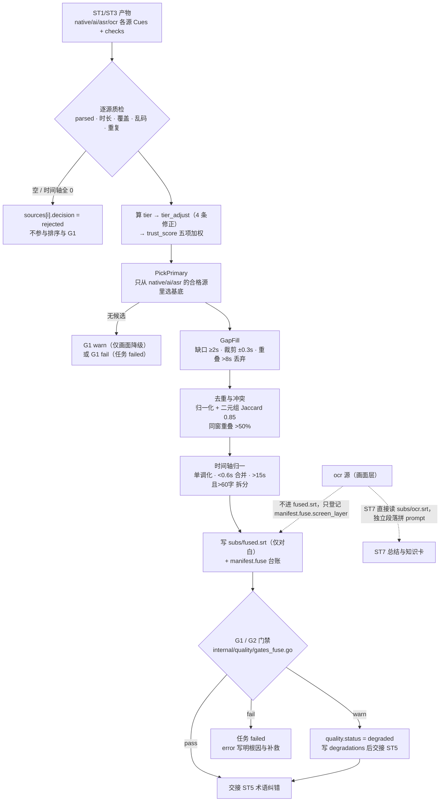

# ST4 · 字幕质检与融合

> 导读：本文是工作项 ST4 的设计与验收文档，只解决一件事——**把 ST1 送来的多份字幕变成一份可信的对白统一稿**。输入是来源模型（00 §4.1）里的 `native/ai/asr/ocr` 各源及其 `checks`（ST1 产出）；输出是 `subs/fused.srt`（唯一正文）与 `subs/manifest.json#/fuse`（融合台账），并由 G1/G2 门禁判定能否交给 ST5、ST7。阶段、产物路径、JSON Schema、门禁编号一律以 00 为准，本文只引用不复述；术语沿用 00 §11，尤其「来源 / 可信梯 / 基底 / 补齐 / 画面层 / 统一稿 / 门禁 / 降级」。
> 读者：实现者（照 §3、§5 落地）、验收者（照 §6 判定）、排障者（照 §7 回退）。

## 1 目标与非目标

目标：
1. **有据可判**：每个来源都有 `tier`、`tier_adjust`、`trust_score`、`checks`、`decision`、`reason` 六项，写进 manifest，任何人能回答「为什么用它/不用它」。
2. **选而不是拼**：基底从可信梯最小的合格语音源里选，其余来源只做补齐（gap fill），补齐必须裁剪到缺口内。
3. **口径单一**：`fused.srt` **只含对白**；画面文字单独存放，不进正文流，覆盖率只按对白算。
4. **去重可解释**：文本归一化 + 字符二元组 Jaccard 判定重复/冲突，重复丢弃有计数、冲突裁决有记录。
5. **时间轴可用**：融合结果单调、无倒挂、无 <0.6s 碎片、无 >15s 大块，SRT 写盘毫秒无二次取整误差。
6. **门禁机器判定**：G1/G2 在 `internal/quality/gates_fuse.go` 实现，结果写 `output/quality.json`，与 00 §5.4、§6 逐字对齐。

非目标：
- 不做术语纠错（`ApplyTerms`，`backend/internal/subtitle/fuse.go:127-148`，归 ST5；本文只约定「fused.srt 是 ST5 的输入，ST5 输出仍写同一 Cue 结构」的衔接）。
- 不重新解析字幕：`Cue`（`backend/internal/subtitle/parse.go:12-17`）与 `ParseFile`（同文件 19-30 行）已够用，本文只在读入后做**归一化**，不改解析器。
- 不生成 SRT 之外的新产物（画面层复用 `subs/ocr.srt` 原文件）。
- 不做总结/用语库（ST6、ST7）。

## 2 现状与差距

现状问题全部引用 `backend/internal/subtitle/fuse.go` 真实行号：

| 现状（代码位置） | 问题 | 影响 |
|---|---|---|
| 基底按 `native > ai > asr` 取第一个非空（`fuse.go:16-30`） | 不看覆盖率、不看时长校验、不看乱码率；ASR 只覆盖前 3 分钟也照样当基底 | 一份脏字幕决定整篇结论（缺陷 B） |
| ASR 补齐条件：`coverageRatio(base, a) < 0.3` 才**整条 cue** 追加（`fuse.go:32-39`，阈值在 `fuse.go:35`） | 阈值靠猜；追加不裁剪，与基底重叠区重复；110s 分片被写成单条 cue（`pipeline.go:241`）整段挂在一点上 | 时间轴精度被毁，出现「一句 110 秒」 |
| vision 无条件全部追加（`fuse.go:41-47`） | 画面文字混入对白流，没有层级概念 | 读者分不清「人说的」与「屏幕上写的」；覆盖率被虚高 |
| 去重按 `c.Text` 完全相等（`fuse.go:93-105`） | 同句措辞略不同 → 留两条；真重复但长度不同 → 反而留下 | 条数虚高，ST7 预算被重复句吃掉 |
| 融合后只排序不归一（`fuse.go:49-50`） | 重叠、倒挂、碎片、大块原样进产物 | `FormatSRT`（`parse.go:204-212`）输出的时间轴不可读 |
| `Fuse` 只返回 `[]Cue`（`fuse.go:14-16`） | 谁被丢、为何丢、冲突在哪全无记录 | 无法验收、无法排障，G1/G2 无从判定 |
| `ApplyTerms` 全局盲替换（`fuse.go:127-148`） | 无最长匹配、无词边界（本任务范围外） | 归 ST5；ST4 只需保证 fused.srt 是它的输入、不被二次改写 |

## 3 设计

### 3.1 包边界与数据结构

- `backend/internal/subtitle/source.go`：`SubtitleSource`（00 §4.1 结构，ST1 已定义，这里直接用）、`Checks`、`FuseOptions`（`GapThreshold`、`SimilarityThreshold`、`SkipOcrIntoFused bool`）、`FuseResult{Cues, Primary, GapFill, ScreenLayer, DroppedDuplicates, Conflicts}`。
- `trust.go`：tier 计算与 `trust_score`；`fuse.go`：新 `FuseSources` + 保留 `FuseLegacy`；`timeline.go`：归一化；`dedupe.go`：归一化文本与相似度。
- `internal/quality/gates_fuse.go`：G1/G2 判定，纯函数，输入 manifest + 视频时长，输出 `quality.json` 的 gate 片段。**门禁只判定不改产物**（00 §6 纪律）。

### 3.2 指标与可信梯（完全对齐 00 §4.2）

tier 值读自 00 §4.2 的 8 档（不得在代码里另立一套）：1 `native:upload`、2 `ai:upload`、3 `asr:upload`、4 `ocr:upload`、5 `asr:generate/cloud-api`、6 `ocr:generate/cloud-api`、7 `asr:generate/local-model`、8 `ocr:generate/local-model`；`danmu` 不进正文不参与排序。

降级修正（4 条，写进 `tier_adjust`，只增不减）：
1. 时长校验 fail（too-long 或覆盖率低于阈值）→ +2 档；
2. 覆盖率 < 40% → +1 档；
3. 乱码率 > 2% 或 4-gram 重复率 > 5% → +2 档；
4. 解析为空或时间轴全为 0 → 直接 `rejected`，不参与排序（不进排序表，也不参与 G1 判定）。

`trust_score` 计算式（五项权重和为 1.00，结果 ∈ [0,1]，只在**同一 tier 内**用于排序，绝不跨 tier 压倒梯次）：

```
tier_score  = clamp(1 − 0.1 × (tier_adjust − 1), 0, 1)
granularity = clamp(1 − short_cue_ratio − long_cue_ratio, 0, 1)
trust_score = 0.45·tier_score + 0.25·coverage + 0.10·(1 − dup_ngram_ratio)
            + 0.10·(1 − garbage_ratio) + 0.10·granularity
```

权重理由：梯次 0.45 是**来源血统**这个最强先验（平台人工字幕出错概率天然低于本地模型）；覆盖率 0.25，因为没覆盖的源再准也用不上；`dup_ngram` 与 `garbage` 各 0.10 是硬缺陷惩罚（这两项来自 ST1 的 `checks`，ST4 不重算）；粒度 0.10 映射「时间轴可用性」，正好命中现状缺陷——整段 ASR 写成单条 cue 时 `long_cue_ratio = 1`，`granularity = 0`。`tier_score` 取 1.0→0.3 线性而非 1.0→0，是为了让第 7/8 档（本地模型）之间仍可比较，不被压成同一个 0。

覆盖率的唯一口径：`coverage = 语音类来源（native/ai/asr）时间区间的并集 ∩ [0, 视频时长] / 视频时长`；**ocr 不计入**，否则屏幕文字会把 40% 对白覆盖伪装成 90%（见 §3.4）。

### 3.3 基底选择与补齐（伪代码）

```
PickPrimary(srcs, checks):
  cand = { s | s.Kind ∈ {native, ai, asr}
               && checks[s].Parsed && s.Cues 非空
               && !checks[s].TooLong && checks[s].Coverage > 0 }
  if cand 为空: return nil                     // → G1 warn（仅画面）或 fail（全无）
  sort cand by (tier_adjust ↑, trust_score ↓, len(Cues) ↓)
  return cand[0]

GapFill(base Cues, fills[] 按 tier ↑, videoDuration):
  gaps = Complement(mergeIntervals(base), [0, videoDuration])
  gaps = { g | g.End − g.Start ≥ 2.0s }        // 小于 2s 的洞多是断句停顿，补进来反而撕句
  for each fill in fills（跳过 primary 与所有 ocr）:
    for each g in gaps（按时间升序）:
      for each cue in fill.Cues 与 g 相交:
        c = clip(cue, g.Start + 0.3, g.End − 0.3)     // 边界裁剪，±0.3s 容差
        if c.End − c.Start < 0.6: continue             // 裁完过短，丢弃
        if overlapWith(base, c) > 8.0:                 // 8s 重叠上限：超过判为串轴/错位
          DroppedDuplicates++ ; continue
        out.append(c); GapFill.add(fill.SourceID)
  return timeline.Normalize(base ++ out)
```

要点：补齐**只补缺口、只在缺口内**，不做「覆盖率低于某值就整段追加」（现状 `fuse.go:32-39` 的错误做法）。补齐条一律打上来源标记，供 §3.5 的 tier 比较与 §3.6 的合并使用。

### 3.4 画面层单独存放（明确约定）

**`subs/fused.srt` 只含对白，不含任何 ocr 来源的 cue。** 画面层不新生成文件，就是 `subs/ocr.srt` 原文件本身，只在 `manifest.fuse.screen_layer`（00 §5.2 已有字段）登记来源 id 数组；ST7 装配总结输入时**单独读 `subs/ocr.srt`**，以「屏幕上写着：…」的独立段落拼进 prompt。三条理由：
1. **口径单一**：`fused.srt` 是所有下游（ST5 纠错、ST6 用语库、ST7 总结）的唯一正文输入，混入画面文字后每个下游都要再判一次「这句是人说的吗」，口径必然分叉。
2. **覆盖率只算对白**：G2 的 `coverage_after` 若混入画面文字，稀疏但全程有字牌的 OCR 会把 40% 的对白覆盖撑到 90%+，门禁直接失效。
3. **不丢信息**：画面层仍在 manifest 有据可查、在 ST7 有专用通道，不属于「丢弃」，属于「分层」。

### 3.5 去重与冲突裁决

文本归一化：去掉所有空白（含全角空格 `U+3000`）、去掉中英文标点、全角字符转半角（数字/字母/常用标点）、英文统一小写。归一化后取**字符二元组集合**（长度 <2 时退化为单字符集）。

```
sim(a, b) = |A ∩ B| / |A ∪ B|                      // 字符二元组 Jaccard
overlap   = min(a.End, b.End) − max(a.Start, b.Start)
overlapRatio = overlap / min(a.Dur, b.Dur)
```

判定（只比较 `|a.Start − b.Start| ≤ 30s` 的窗口内两两，避免 O(n²) 全表扫描）：
- `overlapRatio > 0.5` 且 `sim ≥ 0.85` → **重复**：保留 `tier` 更小者（同 tier 保留文本更长者），loser 计入 `dropped_duplicates`。
- `overlapRatio > 0.5` 且 `sim < 0.85` → **冲突**（同一时间窗不可能有两个人在说不同的话，只能是一方转写错）：高 tier 胜，保留 winner、丢弃 loser，按 00 §5.2 写 `conflicts[{at, winner, loser, similarity}]`。
- `overlapRatio ≤ 0.5` → 各自保留，允许相邻共存（不同来源的断句差异不等于重复）。

时间重叠 >50% 是「同一窗」的必要条件：低于半重叠的两条更可能是同一句被不同来源切成两段，归 §3.6 的合并处理，不在此丢弃。

### 3.6 时间轴归一

1. **单位与取整**：内部一律毫秒整数（`int64`）；读入 `ms = round(sec × 1000)`（四舍五入，半值进位），与写盘 `fmtStamp` 的 `int(sec*1000+0.5)`（`parse.go:218`）一致，**写盘时不再二次取整**，避免 1ms 抖动。
2. **排序**：按 `(Start, tier, 原序)` 稳定排序。
3. **重叠裁剪**：`start < prev.end` 时，重叠 < 0.3s 原样保留（字幕工具常见的 ±0.3s 抖动），否则 `start = prev.end`。
4. **单调化兜底**：裁剪后仍 `start < prev.end − 0.3s`（来源内部自身倒挂）→ `start = prev.end`；若因此 `dur < 0.6s` 进入第 5 步。
5. **过短合并**：`dur < 0.6s` 的条并入文本最相近的邻居（同源优先，取 sim 更大者），合并区间取并集、文本按先后拼接（`…` 分隔）；合并若制造出 >15s 条则改并入另一侧。
6. **过长拆分**：`dur > 15s 且 chars > 60`（两条件同时满足，避免慢语速长句被拆碎）→ `k = ceil(chars / 35)`，按标点（`。！？；，、,.!?;`）就近切成 k 段，时间按各段字数占比等分，每段保底 ≥ 0.6s。
7. **写盘**：`subtitle.FormatSRT`（`parse.go:204-212`）→ `subs/fused.srt`，同时回填 `manifest.fuse.coverage_after` 与 `cues_after`。

### 3.7 常量表（唯一出处，实现与测试都引用这里）

| 常量 | 值 | 用途 | 依据 |
|---|---|---|---|
| trust 权重 | tier 0.45 / coverage 0.25 / dup 0.10 / garbage 0.10 / 粒度 0.10 | trust_score | §3.2，和为 1.00 |
| 相似度 `sim` | 0.85 | 重复 vs 冲突分界 | 二元组 Jaccard，同句换语序实测 0.85–0.95 |
| 时间重叠比 | > 0.50 | 才算同一窗 | 半重叠以上才可能是同句 |
| `gap` 阈值 | 2.0s | 只补 ≥2s 的空洞 | 更小的洞是断句停顿 |
| 边界容差 | 0.3s | 裁剪 + 单调化 | SRT 时间抖动容差 |
| 重叠丢弃 | 8.0s | 补齐条与基底重叠上限 | 超过一个长句，判串轴 |
| 过短条 | 0.6s | 合并 | 短于 0.6s 读不完 |
| 过长条 | 15s **且** 60 字 | 拆分 | 双条件，防误拆 |
| 拆分目标 | 35 字/段 | 拆分粒度 | 单行可读上限 |
| 覆盖率 pass/warn | 0.90 / 0.60 | G2 | 00 §6 |
| 片长 <180s 降档 | 0.50 / 0.30 | G2 | 00 §6 |
| 降级修正 | +2 / +1 / +2 档 | tier_adjust | 00 §4.2 |
| 比较窗口 | 30s | 去重两两比较 | 控制复杂度 |

### 3.8 门禁 G1/G2

实现位置 `backend/internal/quality/gates_fuse.go`，两个纯函数：

- `GateG1VoiceSubtitle(m *Manifest) Gate`：存在 `kind ∈ {native,ai,asr}` 且 `checks.parsed`、`cues > 0`、时长校验非 fail（`last_sec ≤ duration + 5`、`coverage > 0`）的源 → `pass`；**仅**存在画面字幕（ocr）→ `warn`（允许「仅画面」降级产出，00 §4.4）；一个都没有 → `fail`。`detail` 必须含具体 `source_id` 与 `coverage` 数值，`evidence` 指 `subs/manifest.json#/sources/<i>`。
- `GateG2FusedCoverage(m *Manifest, videoDuration float64) Gate`：`fuse.coverage_after ≥ 0.90` → `pass`；`0.60 ≤ x < 0.90` → `warn`；`< 0.60` → `fail`；`videoDuration < 180` 时阈值降档为 `0.50 / 0.30`（短片的覆盖天然稀疏，用长片阈值会误杀）。

输出字段严格按 00 §5.4：`gates[{id, name, status, detail, evidence}]`、`metrics{fused_coverage, fused_cues}`、`degradations[]`。ST4 只填 G1/G2 与两项 metrics，其余 gate 由 ST5/ST6/ST7/ST8 追加，最终由 `quality` 阶段统一落盘（见 ST8）。`status` 归并规则按 00 §5.4：任一 fail → `fail`；任一 warn 或 degradations 非空 → `degraded`；否则 `pass`。

### 3.9 v1 兼容

- 原 `Fuse(sources []Source) []Cue`（`fuse.go:16-51` 整段函数体）**原样搬入** `fuse_legacy.go` 并改名 `FuseLegacy`；`Fuse` 保留为薄封装直接调它，v1 profile 任务行为与今天逐字节一致。
- 新增 `FuseSources(srcs []SubtitleSource, opts FuseOptions) (*FuseResult, error)` 为 v2 主路径，由 `fuse` 阶段按 `tasks.stage_profile` 选择。
- `TestLegacyCompare`：同一输入（`backend/testdata/samples` 的 native/ai/asr 三份 SRT）分别跑 `FuseLegacy` 与 `FuseSources`，把 `条数差` 与 `coverage_after 差` 冻结成期望值并**逐条注释解释**（例：新算法少 3 条，因为 2 条文本近似重复 + 1 条被裁剪成 <0.6s 合并）。改算法必须同步改期望，禁止只改期望不改解释。

## 4 流程图



## 5 实现步骤

| # | 工作项 | 落点 | 完成判据 |
|---|---|---|---|
| ST4.1 | 融合数据结构与 manifest 读写封装：`FuseOptions`、`FuseResult`、`Checks` 结构体映射、`manifest.fuse` 原子写 | `internal/subtitle/source.go`、`manifest.go` | 不传真实字幕也能写出符合 00 §5.2 的 `fuse` 段（schema 校验过） |
| ST4.2 | 可信梯与指标：8 档 tier + 4 条降级修正 + `trust_score` 五项加权 + 覆盖率/粒度计算 | `internal/subtitle/trust.go` | `TestTierOrder`、`TestTrustScore` 全过 |
| ST4.3 | 基底选择 `PickPrimary`（只收 `parsed && 非 too-long && coverage>0`） | 同上 | `TestPickPrimary` 覆盖「native 脏、ai 干净」等 6 组用例 |
| ST4.4 | 缺口补齐 `GapFill`：缺口 ≥2s、裁剪 ±0.3s、重叠 >8s 丢弃、补齐来源打标 | `internal/subtitle/gapfill.go` | `TestGapFill`（空基底/满基底/单缺口/跨源重叠 4 例） |
| ST4.5 | 画面层分离：`fused.srt` 过滤 ocr，`manifest.fuse.screen_layer` 登记 | `fuse.go` | fused 中 ocr 条数为 0，manifest 的 `screen_layer` 非空 |
| ST4.6 | 归一化与重复判定：去空白/标点/全半角、二元组 Jaccard、`overlapRatio > 0.5 && sim ≥ 0.85` | `dedupe.go` | `TestDedupeSimilarity`（含「同句换语序=重复」「近似但不同句=不重复」两类） |
| ST4.7 | 冲突裁决：`sim < 0.85` 判冲突，高 tier 胜，写 `conflicts` | `fuse.go` | `TestConflictRecord` 断言 winner/loser/similarity 三个字段与 00 §5.2 一致 |
| ST4.8 | 时间轴归一 `Normalize`：毫秒整数域、单调化 0.3s、<0.6s 合并、>15s且>60字 拆分、重叠裁剪 | `timeline.go` | `TestNormalizeTimeline` 断言无倒挂、无短条、无长条、总时长损失 <1% |
| ST4.9 | G1/G2 门禁与 `quality.json` 片段 | `internal/quality/gates_fuse.go` | `TestCoverageGate` 覆盖 0.97/0.75/0.40 与片长 120s 降档 0.45/0.25 共 5 例 |
| ST4.10 | v1 兼容：`FuseLegacy` 抽离 + 新老对比测试 + 差异解释 | `fuse_legacy.go`、`fuse_compare_test.go` | `TestLegacyCompare` 通过且差异逐条注释；`fuse_algo` 开关可回退 |

## 6 验收标准

统一夹具放 `backend/testdata/samples/`（仓库内，CI 可用，见 00 §9）：`sample_native.srt`、`sample_ai.srt`、`sample_asr.srt`、`sample_ocr.srt`、`sample_bad_duration.srt`。

| 验收项 | 命令 | 期望 | 证据路径 |
|---|---|---|---|
| 梯次与指标 | `go test ./internal/subtitle/ -run 'TestTierOrder|TestTrustScore' -v` | 8 档顺序单调；降级修正 4 条各命中 1 例；`trust_score ∈ [0,1]` 且同 tier 内排序稳定 | `docs/evidence/singletask/ST4/unittest_fuse.txt` |
| 基底选取 | `go test ./internal/subtitle/ -run TestPickPrimary -v` | `sample_bad_duration.srt` 永不被选为基底；native 脏时选 ai | 同上 |
| 补齐 | `go test ./internal/subtitle/ -run TestGapFill -v` | 3 源 60s 输入下 `gap_fill` 非空、无 <2s 缺口被填、裁剪后条数 ≤ 原条数 | 同上 |
| 去重与冲突 | `go test ./internal/subtitle/ -run 'TestDedupeSimilarity|TestConflictRecord' -v` | `sample_asr.srt` 的 2 处重复幻觉被丢弃、3 处术语错误产生 ≥1 条 conflict | `docs/evidence/singletask/ST4/unittest_dedupe.txt` |
| 时间轴归一 | `go test ./internal/subtitle/ -run TestNormalizeTimeline -v` | 输出满足 `start ≥ prev.end − 0.3`、无 `dur<0.6`、无 `dur>15 且 chars>60`；总时长损失 <1% | 同上 |
| 门禁 | `go test ./internal/quality/ -run TestCoverageGate -v` | 0.97→pass、0.75→warn、0.40→fail；片长 120s 时 0.45→warn、0.25→fail | `docs/evidence/singletask/ST4/gates_quality.json` |
| 端到端融合 | `go test ./internal/pipeline/ -run TestFuseCoverage -v` | `coverage_after ≥ 0.90`（60s 样片 ≈0.97）、`dropped_duplicates > 0`、`conflicts` 非空、`cues_after` 落在 12–18 条 | `docs/evidence/singletask/ST4/manifest_fuse.json` |
| v1 兼容 | `go test ./internal/subtitle/ -run TestLegacyCompare -v` | 老算法条数与今日一致（冻结期望）；新老条数差 ≤ 3 且差异逐条注释 | `docs/evidence/singletask/ST4/legacy_compare.txt` |
| 产物契约 | `go vet ./... && go test ./...` | 全绿；`fused.srt` 中 ocr 来源条数 = 0，`manifest.fuse` 五字段齐全 | `docs/evidence/singletask/ST4/README.md`（结论表 + 原始输出 + 复现命令） |

## 7 风险与回退

| 风险 | 影响 | 缓解 / 回退 |
|---|---|---|
| 阈值（0.85 / 2s / 8s）是工程先验，未经真数据校准 | 误判重复或漏补缺口 | 用 `reference/out` 下两份真实 SRT 做**离线校准**（只读，不写入仓库产物）；校准结论固化为夹具，**夹具另存 `backend/testdata/samples`**，CI 不依赖 `reference/` 路径 |
| 融合算法重写引入回归 | 既有 e2e 结论失效 | `FuseLegacy` 完整保留 + `TestLegacyCompare` 冻结老行为；`fuse_algo=legacy` 开关可一键回退，v1 profile 默认走 legacy |
| `fused` 条数增多导致 ST7 预算超 | 总结阶段截断 | 归一化后按 ~15s/条估算规模；超预算由 ST7 的抽样解决（00 §5.5），ST4 不砍内容 |
| 短视频（片长 <180s）被 G2 误杀 | 任务无故 failed | 阈值降档 0.50/0.30；仍落 warn 区间时按降级产出（00 §4.4），不判 fail |
| 冲突裁决丢弃低 tier 文本，误判无法回溯 | 信息静默丢失 | conflicts 全部落账；若需要人工抽查则按 §8 建议补 `loser_text` |
| `manifest` 读法变更导致 ST5/ST7 读不到 fuse 段 | 下游 panic | 下游只依赖 `fused.srt` 与可选 `manifest.fuse`；缺字段时按「无台账」降级读，不阻断 |

## 8 对 00 契约的增补建议

1. `manifest.fuse` 增加 `gap_filled_cues`（int）与 `screen_layer_cues`（int）：现有只有来源 id 数组，条数无法从台账看出，而 §6 验收要按数值断言。
2. `manifest.fuse.conflicts[]` 增加可选 `loser_text`（≤60 字）：只有 `{at, winner, loser, similarity}` 时，裁决误判无法人工抽查，且 loser 文本已丢弃无法回溯。
3. `quality.json` 增加 `fuse_algo`（`"v2"` / `"legacy"`）：v1/v2 双轨并存期必须能从产物判断走的哪条算法，否则 `TestLegacyCompare` 的回归对比没有锚点。

> 返回上级：[计划索引](../README.md) ｜ 契约源：[ST0](00-总览与契约.md)
