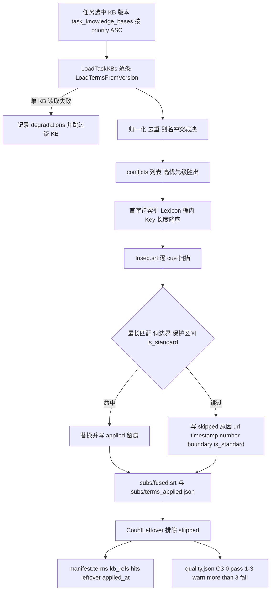

# ST5 · 知识库术语纠错

> 本文解决：把 `subtitle.ApplyTerms` 的"全局盲替换"换成**可解释的最长匹配纠错**——谁被替换、为什么跳过、残留几条，全部留痕，供 ST7 术语一致性与 G3 复用。
> 依赖：[ST0 契约](00-总览与契约.md)（`fuse` 阶段、manifest `terms` 块、G3 口径、§11 术语表）、ST4（统一稿与 manifest v1）、ST6（confirmed 用语回流）。
> 验收口径：四组单测（最长匹配/别名冲突/保护区间/残留计数）+ 1 万条字幕 × 5k 术语 <200ms（08 矩阵 ST5 行）+ mock 链路 `terms.hits>0 && terms.leftover=0`。
> 边界：只改"正文纠错"一步；不产总结、不产用语库、不新增阶段、不改 KB 文件 schema。

## 1. 目标与非目标

**目标**

1. 词表装配：任务级多 KB 按 `priority`（1 最高）合并，归一化、去重、别名冲突裁决，结果可追溯。
2. 匹配：最长匹配优先 + 首字符索引 + 英文词边界 + 保护区间，杜绝 `云雾` 吃掉 `云雾之湾`。
3. 留痕：每次替换写 `subs/terms_applied.json`（cue 索引、原片段、standard、alias、来源 `kb_id:version`）。
4. 门禁：输出 G3 用的"已确认别名残留数"，口径与 00 §6 一致（0 pass / 1–3 warn / >3 fail）。

**非目标**

- 不做全文繁简转换（P2 才引入，且只折叠已加载词条用字，见 §7）。
- 不做同义改写、不做 LLM 润色、不改断句与时间轴（断句归 ST4，总结归 ST7）。
- 不改 KB 文件格式 `{standard,aliases,note}`（`kb.go:170-195` 已定契约），不改 `parseTermBytes` 兼容面。
- 不新增阶段/门禁编号；`terms_applied.json` 是新产物，按 §8 回写 00。
- 不负责热词注入（ST3 注入、ST6 供词表）。

## 2. 现状与差距

下表路径与行号均按当前仓库核对（`backend/internal/**`）。

| 现状（真实路径:行号） | 问题 | 影响 |
|---|---|---|
| `subtitle/fuse.go:127-148` `ApplyTerms`：每条 Cue × 每个 Term × 每个 Alias 做 `strings.ReplaceAll` | 无最长匹配、无词边界、无保护 | `云雾` 把 `云雾之湾` 改坏；单字别名污染全稿 |
| `fuse.go:138-143` 只跳过 `alias==""`、`alias==standard` | 不校验别名长度/语言，不与其它 standard 交叉去重 | 1 字别名误替换率不可控 |
| `fuse.go:145` 重建 Cue 只保留 Start/End/Text | 无命中记录、无跳过原因 | ST7 与 G3 没有纠错输入，问题无法定位 |
| `pipeline/pipeline.go:359` 唯一调用点 `ApplyTerms(fused, loadTaskTerms(taskID))` | 纠错不可观测 | 无法回答"这条错为什么没改" |
| `pipeline.go:392-406` `loadTaskTerms` 直接按 `ListTaskKBs` 顺序 `append` | 无去重、无冲突裁决；`GetKBVersion`/`LoadTermsFromVersion` 失败 `continue` | 两 KB 对同一别名给出不同 standard 时"后加载者胜"，结果依赖行序 |
| `db/repo.go:417-432` `ListTaskKBs` `ORDER BY priority ASC`；`api/api_tasks.go:91-102` 按选择顺序写 `priority=i+1` | 优先级已落库却没参与纠错 | 用户排的优先级在纠错上完全不生效 |
| `pipeline/kb.go:170-195` 只认 JSON `{terms:[{standard,aliases,note}]}` 与 CSV/TXT；`kb.go:225-235` 别名分隔符 `\| ; 、 /`；`note` 丢弃 | 消歧信息不参与匹配；空别名无清洗 | 同形异义无依据，别名重复无告警 |
| `db/db.go:109-115` `task_knowledge_bases` 只有 `(task_id,kb_id,version,priority)` | 没有冲突/归一/生效记录落点 | 冲突与降级只能写留痕文件，DB 侧不可查 |
| `pipeline/kb.go:68-88` blob 缺失 `continue` | 残缺词表静默变成"少几个词" | 纠错效果无解释，G3 易误判 |
| `subtitle/subtitle_test.go:161-171` 断言 `斯涅尔`→`斯涅尔定律` | 兼容面必须在改造后仍绿 | 算法重写不能改坏既有语义 |

## 3. 设计

### 3.1 数据契约

代码放 `backend/internal/subtitle/terms_*.go`（与 `fuse.go` 同包，避免 `pipeline→subtitle` 之外的新依赖）。`Term` 只加**内存字段**，不写进 KB 文件，`kb_test.go:29-30` 的解析断言不受影响。

```go
type Term struct {                 // 扩展现有 fuse.go:120-124
    Standard string
    Aliases  []string
    Note     string
    KBRef    string // "3:2"；用语库来源为 "glossary:<taskID>"
    Priority int    // 任务内优先级（越小越优先）；glossary=0
    Origin   string // kb | glossary
}

type LexEntry struct {
    Alias       string // 原文（留痕/展示）
    Key         string // 归一化别名（匹配键）
    Standard    string // 归一化后的标准写法
    Note        string
    EntryID     int
    WordBounded bool   // 首/尾为拉丁字母或数字 → 需词边界
    Source      string // "kb:3:2" | "glossary:<taskID>"
}

type AliasConflict struct {
    Alias        string `json:"alias"`
    Winner       string `json:"winner"`
    Loser        string `json:"loser"`
    WinnerSource string `json:"winner_source"`
    LoserSource  string `json:"loser_source"`
}

type Lexicon struct {
    Schema    string          // "toutetsu.lexicon.v1"（仅内存/留痕，不对外）
    Entries   []LexEntry
    Standards map[string]bool // 归一化 standard 集合，用于 is_standard 保护
    Conflicts []AliasConflict
    AliasesLoaded int
    byFirst   map[rune][]int  // 首字符 → 下标，桶内按 Key 的 rune 数降序
}
```

替换留痕 `subs/terms_applied.json`（`toutetsu.terms-applied.v1`）：

```json
{
  "schema": "toutetsu.terms-applied.v1",
  "task_id": "17950...-49904",
  "fused_sha": "ab12...",
  "lexicon": {"kbs": ["3:2", "1:5"], "aliases_loaded": 128, "entries": 96, "conflicts": 1},
  "applied": [{"cue": 12, "t": 742.0, "offset": 9, "before": "2万1云", "after": "云雾之湾", "standard": "云雾之湾", "alias": "2万1云", "source": "kb:3:2"}],
  "skipped": [{"cue": 31, "t": 1301.5, "alias": "云雾", "text": "云雾之湾", "reason": "is_standard"}],
  "stats": {"cues": 341, "cues_changed": 37, "hits": 52, "skipped": 4}
}
```

### 3.2 词表装配步骤

1. `LoadTaskKBs(taskID)`（`repo.go:417-432`，已按 priority ASC）逐条 `GetKBVersion` → `LoadTermsFromVersion`；单 KB 失败**记录后跳过**，不中断。
2. 每条 Term 注入 `KBRef="<kb_id>:<version>"`、`Priority=1..n`、`Origin="kb"`；`note` 保留供冲突解释。
3. 归一化：standard 与每个 alias 各算 `Key`；`Key` 为空或 `runeLen(alias)<2` 的别名丢弃并计数（`dropped_aliases`）。
4. 去重：`Key` 相同且 `Standard` 相同 → 合并（保留最小 priority 的 `Source`，别名并集去重）。
5. 冲突：`Key` 相同但 `Standard` 不同 → 按 `(Priority ASC, Standard 长度 DESC, KBRef 字典序)` 选胜者，败者进 `Conflicts`；只保留胜者条目。
6. 交叉保护：任何 `Key` 命中 `Standards` 集合的别名 → 丢弃（防 A→B→A 互改），按 §3.7 `dropped_aliases` 计数并在 `Conflicts` 里留 `reason=alias_is_standard`。
7. 建索引：`byFirst[首个 rune]` 追加下标，桶内按 `len([]rune(Key))` 降序，等长按 `Priority` 升序。

归一化口径（不引 `golang.org/x/text`，go.mod 目前只有 `modernc.org/sqlite`）：

| 处理 | 规则 | 理由 |
|---|---|---|
| 全/半角 | U+FF01–U+FF5E 减 0xFEE0；U+3000 → 半角空格；连续空格折叠 | 弹幕与上传稿里 `ＡＩ`/`AI` 必须是同一键；标准库无 NFKC |
| 大小写 | 拉丁字母 `ToLower`（仅键，展示保留原文） | `Cloudy Bay`/`cloudy bay` 同键 |
| 空白 | `TrimSpace` + 内部折叠 | 上传词表常带尾随空格（`kb.go:209,229` 只 trim 一次） |
| 标点 | **不剥离**，匹配后按字符推进 | 剥离会让 `offset` 与原文错位，留痕不可用 |
| 繁简 | 默认关；开启时查内嵌 `tradToSimp` 单字表 | P2 项，见 §7；全字库需引 `x/text`，本期不引 |

### 3.3 匹配算法

```text
Match(runes, protected):
  i = 0
  while i < len(runes):
    for e in byFirst[runes[i]]:          # 桶内 Key 长度降序 = 最长匹配优先
      k = runes(Key(e))
      if i+len(k) > len(runes) or runes[i:i+len(k)] != k: continue
      if WordBounded(e) and not boundaryOK(runes, i, len(k)): skip("boundary"); continue
      if isStandard(runes[i:i+len(k)]):   skip("is_standard"); continue
      if protected.overlaps(i, i+len(k)): skip(protected.reason); continue
      hits += Hit{Start:i, End:i+len(k), Entry:e}; i += len(k); break
    else: i++
```

- 复杂度：`O(C·B + H·L̄)`，C=总 rune 数、B=桶内均值（5k 别名约 10–20）、H=命中数；最坏 `O(C·maxB)`。
- 取舍：**不默认上 Aho-Corasick**。AC 是 `O(C)` 但"最长匹配 + 词边界 + 保护区间 + is_standard"要在自动机上挂状态，留痕解释成本高；首字符索引在 10k 别名内已达预算（§6 实测口径）。切换条件写死在 §3.7：别名 >10000 或 bench 超预算 → 启用 `terms_match_ac.go`（同语义，仅换匹配内核）。

### 3.4 保护规则

保护区间在每个 cue 上一次性预计算，按半开区间 `[start,end)` 求交。

| 规则 | 判定（对 cue 原文） | 命中处理 |
|---|---|---|
| URL/域名 | `(?i)^(https?://\|www\.)` 或 `\w+\.(com\|cn\|net\|org\|io)(/\|$)` | 整段保护，`skipped.reason=url` |
| 时间戳 | `\d{1,2}:\d{2}(:\d{2})?`（与 00 §5.5 `[MM:SS]` 同形） | 保护，`reason=timestamp` |
| 数值/单位 | 连续 `[0-9.,]` 及其紧邻 `%/s/年/度/mg/kg` | 保护，`reason=number` |
| 英文词边界 | 别名首/尾是 `[A-Za-z0-9]` 时，要求相邻 rune 不在该集合 | 不满足则跳过，`reason=boundary`；纯中文别名不加边界 |
| 已覆盖区间 | 本 cue 已接受 Hit 的区间 | 不重叠（最长匹配先行，短别名不会落进来） |
| is_standard | 命中串归一后 ∈ `Lexicon.Standards` | 跳过，`reason=is_standard` |

### 3.5 残留校验（G3）

- 计数对象：`lex.Entries` 中**已确认（KB）别名**在 fused 文本里的残留命中，复用 §3.3 匹配（不含大小写差异）。
- 排除项：`skipped` 中保护命中（url/timestamp/number/boundary/is_standard）与重叠区间；同一位置只计一次。
- 阈值（00 §6 G3）：0 → pass；1–3 → warn；>3 → fail；fail 只标 `degraded`、不中断（08 §6）。
- 产物：`manifest.terms.leftover`、`quality.json.metrics.term_violations`、`quality.gates[G3].detail` 列前 10 条（`alias@MM:SS`）。

### 3.6 与用语库联动

| 来源 | 优先级 | 理由 |
|---|---|---|
| 任务 KB（`kb:<id>:<v>`） | 1（最高） | 长期资产，已被多任务验证，人工上传即确认 |
| 用语库 confirmed（`glossary:<taskID>`） | 2 | 单任务证据局部、人工刚确认，可信但样本小 |

三条硬规则：

1. **同别名冲突**：KB 胜，glossary 进 `Conflicts`，不参与替换；`quality.degradations` 记一条。
2. **同名合并**：glossary 的 term 归一后等于某 KB `Standard` → 直接并入该 KB 条目的别名并集，不新建条目。
3. **禁止自引用**：glossary 阶段在 fuse 之后，首跑时 glossary.json 尚不存在；若首跑就注入会让 `fused.sha` 变化、glossary 幂等键（00 §3.1：fused sha + prompt 版本）失效。因此**仅当 fuse 重跑（retry/续跑）且 glossary.json 已存在时注入**，注入后 glossary 阶段必然重算，旧审阅状态按 term 键继承（见 ST6 文档审阅与晋升一节）。

### 3.7 常量与失败语义

| 常量 | 值 | 取值理由 |
|---|---|---|
| 别名最小长度 | 2 rune | 单字别名误替换不可控；现实现无限制是缺陷 |
| 别名最大长度 | 40 rune | 对齐 00 §5.3 `term` 长度 2..40 |
| 首字符索引适用范围 | ≤10000 条别名 | 内存可控；超出切 AC（§3.3） |
| 性能预算 | 10k cues × 5k 别名 <200ms | 08 矩阵 ST5；fuse 权重 10（00 §3.1），不能成瓶颈 |
| 单任务 KB 上限 | 20 个 KB / 合计 ≤1 万别名 | 产品上限；超限按 priority 截断并 warn |
| 留痕条数上限 | 20000 条 `applied` | 约 4MB；超限只保留 stats 并 warn |
| 兜底超时 | 单任务纠错 3s | 超过即放弃剩余 cue、保留已改结果并记 degraded |

| 失败情况 | 处理 | 不许 |
|---|---|---|
| 某 KB 版本不可读 | 跳过 + `degradations`："KB 3:v2 词表不可读，已跳过" | 静默 `continue`（现状 `pipeline.go:397-403`） |
| 词表全空 | fuse 照常，`terms.hits=0`，仍写空 `terms_applied.json` | 不写文件（无法区分"没跑"与"没命中"） |
| 版本存在但解析 0 条 | warn，`aliases_loaded=0` | 判 fuse 失败 |
| `terms_applied.json` 写失败 | fuse 仍 done，message 记 warn，quality 记 degraded | 回滚已产出的 `fused.srt` |
| G3 fail | 只标 degraded（08 §6） | 自动重跑融合 |
| 匹配过程 panic | recover，该 cue 保留原文并计数 | 整任务 failed |

## 4. 流程图



## 5. 实现步骤

| 编号 | 改动文件 | 要点 | 依赖 | 可独立验收 |
|---|---|---|---|---|
| ST5.1 | `backend/internal/subtitle/terms_lexicon.go`（新增） | `Term` 扩展、`LexEntry`/`Lexicon`/`AliasConflict`、`Normalize`、`BuildLexicon`（优先级合并/去重/冲突/交叉保护/建索引） | ST0 | 是 |
| ST5.2 | `backend/internal/subtitle/terms_match.go`（新增） | `MatchText`（最长匹配+边界+is_standard）、`protectedSpans`（URL/时间戳/数值）、`boundaryOK` | ST5.1 | 是 |
| ST5.3 | `backend/internal/subtitle/terms_apply.go`（新增） | `ApplyTermsTraced(cues, lex) ([]Cue, Trace)`；`ApplyTerms` 改为委托同内核（保留旧签名，`subtitle_test.go:161-177` 不改） | ST5.2 | 是 |
| ST5.4 | `backend/internal/subtitle/terms_leftover.go`（新增） | `CountLeftover(cues, lex) (residual, protected)`，排除 skipped 位置，供 G3 | ST5.2 | 是 |
| ST5.5 | `backend/internal/pipeline/kb.go`（改） | `LoadTaskLexicon(taskID)`：`ListTaskKBs`→`LoadTermsFromVersion`→注入 `KBRef/Priority`；失败转 `degradations` 不再 `continue`；`note` 透传 | ST5.1 | 是 |
| ST5.6 | `backend/internal/pipeline/pipeline.go`（改 fuse 段 357-364 与 392-406） | 用 `ApplyTermsTraced` 替换 `ApplyTerms`；原子写 `subs/terms_applied.json`；读改写 `manifest.json` 的 `terms` 块 | ST5.3/ST5.5、ST4 manifest v1 | 否（需 ST4 先用例） |
| ST5.7 | `backend/internal/quality/gates_terms.go`（新增） | G3 门禁：调 `CountLeftover`、写 `quality.json` 的 `gates[G3]` 与 `metrics.term_violations`，detail 前 10 条 | ST5.4、ST8 门禁骨架 | 否 |
| ST5.8 | `backend/internal/subtitle/terms_test.go`（新增）、`backend/testdata/samples/sample_terms_kb.json`（新增） | 四组单测 + `BenchmarkApplyTerms` + 夹具；夹具与 08 §3 一致（3 term、含 1 组别名冲突、1 个 URL、1 个时间戳、1 个数值） | ST5.1–ST5.4 | 是 |

**跨文档写作用域提示**：`pipeline.go` 同时被 ST6 的 glossary 段（新增代码，不在 357-406）与 ST5 的 fuse 段（357-364、392-406）改动，按分支 `feat/st5-terms` / `feat/st6-glossary` 分开提交，合并时以本表行号为准复核。

## 6. 验收标准

> 命令均在 `backend/` 目录下执行（Go 1.23）；证据目录 `docs/evidence/singletask/ST5/`。

| 验收项 | 命令 | 期望结果 | 证据落盘 |
|---|---|---|---|
| 最长匹配 | `go test ./internal/subtitle/ -run TestTermLongestMatch -v` | PASS：`云雾之湾的云雾万` → `云雾之湾的云雾之湾`；`云雾之湾` 本身不变；`skipped` 含 1 条 `is_standard` | `docs/evidence/singletask/ST5/unittest_output.txt` |
| 别名冲突优先级 | `go test ./internal/subtitle/ -run TestAliasConflictPriority -v` | PASS：`len(Conflicts)==1`、winner=`云雾之湾`（KB priority 1）、败者不出现在 applied | `docs/evidence/singletask/ST5/unittest_output.txt` |
| 保护区间 | `go test ./internal/subtitle/ -run TestProtectedSpans -v` | PASS：URL/时间戳/数值各 1 条 skipped，applied 只有末尾 1 条；原文本其余字符零改动 | `docs/evidence/singletask/ST5/unittest_output.txt` |
| 残留计数 | `go test ./internal/subtitle/ -run TestLeftoverCount -v` | PASS：受控词表 residual=0；剔除该条目后 residual=2；protected 计数=3 | `docs/evidence/singletask/ST5/unittest_output.txt` |
| 性能预算 | `go test ./internal/subtitle/ -run '^$' -bench 'BenchmarkApplyTerms$' -benchtime=100x -count=1` | `ns/op ≤ 2.0e8`（200ms/万条字幕×5k 术语），无 `B/op` 爆炸（≤64MB/op） | `docs/evidence/singletask/ST5/bench.txt` |
| mock 链路 | `go test ./internal/pipeline/ -run TestFuseTermsMock -v` | PASS：`manifest.terms.aliases_loaded=5`、`entries=2`（`云雾山` 别名全被冲突裁掉）、`hits≥3`、`leftover=0`；`subs/terms_applied.json` 存在且 `stats.cues_changed≥1`；假模型用 httptest 起 chat/ASR 端点并把方案 `BaseURL` 指过去（ST3 的 `internal/aitest` 就绪后优先复用），测试内无真实域名 | `docs/evidence/singletask/ST5/mock_chain.txt`、`ST5/terms_applied.json` |
| G3 门禁 | `go test ./internal/quality/ -run TestGatesTerms -v` | PASS：三例判定 0→pass、2→warn、4→fail，且 fail 时 `quality.status=degraded` 不中断 | `docs/evidence/singletask/ST5/g3.txt` |
| 兼容回归 | `go test ./internal/subtitle/ -run "TestApplyTerms\|TestApplyTermsEmpty" -v` | PASS（旧断言不改）；`go test ./internal/pipeline/ -run "TestIngestAndLoad" -v` PASS | `docs/evidence/singletask/ST5/compat.txt` |
| 真实环境 | `powershell scripts/e2e-live.ps1`（可选） | **环境缺口**：本仓库无真实 ASR 通道与真实 KB 语料；沿用降级透明纪律——live 缺失必须在证据 README 写明"未验证项"，不得以 mock 冒充 live | `docs/evidence/singletask/ST5/live_note.md` |

夹具说明：`sample_terms_kb.json` 结构为 `{"terms":[{"standard":"云雾之湾","aliases":["2万1云","云雾万","云雾"],"note":"新西兰酒庄"},{"standard":"云雾山","aliases":["云雾"],"note":"冲突样本"},{"standard":"斯涅尔定律","aliases":["斯涅尔","snell"],"note":""}]}`。用例把它作为两个 KB 的两个版本（priority 1 与 2）分别 `IngestVersion`，即可复现别名冲突；匹配用纯字符串断言，不依赖视频/ffmpeg（mock 链路除外，缺 ffmpeg 时 `t.Skip` 并在 `mock_chain.txt` 注明）。

## 7. 风险与回退

| 风险 | 触发条件 | 缓解 | 回退开关 |
|---|---|---|---|
| 繁简转换依赖缺失导致错配 | 词表是繁體、字幕是简体 | 默认关闭；开启只用内嵌单字表并记录 `degradations` | `TERMS_TRAD=off`（默认） |
| 术语表膨胀拖慢 fuse | 别名 >10k 或 bench 超标 | 首字符索引 + 截断到 1 万条 + AC 内核切换 | `TERMS_AC=1` 强制 AC |
| 误替换把正确文本改坏 | 别名过短/同形异义 | 最小长度 2、is_standard 保护、保护区间、留痕可回滚 | `TERMS_APPLY=off` 跳过纠错 |
| 优先级语义漂移 | 前端改选择顺序 | 冲突裁决用 priority 数值而非行序，单测锁定 | — |
| 留痕文件撑大任务目录 | 极端命中（>2 万条） | 上限截断 + stats 保底 | `TERMS_TRACE=stats` 只写统计 |
| ST5/ST6 同改 `pipeline.go` 冲突 | 并行分支 | 分段写作用域（§5 提示）+ 合并前复核行号 | — |

## 8. 对 00 契约的增补建议

1. **产物清单**：00 §5.1 增列 `subs/terms_applied.json`（`toutetsu.terms-applied.v1`），并说明它是 G3/ST7 的输入而非门禁产物。
2. **manifest `terms` 块**：建议增可选字段 `conflicts`（int，别名冲突条数，非门禁），便于排障时不打开留痕文件。
3. **G3 口径**：00 §6 补一句"残留计数排除保护跳过位置（URL/时间戳/数值/英文边界/is_standard）"，避免实现侧口径不一。
4. **用语库联动**：00 §5.3/§6 补一句"confirmed 用语仅在同一任务 fuse 重跑时参与纠错，首跑不注入（自引用会破坏 glossary 幂等键）"。
5. **依赖**：繁简全字库需 `golang.org/x/text`，本期不引；若 P2 引入需在 00 §10 风险表登记依赖变化。

> 返回上级：[计划索引](../README.md) ｜ 契约源：[ST0](00-总览与契约.md)
