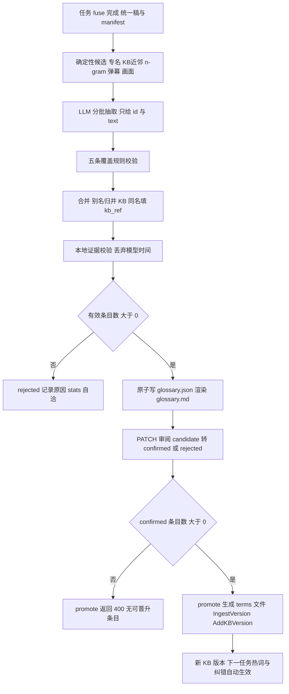
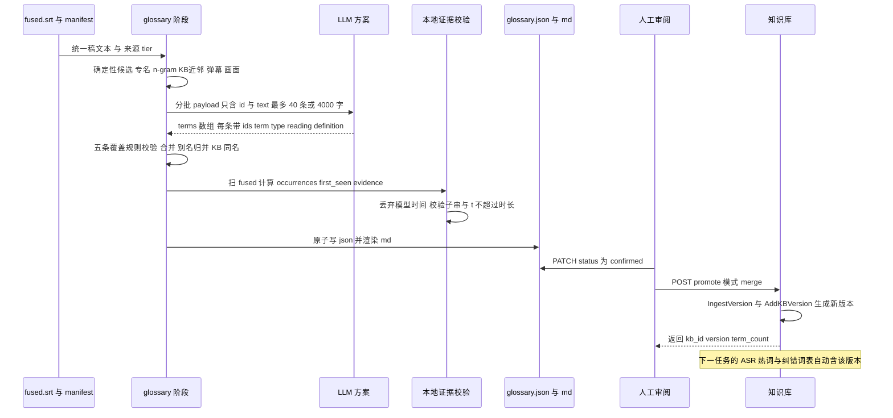

# ST6 · 用语库产出与晋升

> 本文解决：把"每条字幕里的专有名词"变成**可审阅、可晋级、可回流**的资产——任务内产 `glossary.json/.md`，人工确认后晋升为知识库新版本，下一个任务的 ASR 热词与纠错词表自动生效。
> 依赖：[ST0 契约](00-总览与契约.md)（`glossary` 阶段、§5.3 schema 与六条硬约束、G5、§11 术语）、ST5（归一化与匹配内核）、ST3（ASR 热词通道）、ST4（统一稿与来源 tier）、ST7（summary 作为可选评分因子）。
> 验收口径：`sample_glossary_expected.json` 召回 ≥0.7、误抽 ≤1；证据本地可检索、模型时间全丢弃；promote 生成 KB 新版本且 `parseTermBytes` 可读；任务 B 的 ASR 请求体含已晋升术语。
> 边界：只做"抽取 → 审阅 → 晋升 → 回流"；不改 summary/knowledge 生成（ST7）、不改融合（ST4）、不新增阶段。

## 1. 目标与非目标

**目标**

1. 确定性优先：专名模式、KB 变体近邻、高频 n-gram、弹幕佐证、画面层专名五路候选，无 LLM 也能出可用用语库。
2. LLM 抽取：严格照 MAW 4.3 的信任边界——**只给 `[{id,text}]`，模型不碰时间**，返回按 ID 引用。
3. 本地证据校验：`occurrences`/`first_seen`/`evidence` 全部由本地扫 fused 计算，模型编造的时间与文本一律丢弃。
4. 审阅与晋升：文件即真源（`PATCH` 改状态、temp+rename 原子写），`confirmed` 才能晋升为 KB 新版本。
5. 闭环：晋升后的 KB 成为下次任务的纠错词表（ST5）与 ASR 热词（ST3），并给出 assertable 的闭环验收。

**非目标**

- 不做跨任务全局词表、不做自动晋升（必须人工确认）、不做同义词本体/层级关系。
- 不做定义的事实核查（定义质量靠证据与人工审阅，不靠外部知识库）。
- 不新增阶段与门禁编号；`glossary` 已是 00 §3.1 第 8 阶段，G5 已是 00 §6 事实门禁。
- 不在本阶段改 summary 正文（用语库只贡献术语提示，见 ST7）。

## 2. 现状与差距

| 现状（真实路径:行号） | 问题 | 影响 |
|---|---|---|
| `db/progress.go:6-18` `stageOrder` 只有 7 阶段；`pipeline/pipeline.go:330-364` fuse 之后直接进 `pipeline.go:372-385` summary | 没有 `glossary` 阶段，无任何用语产出 | 同 UP 主第 2 个视频仍从零开始错，纠错词表只能人工上传 |
| `pipeline/kb.go:170-195` `parseTermBytes` 只认 `{standard,aliases,note}`，词表只能经 `api_knowledge.go:67-109` 人工上传 | 无"从视频长出词"的路径 | 沉淀完全靠人工，成本高到不会发生 |
| `pipeline/pipeline.go:367-370` 弹幕 `CleanDanmu`+`SummarizeDanmu(…,200)`；`subtitle/parse.go:229` `ParseDanmu` 返回 `[]string` | 弹幕只剩字符串，时间被丢弃 | 弹幕不能作证据（无 `t`），SLA 上只能当"文本提示" |
| `deepseek/client.go:127-129` 只有 `ChatText`；`client.go:176-180` 请求体无 `response_format`；`client.go:25` 只有 `HTTP *http.Client` | 无 JSON 模式、无 Doer 注入 | 结构化抽取全靠自造容错；单测只能起 httptest 顶掉 BaseURL |
| `api/api.go:43-61` 无 glossary 路由；`api/api_tasks.go:160-178` 下载白名单只有 summary/knowledge/fused/asr/vision | `glossary.json/.md` 无法下载 | 产出不可见 = 没有产出 |
| `api/api_knowledge.go:94-107` 上传版本 = `IngestVersion`→`CountTermsInVersion`→`AddKBVersion`；`db/repo.go:132-154` 事务内 bump `latest_version` | 晋升可复用这条路径，但缺"产品生成词表文件"的入口 | 从 glossary 到 KB 新版本没有实现落点 |
| `frontend/src/views/TaskDetail.vue:88-101` 只展示/下载 summary、knowledge；`TaskCreate.vue:152-162` 能选 KB 版本与优先级 | 无用语库展示与审阅、无晋升按钮（前端归 P1-4） | 审阅只能手工改 JSON，无法形成闭环 |
| `pipeline/pipeline.go:213-223` `asrClient.Transcribe(ctx, chunks[i].Path)` 无热词/上下文参数 | 晋升后的词无法回流到 ASR | 术语在识别前就错，事后纠错只能救一部分 |

## 3. 设计

### 3.1 定义与边界

| 维度 | 用语库（glossary） | 知识库（KB） |
|---|---|---|
| 生命周期 | 单任务产物 | 长期资产，版本不可变（`db/db.go:51-62`） |
| 真源 | `output/glossary.json`（含审阅状态） | `knowledge_base_versions` + content-addressed blob |
| 条目结构 | 00 §5.3：term/type/aliases/reading/definition/evidence/confidence/status | `{standard,aliases,note}` |
| 用途 | 人读、审阅、晋升候选 | 纠错词表（ST5）+ ASR 热词（ST3） |
| 写入权 | 任务内自由写（含 PATCH 状态） | 只经 `IngestVersion` 写新版本，不改旧版本 |
| 晋升 | `confirmed` → 新 KB 版本 | — |

硬约束：`candidate`/`rejected` 永不进 KB；同名不同义不合并；每次晋升只增版本，不回写旧版本。

### 3.2 数据契约

字段名与 00 §5.3 **逐字一致**，本文件不复述约束条文（六条硬约束见 00）。

```go
// backend/internal/glossary/schema.go
const SchemaV1 = "toutetsu.glossary.v1"

type Evidence struct {
    T      float64 `json:"t"`      // 本地计算的 cue.Start，模型时间不采信
    Text   string  `json:"text"`   // 对应来源 cue 原文子串
    Source string  `json:"source"` // native:upload:1 / asr:generate:1 / danmu:upload:1
    Match  string  `json:"match"`  // term | alias
}
type KBRef struct { KBID int64 `json:"kb_id"`; Version int `json:"version"` } // 00 §5.3 kb_ref
type Term struct {
    Term string `json:"term"`; Type string `json:"type"`; Aliases []string `json:"aliases"`
    Reading string `json:"reading"`; Definition string `json:"definition"`
    Evidence []Evidence `json:"evidence"`; Occurrences int `json:"occurrences"`
    FirstSeen float64 `json:"first_seen"`; Confidence float64 `json:"confidence"`
    Status string `json:"status"`; Origin string `json:"origin"`; KBRef *KBRef `json:"kb_ref"`
}
type Glossary struct {
    Schema string `json:"schema"`; TaskID string `json:"task_id"`
    Domain string `json:"domain"`; GeneratedAt string `json:"generated_at"`
    Generator struct {
        Model string `json:"model"`; PromptVersion string `json:"prompt_version"`; FusedSHA string `json:"fused_sha"`
        SourceTiers []string `json:"source_tiers"`; DanmuUsed bool `json:"danmu_used"`
    } `json:"generator"`
    Terms []Term `json:"terms"`; Rejected []Rejected `json:"rejected"`; Stats Stats `json:"stats"`
}
type Rejected struct { Term string `json:"term"`; Reason string `json:"reason"` }
type Stats struct { Candidates, Kept, Rejected, LLMTerms, RuleTerms, DanmuTerms, Merged int }
```

`type` 取值固定 00 §5.3 八类（brand/place/person/product/term/slang/event/other）；`origin` ∈ rule/llm/danmu/rule+llm；`status` ∈ candidate/confirmed/rejected。渲染与服务端不写额外顶层字段（如需 `conflicts` 见 §8）。

### 3.3 确定性候选挖掘（优先级最高，无 LLM 也能跑）

| 规则 | 实现 | 权重 / 常量 | 理由 |
|---|---|---|---|
| 专名模式 | 引号 `「」“”""《》【】`；括号注释 `中文（English）`、中英并列；书名号整段 | 1.0，occ 计 1 | 引号/书名号是作者与平台的"这是专名"标记 |
| KB 变体近邻 | 对已加载 KB `standard+aliases`（ST5 词表）取长度 ≥3 的窗口，编辑距离 ≤2 且 occ≥2 | 0.8，产出 alias 变体 | 错写常与正写差 1–2 字（`2万1云`↔`云雾之湾`），这是纠错的上游 |
| 高频 n-gram | CJK 2–6 字滑窗，occ≥3，过停用词表与弹幕垃圾词表 | 0.6 | 领域词高频重复是强信号；<3 次多为偶然 |
| 弹幕佐证 | 弹幕 cue 文本里同词出现（需 ST1 结构化弹幕） | 0.3，只加权不单独成候选 | 观众复述的是"他们记住的词"，噪声大但能救冷门专名 |
| 画面层专名 | `kind=ocr` 来源的 cue 中出现的专名 | 0.7 | 屏幕文字多为产品名/标题/价格，精度高 |
| 过滤 | 纯数字、数值+单位、年份 `19xx/20xx`、单字、停用词、长度 >40、纯拉丁 <2 | 直接丢弃并计数 | 对齐 00 §5.3 硬约束 1、2 |

上表"权重"是**候选优先级**（同一 term 被多路挖到取最大值、用于 LLM 分批排序与合并时的取舍），不是最终 `confidence`（后者见 §3.6）。常量理由：n∈[2,6] 因中文术语极少超 6 字且 00 §5.3 上限 40 留足别名空间；编辑距离 ≤2 覆盖"漏字/错字/同音替换"三类主错误；occ≥3 与 00 §9 样片口径一致（60s 样片 12 条字幕里出现 3 次即达门槛）；候选池上限 500，保证 LLM 分批最多 13 批。

### 3.4 LLM 挖掘协议（借用 MAW 4.3，参考设计见 `reference/MAW-总结.md:204-238`）

**信任边界**：请求只有 `[{id,text}]`，`id` 为临时不透明标识（`c0001`）只表达顺序；**不含时间码、媒体路径、逐词时间、工程元数据**。

```json
// 请求（system 只约束输出，user 放 payload）
{"domain": "葡萄酒/新西兰酒展", "types": ["brand","place","person","product","term","slang","event","other"],
 "items": [{"id": "c0001", "text": "我们之前测过了几款云雾之湾"}, {"id": "c0002", "text": "卷云和2万1云"}]}
// 响应（模型只许返回 id 引用）
{"terms": [{"ids": ["c0001","c0002"], "term": "云雾之湾", "type": "brand",
            "reading": "Cloudy Bay", "definition": "新西兰马尔堡产区代表性酒庄，以长相思白葡萄酒著称。"}]}
```

五条覆盖规则（本地强制，MAW 4.3 的抽取场景适配）：

| # | 规则（对应 MAW 4.3 五条覆盖规则，抽取场景适配） | 违反处理 |
|---|---|---|
| 1 | ID 全覆盖：每条 term 的 `ids` 非空且全部落在本批输入 | 丢弃该 term，计 `invalid_ids` |
| 2 | 保序：`ids` 的相对顺序即出现顺序，重排不做任何解释 | 丢弃该 term（保序错的解释不可信） |
| 3 | 不新增：禁止输出输入里没有的 id（含跨批 id） | 丢弃该 term |
| 4 | 只合并不重排：同一 `term` 多条 → 合并 `ids`；不拆分、不重排 | 合并并计数 |
| 5 | 非空：`term` 非空且 2..40 字符、`type` ∈ 八类、`ids` 去重 | 丢弃该 term |

`definition`/`reading` 可空（与 MAW 的"每组 text 非空"不同：抽取任务允许只出词），空定义按 §3.6 如实降权，不判失败。

- **分批**：单批 ≤40 条或 ≤4000 字，任一达上限按原顺序切；超长单条独占一批不切文本；跨批不允许合并（MAW `:224`）。
- **JSON 容错**：原样 `json.Unmarshal` → 失败做一次尾部修复（只补缺失 `}`/`]`、删结构性尾逗号；未闭合字符串放弃）→ 仍失败重试 1 次（`MAX_RESPONSE_ATTEMPTS=2`，MAW `:235`）。
- **`response_format` 三级降级**：`json_object` → 400/422 换 `json_schema` → 仍拒则不带参数、纯提示词约束；能力按 `(BaseURL, Model, Protocol)` 在会话内缓存（MAW `:237`）。现 `deepseek.Client` 无此参数（`client.go:176-180`），需新增 `ChatJSON(ctx, prompt, schemaName, schema)`。
- **温度**：方案未设置时传 0.2（抽取要稳定复现，不追求多样）；**超时** 单批 60s，不随方案 180s 累加。

### 3.5 合并与归一

归一化直接复用 ST5 的 `subtitle.Normalize`（全半角/大小写/空白）。

| 情形 | 处理 | 约束 |
|---|---|---|
| 同 term 不同写法 | 归一后相同 → 合并 ids/定义/别名，保留最早出现与最高 tier 来源 | 一条 term 只出现一次（G5 约束 1） |
| 变体归并为别名 | 与主 term 编辑距离 ≤2、同 type、时间共现（`\|Δt\|≤120s`）、occ 更低 → 进 `aliases` | 每 term 别名 ≤8，超出取 freq 高者 |
| 与 KB 同名 | 归一后 == 某 KB `standard` → 填 `kb_ref`，KB 别名并入 `aliases` | 00 §5.3 约束 6：冲突时 `kb_ref` 必填且 `status≠confirmed` |
| 同名不同义 | 定义/别名集合与 KB 条目矛盾（KBRef 有值但 alias 与定义冲突）→ 不合并，两条都留 candidate，写冲突清单 | 禁止自动 confirmed；晋升时阻断并返回 conflicts |
| 跨类型重复 | 同 term 不同 type → 取最高 tier 证据的类型，另一条进 `rejected(reason=type_conflict)` | 保证 term 唯一 |

### 3.6 评分与数量控制

`confidence` 为可解释加权和，`clamp(0,1)`；权重按"对'这是本视频术语'的解释力"排序：

| 因子 | 权重 | 取值 | 理由 |
|---|---|---|---|
| 词频 | 0.35 | occ≥3：`min(1, 0.5+0.08·(occ−2))` | 出现次数是最强信号；occ=3→0.58，occ≥9→1.0 |
| 来源 tier | 0.20 | 00 §4.2：1→1.0、2→0.95、3→0.85、4→0.7、5→0.6、6→0.5、7→0.35、8→0.25、弹幕→0.2 | 高可信来源里出现，术语更可能是真词 |
| LLM 置信代理 | 0.20 | term+def+reading 1.0 / term+def 0.85 / 仅 term 0.7 / 规则独有 0.5 | 模型抽到并给出定义显著增强；规则独有说明模型不认 |
| 定义完整度 | 0.15 | `min(1, 0.5+len(definition)/40)`，无定义为 0.5 基线 | 有定义 = 可审阅、可晋升 |
| 出现在 summary | 0.10 | 1 / 0 | 下游重要性代理；**但 glossary 阶段在 summary 之前**（00 §3.1），首跑该因子不可用 → 按剩余权重归一化（不虚高、不惩罚） |

- 软阈值 **0.5**：<0.35 → `rejected(reason=low_confidence)`；0.35–0.5 → 保留 candidate 但只用于填类型配额；≥0.5 参与主排序。
- 数量控制：按 confidence 降序截断 `glossary_max_terms`（默认 60，00 §4.3，范围 1..200）；每种 `type` 至少保留 1 条（有候选时）；被挤出者进 `rejected(reason=over_limit)`，`stats` 必须自洽。

### 3.7 证据校验（本地为准，模型不碰时间）

1. 用 ST5 的 `Lexicon.MatchText` 在 fused 上扫 `term + aliases` → `occurrences`、`first_seen`（本地统计，00 §5.3 约束 4）。
2. `evidence` ≤3 条：先取 tier 最高的来源，再按"首次 + 中段 + 末次"取代表性时间；alias 命中优先于 term 重复命中。
3. 每条 `evidence.text` 必须是该 source cue 原文的**子串**（`strings.Contains` 校验），`t` 取该 cue 的 `Start`，且 `t ≤ video.duration`（读 `work/probe.json`）。
4. 模型返回的任何时间字段一律丢弃——请求里根本没发时间（MAW `:233`）；模型给的 `text` 只做匹配线索，不写进 evidence。
5. 校验不通过 → `rejected(reason=evidence_missing)`；`glossary_evidence_missing` 必须为 0（G5）。

### 3.8 产物渲染

- `glossary.json`：原子写（`temp` + `os.Rename`，00 §8 纪律）；字段顺序固定；写成功后才渲染 md。
- `glossary.md` 结构：`# 用语库：<domain>` + 一行统计 + 按 `type` 分组的表（`术语 | 读音 | 定义 | 别名 | 证据时间 | 置信 | 状态`；证据时间渲染 `[mm:ss]`）+ 末尾 `## 已拒绝`（前 10 条 + 原因）与 `## 统计`（stats 全量）。md 必须可由 json 重建（`pipeline.RenderGlossaryMD` 单测双向校验），避免 md 成为第二真源。

### 3.9 审阅与晋升

| API | 请求 | 响应 | 约束 |
|---|---|---|---|
| `PATCH /api/v1/tasks/{id}/glossary/terms/{term}` | `{"status":"confirmed"}`（可选 `aliases`、`definition`） | 200 + 更新后的 term | `status ∈ {candidate,confirmed,rejected}`；`term` 需 `url.PathUnescape`（中文）；文件即真源，其它字段不变 |
| `POST /api/v1/tasks/{id}/glossary/promote` | `{"kb_id":3,"mode":"merge","include":"confirmed_only"}` 或 `{"new_kb_name":"葡萄酒术语","mode":"new_version"}` | `{"kb_id":3,"version":7,"term_count":42,"merged":18,"conflicts":[],"skipped":[]}` | `include` 只接受 `confirmed_only`；confirmed 为 0 → 400 |

promote 步骤：

1. 读 `glossary.json`，筛 `status==confirmed`；为空 → 400 `{"error":"无可晋升条目（需先 PATCH 为 confirmed）"}`。
2. 生成**兼容 `parseTermBytes`** 的词表文件：`{"terms":[{"standard":"云雾之湾","aliases":["2万1云"],"note":"定义…[glossary:<taskID>]"}]}`，文件名 `glossary_<taskID>.json`。
3. `mode=merge`：先 `LoadTermsFromVersion(最新版)` 取现词表，按归一 standard 合并（同 standard → 别名并集；同名不同义 → 不合并，进 conflicts）；`mode=new_version`：只取本次 confirmed，但仍做同名不同义检测。
4. `pipeline.IngestVersion(dataDir, kbID, kb.LatestVersion+1, fileName, content)` → `CountTermsInVersion` → `db.AddKBVersion`（事务内 bump `latest_version`，`repo.go:132-154`），与 `api_knowledge.go:94-107` 同一路径，保证历史版本与新版本同构。并发注意：同 KB 同时上传与晋升会算出相同版本号，以 `AddKBVersion` 返回的 `Version` 为准，目录号不一致时重命名重试 1 次。
5. `new_kb_name` 非空且不存在 → `CreateKnowledgeBase`（`repo.go:88-94`）；已存在同名 → 409，提示改用 `kb_id`。
6. 原子写：`glossary.json` 的 PATCH 用 `glossary.json.tmp` + `os.Rename`；写后立刻重渲染 `glossary.md`，两步都成功才返回 200/201。
7. 不改 glossary 的 `status`（晋升≠确认，确认已由 PATCH 完成），也不改 KB 旧版本。

### 3.10 热词回流闭环

- `pipeline.BuildHotwords(taskID) []string`：任务选中 KB 的 `standard + aliases`，按 `priority` 去重，产出上限 200 词；ST3 侧再按请求预算截断为 **≤50 词 / ≤500 字符**（见 ST3 §3.6，两处数值以此为准）。权重参考 MAW 4.7 `--hotword-weight 1-5`（标准形 5、别名 3，`reference/MAW-总结.md:280-292`）。
- ST3 的 ASR 适配器在请求体带 `hotword` 数组与 `context`（≤400 字，MAW 同节）；本 ST6 只负责"词从哪来 + 断言请求体含词"。
- 闭环断言：任务 A 产 glossary → PATCH confirmed → promote 进 KB v(N+1) → 任务 B 选该 KB → `aitest.FakeASR` 记录的请求体含 `云雾之湾`。
- live 对比（可选）：同一音频加/不加热词各转写一次，比较术语错误数；成本按 MAW §5 `0.00022 元/秒` 估算（60s 样片 ≈ 0.013 元）。

### 3.11 失败语义

| 情况 | 处理 | 不许 |
|---|---|---|
| LLM 不可用/全部批次失败 | 只用确定性候选产出 glossary（`origin=rule`），阶段 `status=done` 且 `message="degraded: LLM 不可用，仅规则候选"`，`quality.degradations` 记一条 | 判阶段 failed；丢掉 summary/knowledge（00 §4.4） |
| 单批 JSON 两次失败 | 丢弃该批（`skipped_batches` 计数），其余批继续 | 整阶段失败 |
| 证据校验后无有效条目 | 写 `terms: []` 的合法 glossary.json + stats（kept=0） | 不写文件；或写成"有 term 无证据" |
| 写盘/内部错误 | 阶段 `failed`；**summary/knowledge 照常产出**，任务 `degraded` | 因用语库失败让任务整体 failed |
| 任务开关关闭（`glossary_enabled=0`） | 阶段 `skipped`，`message="用语库开关关闭"`（00 §3.2 不许空跳） | 静默跳过或无 message |
| G5 fail | 只标 `degraded`（08 §6） | 阻断发布或篡改产物 |
| 数量超限截断 | rejected(`over_limit`) + stats 自洽 | 静默丢弃（G5 要对得上 stats） |

> 注：00 §3.2 明确 `degraded` 不是阶段状态，因此"降级"写进阶段 `message` 与 `quality.degradations`，阶段状态只取 done/failed/skipped。

## 4. 流程图

状态流转与调用时序分两图给出（上：状态机；下：一次完整闭环的调用时序）。





## 5. 实现步骤

| 编号 | 改动文件 | 要点 | 依赖 | 可独立验收 |
|---|---|---|---|---|
| ST6.1 | `backend/internal/glossary/schema.go`（新增） | 00 §5.3 全字段结构、schema 常量、严格 `Unmarshal`/`Marshal`（未知字段不落地） | ST0 | 是 |
| ST6.2 | `backend/internal/glossary/normalize.go`（新增） | 复用 `subtitle.Normalize`；停用词表；八类 `type` 校验；数字/单位/年份过滤 | ST5 | 是 |
| ST6.3 | `backend/internal/glossary/mine_rule.go`（新增） | 专名模式、2–6 字 n-gram、画面层专名、候选池 ≤500 | ST6.1/6.2 | 是 |
| ST6.4 | `backend/internal/glossary/mine_kb.go`（新增） | KB 变体近邻（编辑距离 ≤2、occ≥2、长度 ≥3），输入 `[]subtitle.Term` | ST5 词表 | 是 |
| ST6.5 | `backend/internal/glossary/mine_danmu.go`（新增） | 弹幕佐证（仅加权；无结构化时间则不加证据） | ST1 弹幕结构 | 否（依赖 ST1） |
| ST6.6 | `backend/internal/glossary/llm.go`（新增） | 分批、payload、五条覆盖规则、尾部修复、重试 1 次、三级 `response_format` 降级 | ST6.7 | 是（mock client） |
| ST6.7 | `backend/internal/deepseek/client.go`（改） | 新增 `Doer` 字段与 `ChatJSON`；`ChatText` 行为不变；能力缓存按端点+模型 | ST0、08 §4 | 是 |
| ST6.8 | `backend/internal/glossary/merge.go`（新增） | 归一合并、别名归并四条件、KB 同名填 `kb_ref`、冲突清单 | ST6.1–6.6 | 是 |
| ST6.9 | `backend/internal/glossary/score.go`（新增） | confidence 五因子、软阈值 0.35/0.5、`glossary_max_terms` 截断、每 type 保底 1 | ST6.8 | 是 |
| ST6.10 | `backend/internal/glossary/evidence.go`（新增） | 本地扫 fused、≤3 条证据、子串与 `t≤duration` 校验、丢弃模型时间 | ST5 匹配内核 | 是 |
| ST6.11 | `backend/internal/glossary/render.go`（新增） | 原子写 json；md 分组渲染与可重建；rejected/stats 收尾 | ST6.9/6.10 | 是 |
| ST6.12 | `backend/internal/pipeline/glossary_stage.go`（新增） | 阶段装配：幂等键 fused sha + prompt 版本；重跑按 term 键继承 status；失败不阻断 summary | ST6.1–6.11、ST4 的 fused sha | 否（需 ST4 manifest） |
| ST6.13 | `backend/internal/api/api_glossary.go` + `api/api.go`（新增/改路由） | PATCH 审阅、POST promote（复用 `IngestVersion`/`AddKBVersion`）、下载白名单加 3 个产物 | ST6.11、`api_knowledge.go:94-107` | 是 |
| ST6.14 | `backend/internal/pipeline/hotword.go`（新增）+`glossary_test.go`/`hotword_test.go`、`backend/testdata/samples/sample_glossary_expected.json` | `BuildHotwords`、闭环断言、夹具（10 正例 + 3 负例） | ST3 通道（未就绪用接口桩） | 否（ST3） |

## 6. 验收标准

> 命令在 `backend/` 下执行；证据目录 `docs/evidence/singletask/ST6/`。

| 验收项 | 命令 | 期望结果 | 证据落盘 |
|---|---|---|---|
| 候选挖掘精度 | `go test ./internal/glossary/ -run TestMineCandidates -v` | PASS：对 10 个标注正例召回 ≥0.7（≥7 个命中）；3 个负例误抽 ≤1（≤1 个） | `docs/evidence/singletask/ST6/precision.txt` |
| 证据校验 | `go test ./internal/glossary/ -run TestValidateEvidence -v` | PASS：`t=9999>duration` 被拒；编造 text 不在来源里被拒；`occurrences` 与本地重算一致 | `docs/evidence/singletask/ST6/evidence_check.txt` |
| 合并与评分 | `go test ./internal/glossary/ -run "TestMergeAliases\|TestConfidence" -v` | PASS：变体并入 aliases 且 `merged=1`；KB 同名填 `kb_ref` 且 `status≠confirmed`；confidence 与手算差 ≤0.01、随 occ/tier 单调 | `docs/evidence/singletask/ST6/unittest_output.txt` |
| 晋升 KB | `go test ./internal/pipeline/ -run "TestPromoteKB\|TestPromoteToKB" -v` | PASS：新版本 = 旧 `latest_version+1`、`term_count=3`（仅 confirmed）、`parseTermBytes` 回读 3 条、candidate 未写入；`TestPromoteToKB` 为同一用例的别名包装（保 08 矩阵命令不变） | `docs/evidence/singletask/ST6/promote.json` |
| 热词回流 | `go test ./internal/pipeline/ -run TestHotwordFeed -v` | PASS：任务 B 的 ASR 请求体 `hotword` 含 `云雾之湾`，经 ST3 预算截断后词数 ≤50 且总字符 ≤500（`BuildHotwords` 原始列表 ≤200），`context` ≤400 字；未选该 KB 时不出现 | `docs/evidence/singletask/ST6/hotword_body.json` |
| G5 门禁 | `go test ./internal/quality/ -run TestGatesGlossary -v` | PASS：六条硬约束全过→pass；置信<0.6 占比>30%→warn；证据缺失/重复 term/schema 错→fail（不阻断） | `docs/evidence/singletask/ST6/g5.txt` |
| mock 全链路 | `go test ./internal/pipeline/ -run TestPipelineGlossaryMock -v` | PASS：10 阶段含 `glossary=done`；`glossary.json/.md` 存在、`stats.kept≥1`；假 chat 首包坏 JSON（尾部缺 `}`）被修复成功 1 次（httptest，测试内无真实域名）；`quality.json` 的 `gates` 含 G5 | `docs/evidence/singletask/ST6/mock_chain.txt`、`ST6/glossary.json` |
| API 审阅/晋升 | `go test ./internal/api/ -run "TestGlossaryReview\|TestGlossaryPromote" -v` | PASS：PATCH 200 且状态落盘、无 `*.tmp` 残留；promote 201 返回 `{kb_id,version,term_count}`；candidate-only 请求 400 | `docs/evidence/singletask/ST6/api_review.txt` |
| 真实环境 | `powershell scripts/e2e-live.ps1`（可选） | **环境缺口**：无真实 ASR 通道与真实模型 Key 时，live 仅跑确定性链路（rule-only glossary）；缺失项在证据 README 明确写"未验证"，不得以 mock 冒充 live | `docs/evidence/singletask/ST6/live_note.md` |

夹具与精度断言：`sample_glossary_expected.json` 固定 10 个正例（`云雾之湾/长相思/马尔堡/卷云/斯涅尔定律/…`，各带 `expected_occurrences`）与 3 个负例（`啊`/`哈哈`/`666`），配套 fused 文本由 `sample_native.srt`+`sample_asr.srt` 融合后固定（golden 存 `backend/testdata/golden/fused_for_glossary.srt`，与 08 §4 的 golden 目录一致），保证召回/误抽断言可复现且不依赖模型。

## 7. 风险与回退

| 风险 | 触发条件 | 缓解 | 回退开关 |
|---|---|---|---|
| 精度/召回无法判定 | 无人工标注集 | 20 视频标注计划（见下）；先 5 视频校准阈值再全量 | `GLOSSARY_ENABLED=0` |
| LLM 编造术语或定义 | 模型输出自由文本 | 请求不含时间、id 引用、证据本地校验、定义只做展示 | `GLOSSARY_LLM=off`（仅规则候选） |
| 知识库污染 | 把 candidate 误晋升 | 仅 confirmed 可晋升 + 同名不同义不合并 + 新版本可删（`api_knowledge.go:123-154`） | 删除 KB 新版本 |
| 成本超基线 | 候选池过大/批次过多 | 候选池 ≤500、批 ≤40 条或 4000 字、G6 成本门禁 | `GLOSSARY_MAX_TERMS=20` 收紧 |
| 用语库拖垮任务 | 阶段内部错误 | 失败隔离：summary/knowledge 照常产出（00 §4.4） | 关闭阶段 |
| 与 ST5 循环依赖 | glossary 词反哺 fuse | 首跑不注入，仅 fuse 重跑注入（ST5 §3.6） | — |
| 近义条目重复 | 归一/归并漏 | 四条件归并（距离/同 type/共现/occ） + G5 重复检测 | — |

**20 视频人工标注计划**（P1 完成后 2 周内完成，产出 `docs/evidence/singletask/ST6/annotation_report.md`）：选片 20 条（同 UP 主 5 + 同领域 10 + 跨领域 5，每条 ≥300s）；每片产出 `fused.srt` + 人工 `expected.json`（≥8 正例、≥3 负例）+ 审阅 30 条候选的 confirmed/rejected 判定；判定指标：召回 ≥0.7、误抽 ≤1/视频、confirmed 率 ≥0.6、定义抽检准确率 ≥0.85（20 条/视频）。未达标的视频归档为回归用例（`backend/testdata/golden/glossary/<videoId>/`）。

## 8. 对 00 契约的增补建议

1. **`glossary.json` 顶层可选 `conflicts` 数组**（`{term, kb_id, kb_version, reason}`）：用来承载 00 §5.3 约束 6 的"同名不同义"裁决依据，供审阅与晋升阻断；不参与 G5 六条硬约束，缺失时按空处理。
2. **明确 `kb_ref` 形状**：00 §5.3 只给了 `null` 示例，建议写死 `{"kb_id":3,"version":2}`，避免实现侧各写一套。
3. **`glossary` 阶段重跑语义**：00 §3.1 幂等键为 `fused sha + 提示词版本`，建议补一句"重跑时按归一 `term` 继承旧 `status`"，否则人工确认会在续跑后丢失。
4. **`taskResult` 返回体**：00 §8 API 面建议补 `glossary`（json 对象）与 `quality` 字段，前端不必二次请求即可渲染审阅面板。
5. **promote 的 `version` 来源**：建议写明"新版本号 = 当前 `latest_version+1`，复用 `AddKBVersion` 事务"，防止实现绕过事务直接改 `latest_version`。

> 返回上级：[计划索引](../README.md) ｜ 契约源：[ST0](00-总览与契约.md)
