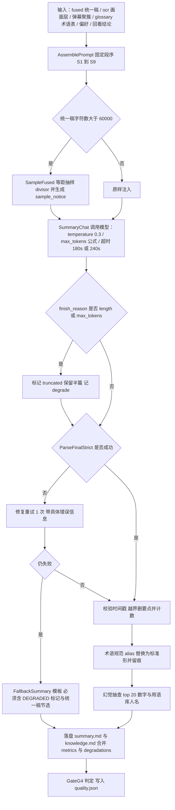

# ST7 · 总结与知识卡生成

> 本文定义单任务流水线第 9 阶段 `summary`（权重 20）：把统一稿、画面层、弹幕聚簇、用语库术语表与用户偏好装配成一份**固定段序**的提示词，一次调用产出 `output/summary.md` 与 `output/knowledge.md`，并让结构、时间戳与失败语义都能机器判定。
> 依赖：[ST0](00-总览与契约.md) 的 §3.1（阶段表）、§4.4（失败语义）、§5.5（结构要求）、§6（G4）；上游产物来自 ST4（`fused.srt` / `manifest.json`）、ST6（`glossary.json`）、ST1（弹幕聚簇）、ST2（`work/probe.json` 与帧）。
> 验收口径：`go test ./internal/pipeline/ ./internal/quality/` 全绿 + httptest 四类响应断言 + G4 与 `quality.metrics` 一致；证据落 `docs/evidence/singletask/ST7/`。
> 文中的"参考 MoonDigest 6.2"等均指 `reference/` 下的**参考设计**，不是本项目现有实现。

---

## 1. 目标与非目标

**目标**

- 段序固定（S1–S9），内置骨架在最前，用户偏好与回看结论只能追加在尾段。
- 预算与抽样：统一稿送模型硬上限 60000 字符，超限等距抽样并**如实告知**"按时间均匀抽取约 1/N"。
- 结构可判定：产出满足 ST0 §5.5，G4 全项可机器判定，指标写进 `quality.json` 的 `metrics`。
- 时间戳零非法：全部 `[MM:SS]` ≤ 时长且能映射回 `fused.srt`（±10s），越界要点删除并计数。
- 失败不静默：截断保留半篇；解析两败走带 `DEGRADED` 标记的模板兜底；原因逐条进 `degradations`。

**非目标**

- 不抽取用语库（ST6 独立调用，理由见 §3.5），本阶段不写 `glossary.json`。
- 不改融合与术语纠错（ST4 / ST5），不改 G1/G2/G3/G5/G6 判定口径。
- 不做流式输出与前端渲染改造（展示沿用 `TaskDetail.vue`，见 ST8）。
- 不引入"先粗总结再润色"的二次调用：成本与幂等优先，质量靠修复重试 + 模板兜底 + 门禁拦截。

## 2. 现状与差距

下表行号为本人在工作区 `read` 核对后的现行代码位置（2026-11-19）。

| 现状（真实代码） | 问题 | 影响 |
|---|---|---|
| `pipeline.go:478-481` 把整份统一稿与结构要求拼成一个 `finalPrompt` 一次性发出 | 无字符预算、无抽样、无 token 估算 | 长片（>6 万字）被上下文截断，结论退化为"开头摘要"且无记录 |
| `pipeline.go:425-431` `ctxText` 只有统一稿 + 弹幕字符串 + 偏好 | 画面层已在 `fuse.go:42-47` 混进 unified，模型分不清"人说的"与"屏幕写的" | 把画面字幕当 UP 主发言引用，事实层失真 |
| `pipeline.go:437-441` 回看轮数直接取 `ReadingDepth`（`db.go:180`），无上限 | 表单填 20 就是 20 轮，问题数 × 轮数成本不可控 | 单任务费用可被一个输入框放大一个量级 |
| `pipeline.go:441` "最多 8 条"只写在提示词里，`parseQuestions`（`:499-511`）不截断 | 模型返回 20 条就真发 20 次 Vision | 每轮最多 20 次多图调用，费用翻倍 |
| `pipeline.go:455-459` 回看时间点不校验是否 ≤ 时长；`nearestFrames`（`:541-561`）总会兜底取最近一帧 | 越界或画面无关的问题照样调用，且不记录跳过 | 浪费调用，`answers.txt` 留下与时间不符的结论 |
| `pipeline.go:515-519` `parseFinal` 用 `strings.Index` 找左花括号、`LastIndex` 找右花括号贪婪取区间 | 正文含花括号或多段 JSON 即 unmarshal 失败；只 `stripFences`（`:530-539`），不剥 think 块 | 合法内容被判解析失败，静默退化 |
| `pipeline.go:489-495` 解析失败即 `defaultSummary`（`:588-595`） | 兜底模板无 `DEGRADED` 标记、无原因；knowledge 退化成一句占位说明 | 用户分不清"模型没给"与"给了没解析出来" |
| `client.go:188-203` openai_chat 只取 `choices[0].message.content` | 不读 `finish_reason` | 截断不可见，半篇被当完整结果发布 |
| `client.go:274` anthropic 协议 `max_tokens` 硬编码 4096 | 长片必截断且无法调大 | 同一任务换协议结果长度不同 |
| `client.go:33` 超时取方案 `TimeoutSeconds`（缺省 180s），单一档位 | 思考型模型 180s 常不够，且无法按档位区分 | 超时整阶段 failed，已花 token 白费 |
| `pipeline.go:382-383` 解析结果直接落盘；`TaskDetail.vue:95-102` 用 `pre` 原样展示 | 无时间戳校验、无术语规范、无幻觉抽查、不展示降级状态 | 越界时间戳与编造数字直接进 `summary.md`，降级对用户不可见 |

## 3. 设计

### 3.1 输入装配：固定段序（S1–S9）

段序固定、骨架在前、偏好与回看结论在后 —— 参考 MoonDigest 过程⑥ 6.2：用户自定义提示词被降级为 system 尾段，"能追加规则，改不掉骨架"。

| 段 | 内容来源 | 预算（字符） | 省略条件 |
|---|---|---|---|
| S1 角色与任务 | 常量 `promptS1` | 700 | 不可省 |
| S2 视频元信息 | `manifest.json` 的 `video` + `tasks.filename`（`db.go:176`）+ `work/probe.json` | 200 | 某字段缺失则整行省略，不写"未知" |
| S3 对白统一稿 | `subs/fused.srt` → `cuesToText`（`pipeline.go:570-579`） | 60000 | 不可省（G1 fail 时任务已 failed，不进本阶段） |
| S4 画面层文字 | `subs/ocr.srt` → 同 `cuesToText` | 8000 | 无 `ocr` 来源则整段省略 |
| S5 弹幕热点 | ST1 聚簇结果（替代 `SummarizeDanmu` 的字符串拼接，`danmu.go:80-88`） | 3000 | 无弹幕则省略 |
| S6 用语库术语表 | `output/glossary.json`：confirmed 全量 + `confidence ≥ 0.7` 的 candidate，按 `occurrences` 降序取 40 | 3000 | 用语库开关关或 `glossary` 阶段 failed 则省略 |
| S7 用户偏好 | `tasks.summary_preference`（`db.go:177`） | 1000 | 空则省略 |
| S8 回看结论 | `work/turn/<n>/answers.txt`（`pipeline.go:473`） | 4000 | T=0 或无有效答案则省略 |
| S9 输出契约 | 常量 `promptS9` | 1200 | 不可省 |

### 3.2 提示词草案（可直接落地为 `prompts.go` 常量）

```text
【S1 角色与任务】
你是一名视频内容分析助手。请把下面给出的「对白统一稿 / 画面层文字 / 弹幕热点 / 用语库术语表」整理成两份可直接阅读的 Markdown 产物：summary_md 与 knowledge_md。
纪律（优先级从高到低）：
1. 只依据下面给出的材料作答，材料没写的内容不说。
2. 区分事实与推测：事实写「字幕显示……」或「画面显示……」，推测写「可以推测……」。
3. 不复述字幕原文，不做逐句翻译，不写「作为一个 AI」式开场。
4. 不输出思考过程，不要 think 标签，不要用代码围栏包裹整份结果。
5. 时间戳只写 [MM:SS] 或 [HH:MM:SS]，不要用反引号或代码块包住时间戳。
【S2 视频元信息】
标题：{{title}}
时长：{{dur_mmss}}（{{dur_sec}} 秒）
文件：{{filename}}
画面：{{width}}x{{height}}，{{fps}} fps
UP 主：{{up_name}}
发布：{{pubdate}}
分区：{{zone}}
（取不到值的行整行删除，不要写「未知」）
【S3 对白统一稿】
以下是对白统一稿，每行格式为 [MM:SS] 文本，按时间升序。第三人转述的内容不等同 UP 主本人观点。
{{fused_block}}
{{sample_notice}}
【S4 画面层文字】
以下是视频画面上出现的文字（识别自截图），可能有错字、重复、图标文字与广告。这是画面文字，不是对白，不得当作某人说的话引用。
{{screen_block}}
【S5 弹幕热点】
以下是观众弹幕的聚簇结果（时间窗 / 条数 / 代表文本）。弹幕可能含噪声、反讽、刷屏与剧透，只作热点与反馈参考，不得当作视频内容事实。
{{danmu_block}}
【S6 用语库术语表】
以下是本视频已确认（confirmed）与高置信（candidate）的领域用语。正文必须使用「标准形」，不得使用别名。
{{glossary_block}}
【S7 用户偏好】
{{preference_block}}
【S8 回看结论】
以下是逐轮回看画面得到的结论，标注了轮次与时间点。画面结论以画面为准，可能与对白不一致，引用时写明「画面显示」。
{{turns_block}}
【S9 输出契约】
只输出一个 JSON 对象，不要任何其它文字，键名固定为 summary_md 与 knowledge_md。
summary_md 要求：
1. 第 1 行 # {{title}}；随后头信息块：- 视频 / - 时长 / - 任务ID / - 分析时间，各占一行。
2. ## 分析概述：3–6 句，最后一句必须给出结论性判断（值得看 / 不值得看 / 适合谁看）。
3. ## 分析具体内容：按主题分节，每节以 ### 主题N：<主题名> 开头；片长 ≥300 秒至少 4 节，<300 秒至少 2 节。
4. 每节至少 1 条要点，每条以「- 」开头且带 [MM:SS]，时间戳必须落在 00:00 到 {{dur_mmss}} 之间。
5. 某时段没有字幕就写「（该时段字幕未覆盖）」；不要给出字幕里没有的数字、人名、引文。
knowledge_md 要求：
1. 第 1 行 # 知识卡片：<主题>；随后 ## 目录，目录项与卡片一一对应（锚点链接）。
2. 每张卡片：## n. 标题 + 一句话结论 + 详细说明（2–5 条）+ 关键词标签 + 来源时间戳（至少 1 个合法时间戳）。
3. 卡片数 3–20 张，按重要性降序。
{{no_speech_notice}}
```

段装配规则：空缺段**整段删除**（不留空标题）；`no_speech_notice` 仅在 G1 warn 分支（无语音字幕、仅有画面层）时替换第 1 条纪律为"本视频无对白字幕，以下结论仅基于画面文字与弹幕热度，不得假装听过对白"。

### 3.3 预算、常量与抽样

| 常量 | 值 | 理由 |
|---|---|---|
| `SummaryFusedMaxChars` | 60000 | ≈39000 token，加输出上限 12288 与回看答案仍在主流模型上下文安全区；参考 MoonDigest 6.3 历史预算 40000 的 1.5 倍 |
| `ScreenMaxChars` | 8000 | 画面层是补充信息，过量会诱导模型把画面当对白；按 22 帧 × 350 字估 |
| `DanmuMaxChars` | 3000 | 弹幕只作热点参考（00 §4.1 明确不进正文），15 簇 × 200 字 |
| `GlossaryMaxTerms` | 40 | `glossary_max_terms` 默认 60 的上游截断，避免术语表压过正文 |
| `TimestampToleranceSec` | 10 | 与 00 §5.5 第 4 条的映射容差同口径 |
| `MaxTokensFloor` / `MaxTokensCap` | 4096 / 12288 | 下限保证短片也能写完 3 张卡；上限防单次费用失控（G6 基线） |
| `TimeoutSec` / `ThinkingTimeoutSec` | 180 / 240 | 沿用 `client.go:33` 缺省 180s；思考档参考 MoonDigest 7.4 的 120s/240s，本处 prompt 更大故 180s 起 |
| `SummaryTemperature` | 0.3 | 结构化输出需稳定；参考 MoonDigest 7.2 `triageChat` 用 0.3 |
| `RepairAttempts` | 2 | 参考 MAW 4.3 `MAX_RESPONSE_ATTEMPTS = 2`：一次原样、一次带错误修复 |

**抽样算法** `SampleFused(text string, maxChars int) (string, SampleMeta)`：

1. 按行切分。统一稿每行即一条 cue 且自带 `[MM:SS]`（`cuesToText` 见 `pipeline.go:570-579`），因此"保留时间戳行"自动成立；以井号或短横线开头的结构行不参与抽取、一律保留（保住主题分隔）。
2. 总字符 ≤ `maxChars`：divisor = 1，notice 为空。
3. 否则 divisor = ⌈totalChars / maxChars⌉，按行号步长 divisor 抽取；每 40 条抽中行回填 1 条相邻行，避免主题切换处被整体跳过。
4. notice 原文：`提示：全文过长（共 {total} 字 / {lines} 条），已按时间均匀抽取约 1/{divisor} 条（保留 {kept} 条，时间覆盖 {first}–{last}），未抽到的时段没有材料。`（句式参考 MoonDigest 6.2）
5. 重抽：抽后仍超限则 divisor 翻倍再抽，最多 3 次；仍超则硬截断到 `maxChars` 并追加 degrade "统一稿被硬截断"。
6. 成本：`EstimateTokens(s) = ⌈RuneCount(s) × 0.65⌉`（中文 1 字≈0.65 token，经验值，ST8 用真实 `usage` 校准）；单次 prompt ≤ 78000 字符（≈51000 token）；全阶段 ≤ 120000 token（含回看 ≤72 帧识图），超限则停回看并把 divisor 翻倍，写 degrade。

### 3.4 回看（T 轮）约束

| 约束 | 取值 | 理由 |
|---|---|---|
| 轮数上限 | T = clamp(`reading_depth`, 0, 3) | 00 §4.3 默认 2；每轮 ≤8 问 × ≤3 帧 ⇒ 最多 72 次识图，与 `MAX_FRAMES=120`（`config.go:63`）兼容 |
| 每轮问题数 | 8，`parseQuestions` 之后**硬截断** | 沿用现有提示词（`pipeline.go:441`），但从"提示词自觉"改为代码保证 |
| 时间点合法性 | 0 ≤ t ≤ dur | 越界丢弃，degradations 记"回看第 N 轮丢弃 k 个越界时间点" |
| 帧存在性 | 最近帧与 t 的距离 > `interval+1` 则跳过该问 | 把 `nearestFrames` 的"硬兜底最近一帧"（`:551-559`）改为"无近帧即跳过并记 degrade" |
| 每问帧数 | ≤3 | 沿用 `nearestFrames` 上限（`:546`），控制视觉 token |
| 答案并入下一轮 | 沿用 `pipeline.go:474` | 累进式深读，不重发上一轮问题 |
| 与 G4 的关系 | 回看只影响 prompt，不参与 G4 | G4 只看最终 `summary.md`；全部轮次 0 有效答案时记 degrade，G4 仍独立判定 |

### 3.5 输出契约与解析

```go
// backend/internal/pipeline/summary.go（新增）
type SummaryOutput struct { // 模型返回契约，唯二键
	SummaryMD   string `json:"summary_md"`
	KnowledgeMD string `json:"knowledge_md"`
}

type SummaryResult struct {
	SummaryMD, KnowledgeMD string
	FinishReason           string   // length | max_tokens | MAX_TOKENS | stop
	Truncated              bool
	Degradations           []string // 顺序即写入 quality.degradations 的顺序
	Metrics                SummaryMetrics
	PromptTokens           int
	CompletionTokens       int
	PromptVersion          string // summary-v1，写 stage.message
}

type SummaryMetrics struct { // 前 4 项与 00 §5.4 quality.metrics 同名同义
	SummarySections    int  `json:"summary_sections"`
	SummaryTimestamps  int  `json:"summary_timestamps"`
	TimestampsInvalid  int  `json:"timestamps_invalid"`
	HallucinationFlags int  `json:"hallucination_flags"`
	Sampled            bool `json:"sampled"`
	SampleDivisor      int  `json:"sample_divisor"`
	TermReplacements   int  `json:"term_replacements"`
}
```

**解析器** `ParseFinalStrict(s string) (SummaryOutput, error)` 五步：

1. `stripFences`（复用 `pipeline.go:530-539`，补"围栏后无换行"情形）。
2. `stripThink`：删除 `think` 配对块、`<thought>` 配对块，以及行首"思考："到下一个空行的整段。
3. **字符级配对扫描**：从首个左花括号起深度计数，维护 `inString` 与 `escape`，深度归零处截断；禁止 `Index` / `LastIndex` 贪婪匹配（`pipeline.go:515-519` 的现有写法会在正文含右花括号时截错）。
4. `json.Unmarshal` + schema 校验：两键非空；`summary_md` 含 `## 分析概述` 与 `## 分析具体内容`；`knowledge_md` 含 `## 目录` 且卡片数 ≥3。
5. 失败 → 修复重试 1 次（把"缺少哪个小节 / 第几字节解析失败"作为追加 user 消息），仍失败 → `FallbackSummary`。

**为什么用语库独立调用**（不放进同一个 JSON）：① 00 §4.4 要求"用语库失败也要保住 summary/knowledge"，同一次调用共享失败点；② G5 有六条硬约束（证据可检索、occurrences 本地为准），与 G4 结构校验口径不同；③ 证据校验必须在 ST6 侧做本地逐条检索，输入与总结阶段不同；④ 幂等键独立（`fused sha + 提示词版本`），可单侧重跑，成本可独立计入 G6。

### 3.6 时间戳、术语规范与幻觉防护

- 时间戳正则：`\[(\d{2,3}):([0-5]\d)(?::([0-5]\d))?\]`（分钟允许 3 位，兼容 100 分钟以上片长）。
- 合法性：0 ≤ t ≤ dur + 2（fused 末条 End 可略超）；且存在 fused cue 满足 `|cue.Start − t| ≤ 10` 或 `t ∈ [cue.Start − 2, cue.End + 10]`（口径同 00 §5.5 第 4 条）。
- 越界或无锚点：删除该要点整行，`timestamps_invalid++` 并写进 `quality.metrics`；某节要点清零则补一行"（该时段字幕未覆盖，无法给出要点）"。
- 全文 0 个合法时间戳：仍落盘，但 G4 判 fail（00 §6）。
- 术语规范：复用 `LoadTermsFromVersion`（`pipeline.go:392-406`）与 ST5 的最长匹配，把 alias 替换为标准形；替换只作用于正文，**绝不改时间戳**（本地版"模型不碰时间"）。
- 留痕：逐条 `{alias, standard, line}` 写 `work/summary_trace.json`（中间产物，可清理），前 20 条摘要写 `summary` 阶段 `message`；不新增交付产物。
- 幻觉-数字：按出现顺序取 `summary_md` 前 20 个不重复数字（含百分比），全角转半角、去千分位后必须能在 fused 原文中作为子串命中；未命中 → `hallucination_flags++` 并在该要点后加"（存疑：字幕未见此数字）"。
- 幻觉-人名/术语：glossary 中 confirmed 与 candidate 若在 summary 出现而 fused 从未出现 → 记为 flag（防"术语表反灌"）。
- `flags > 0` → `degradations` 追加一条；不改 G4（00 §6 未把幻觉纳入 G4，见 §8）。

### 3.7 截断、失败语义与模型参数

`deepseek.ChatResult` 增 `FinishReason string` 与 `Truncated bool`；新增 `ChatOpts{MaxTokens int; TimeoutSec int}` 与 `ChatTextOpts`，`ChatText` 保留为零值包装（不动既有调用方）。

| 协议 | 截断信号（需新增读取） | 现状位置 |
|---|---|---|
| openai_chat | `choices[0].finish_reason == "length"` | `client.go:188-203` 只取 content |
| openai_responses | `status == "incomplete"` 且 `incomplete_details.reason == "max_output_tokens"` | `client.go:231-242` 无 status |
| anthropic_messages | `stop_reason == "max_tokens"`；`max_tokens` 现硬编码 4096（`:274`）必须参数化 | `client.go:288-296` |
| gemini | `candidates[0].finishReason == "MAX_TOKENS"`（thought 片段已在 `:355-361` 跳过） | `client.go:337-362` |

失败语义：

- JSON 第 1 次失败 → 修复重试 1 次（带错误原文）。
- 第 2 次仍失败 → `FallbackSummary`：必含 `> ⚠️ DEGRADED：结构化总结解析失败（原因：…）`、头信息块、统一稿节选（≤4000 字、按时间抽样）、"可重试或调大输出上限"建议；knowledge 用"仅目录 + 1 张兜底卡"；G4 fail 使 `quality.status=fail`，但文件必须落盘。
- 截断（`Truncated=true`）→ 能解析出 `summary_md` 就保存半篇；knowledge 缺则该节用兜底卡；不重试（同参数重试仍截断），degradations 记"总结输出被截断，仅保留已生成部分；建议提高输出上限或缩短片长"。
- HTTP 5xx / 超时 → 沿用 `withRetry`（`pipeline.go:51-60`）3 次；仍失败 → `summary` 阶段 failed（不改既有语义）。
- 模型返回空文本 → 视为解析失败，走同一条兜底路径。

模型参数：

- temperature：方案显式设置则以方案为准并 clamp 到 [0, 0.6]；缺省 `SummaryTemperature=0.3`。
- max_tokens：`estChars = 240 + 320 + sections×300 + cards×360`，`sections = clamp(⌊dur/240⌋+2, 2, 12)`，`cards = clamp(⌊dur/120⌋, 3, 20)`，`maxTokens = clamp(⌈estChars×0.65×1.3⌉, 4096, 12288)`；1292s 样片 → 7 节 10 卡 → 6260 字 → 5290 token。
- 超时：普通 180s / 思考 240s；必须用 `context.WithTimeout` 覆盖 `client.HTTP.Timeout`（`client.go:43` 固定不可调档）。

## 4. 流程图



## 5. 实现步骤

| 编号 | 改动文件 | 要点 | 依赖 | 可独立验收 |
|---|---|---|---|---|
| ST7.1 | 新增 `backend/internal/pipeline/prompts.go` | S1–S9 常量、`prompt_version=summary-v1`、`AssemblePrompt`、空段整段省略 | ST4 / ST6 | 是 |
| ST7.2 | 新增 `backend/internal/pipeline/summary.go` | `SampleFused`、`EstimateTokens`、divisor 与 notice、三次翻倍、硬截断降级 | ST7.1 | 是 |
| ST7.3 | 改造 `backend/internal/deepseek/client.go` | `ChatResult` 增字段、四协议 truncation 映射、`max_tokens` 参数化（`:274`）、ctx 超时、`ChatOpts` | 无 | 是 |
| ST7.4 | `summary.go` | `ParseFinalStrict`：stripFences + stripThink + 字符级配对扫描 + schema 校验 | ST7.1 | 是 |
| ST7.5 | `summary.go` | 修复重试 1 次；`FallbackSummary` 含 DEGRADED 标记与节选；空文本同路径 | ST7.4 | 是 |
| ST7.6 | 改造 `backend/internal/pipeline/pipeline.go` | 回看约束：8 问硬截断、t ≤ dur、无近帧跳过并记 degrade、T ≤ 3 | ST7.2 | 是 |
| ST7.7 | `summary.go` | 时间戳正则、±10s 映射、删要点、`timestamps_invalid` | ST7.2 | 是 |
| ST7.8 | `summary.go` | 术语规范替换（复用 ST5 最长匹配）与 `work/summary_trace.json` 留痕 | ST5 / ST7.5 | 是 |
| ST7.9 | `summary.go` | 幻觉抽查：top-20 数字子串命中、用语库人名反查、flags 与 degrade | ST7.8 | 是 |
| ST7.10 | 改造 `pipeline.go`（`generate` 主体，`413-497`） | 接线 `summary.Run`、落盘两份 md、`stage.message` 带 prompt_version 与 metrics、cost 累加 | ST7.1–ST7.9 | 否 |
| ST7.11 | 新增 `backend/internal/quality/gates_summary.go` | `GateG4(SummaryGateInput) Gate`，口径同 00 §6，只判定不改文 | ST7.10 | 是 |
| ST7.12 | 新增 `backend/internal/pipeline/summary_test.go`、`summary_mock_test.go` | httptest 四类响应、临时 DB（`db.Open` + `Migrate`）、禁止真网 | ST7.10 / ST7.11 | 是 |

## 6. 验收标准

| 项 | 命令 | 期望结果 | 证据路径 |
|---|---|---|---|
| ST7-A 单元测试 | `go test ./internal/pipeline/ -run TestST7_ -v` | 全 PASS；抽样用例 divisor=3、notice 含"约 1/3"、抽中行占比 ≥ 1/divisor − 5%；解析用例含"正文含右花括号"与"含 think 块"各 1 例均成功 | `docs/evidence/singletask/ST7/unittest_output.txt` |
| ST7-B mock 四类响应 | `go test ./internal/pipeline/ -run TestST7_Mock -v` | 合法 JSON：G4 pass、节数 ≥4、timestamps_invalid=0；非法 JSON：恰好 2 次调用、summary.md 含 `DEGRADED`、G4 fail；越界时间戳：timestamps_invalid=3、越界要点 0 残留、summary.md 仍落盘且 >800 字；截断：Truncated=true、degradations 含"截断"、knowledge 用兜底卡 | `docs/evidence/singletask/ST7/mock_four_cases.txt` 与 `mock_artifacts/`（四份 md 快照） |
| ST7-C G4 门禁 | `go test ./internal/quality/ -run TestST7_G4 -v` | 六种输入（全过 / 缺节 / 概述句数越界 / 时间戳非法 / JSON 未解析 / 卡片不足）判定与 00 §6 完全一致 | `docs/evidence/singletask/ST7/g4_table.txt` |
| ST7-D 真实环境 live | `go test ./internal/pipeline/ -run TestST7_Live -v` | 无 Key 时 `t.Skip` 并输出 SKIP 原因（当前仓库无真实 Key，见 `docs/交接报告.md`）；有 Key 时人工抽检 3 个时间戳可回跳、G4 pass | `docs/evidence/singletask/ST7/live_SKIPPED.md`（写明环境缺口与降级纪律） |
| ST7-E 回归 | `go vet ./... ; go test ./...` | 0 错误、全 PASS（含既有 32+ 用例） | `docs/evidence/singletask/ST7/regression.txt` |

```powershell
go test ./internal/pipeline/ -run TestST7_ -v
go test ./internal/pipeline/ -run TestST7_Mock -v
go test ./internal/quality/ -run TestST7_G4 -v
go vet ./... ; go test ./...
```

## 7. 风险与回退

| 风险 | 触发条件 | 缓解 | 回退 |
|---|---|---|---|
| 模型不遵守 JSON 结构 | 首次解析失败率上升 | 修复重试 + `FallbackSummary` + G4 fail 可见 | 环境变量 `SUMMARY_PROMPT_VERSION=v0` 回到 `pipeline.go:478-481` 的单次提示词 |
| 抽样丢掉关键结论段 | 长片被抽到 1/3 以下 | divisor 上限 12；每 40 条回填 1 条；notice 如实告知 | 把 divisor 翻倍阈值由 4 改为 8（更保守，成本上升） |
| 四协议返回差异 | 同一任务换协议长度或结构不同 | 四协议 truncation 统一映射；`stage.message` 记 protocol 与 prompt_version；测试锁定种子 | 配置层强制 `openai_chat` |
| 提示词漂移不可复现 | 产物不可回归 | `prompt_version` 写 `stage.message`（quality.json 无该字段，见 §8）；golden 用例锁定结构 | 版本升到 v2 时保留 v1 常量并存 |
| 成本超限 | 长片 + 高 T + 多帧 | 全阶段 token 上限 120000，超限停回看；G6 基线告警 | `reading_depth` 强制 0（前端校验 + 后端 clamp） |
| 越界时间戳误删要点 | 模型时间戳整体偏移 | 容差 +2s 与 ±10s 锚点映射；节内清零才补占位行 | 改为"吸附到最近合法时间戳"（需 ST8 同意口径变更） |
| 兜底模板被当正常结果 | 模型长期失败 | `DEGRADED` 标记 + G4 fail + 详情页提示（ST8 前端） | `QUALITY_WARN_ONLY=0` 强制阻断发布 |

## 8. 对 00 契约的增补建议

1. `quality.json`（00 §5.4）建议增 `generator.prompt_version` 与 `metrics.summary_truncated`：目前只能靠 `degradations` 文本承载，不利于机器回归。
2. `manifest.video`（00 §5.2）建议增 `up_name / pubdate / zone`：S2 段需要它们，当前 `tasks` 表无对应字段（`db.go:168-192`），短期由 `filename` 与 `probe.json` 兜底并整行省略。
3. 00 §4.3 建议明确 `reading_depth` 上限 3（本文按 00 §4.3 默认 2 实现，但把上限写进契约更稳）。
4. 00 §9.2 建议补一句：`deepseek.ChatResult` 需暴露 `finish_reason` 与 `truncated`（本文 ST7.3 的前置条件）。
5. 已核对并更正：00 §2 的 110 秒分片引用现指向 `backend/internal/media/ffmpeg.go:83`（`targetChunk = 110.0`），本条建议作废（原文误记为 `ffmpeg.go:241`）。

> 返回上级：[计划索引](../README.md) ｜ 契约源：[ST0](00-总览与契约.md)

