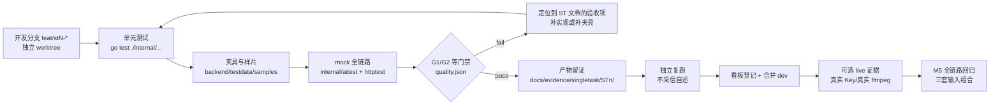
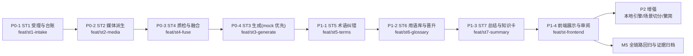

# ST8 · 验收矩阵与实施路线

> 本文把 ST1–ST7 的产出收敛成一套**可复跑、可留证、可判定**的验收体系：样片与夹具怎么造、mock 怎么搭、每个阶段用什么命令验、期望什么数值、证据落在哪、按什么顺序开工、什么条件下允许合入 dev。
> 依赖：[ST0 契约](00-总览与契约.md)（阶段表、schema、G1–G6 门禁）。ST1–ST7 的实现细节见各自文档，本文只做**验收与排期**。
> 纪律沿用仓库既有做法：无证据 = 未完成；自述不算证据；打回要写根因（见 `docs/board.md`、`docs/交接报告.md`）。

---

## 1. 目标与非目标

**目标**
1. 每个 ST 都有一个"跑一条命令就能判定是否完成"的验收入口，且证据可归档复现。
2. 全链路 e2e 在**无真实 AI Key** 的环境下也能判定通过/失败（mock 双轨），有 Key 时再补 live 证据。
3. 给出 P0/P1/P2 的开工顺序、分支、写作用域、DoD 与回退开关，让多 Agent 并行不打架。

**非目标**
- 不重新设计算法（见各 ST）；不改动既有 B/F/V 证据；不追求一次性重写全部阶段（P0 只动必要路径）。

---

## 2. 验收体系总览



---

## 3. 样片与夹具约定

**目录**：`backend/testdata/samples/`（进仓库，体积控制 <300KB；**视频不进仓库**，用脚本生成）。

| 文件 | 用途 | 关键断言 |
|---|---|---|
| `sample_native.srt` | 12 条，覆盖 0–58s，含 2 个专名 | 解析 12 条、coverage ≥0.95、G2 pass |
| `sample_ai.srt` | 同内容不同断句（条更多更碎） | 与 native 融合后条数不翻倍、重复被裁 |
| `sample_asr.srt` | 含 3 处术语错写 + 2 段 4-gram 重复幻觉 | tier 降档、dup_ngram_ratio > 0.05、纠错后残留 0 |
| `sample_ocr.srt` | 画面文字，稀疏（8 条） | 进入 screen_layer、不进 fused 对白、不参与 G2 |
| `sample_bad_duration.srt` | 时间轴到 600s，视频 60s | `too_long=true`、tier 降 2 档、G1 warn/fail |
| `sample_empty.srt` | 空文件 / 只有空行 | 源 `rejected`，任务不因此失败（除非无其它源） |
| `sample_danmu.xml` | 30 条，含 `p@ 时间属性与垃圾弹幕 | 解析出 time/user、清洗后 18±3 条、热点区间 ≥1 |
| `sample_danmu.json` | 弹幕 JSON 变体 | 与 XML 解析结果条数一致 |
| `sample_glossary_expected.json` | 人工标注的 10 个用语 + 3 个不应出现 | ST6 召回 ≥0.7、误抽 ≤1 |
| `sample_terms_kb.json` | 知识库夹具（standard/aliases/note） | ST5 最长匹配与残留校验 |

**样片生成脚本** `scripts/gen-sample.ps1`（幂等、可用 `-Force` 重建）：

```powershell
# 生成 60s 带音轨的合成视频（无声对白，仅用于链路）
ffmpeg -y -f lavfi -i "testsrc=size=640x360:rate=30:duration=60" ^
       -f lavfi -i "sine=frequency=440:duration=60" ^
       -c:v libx264 -pix_fmt yuv420p -c:a aac -shortest backend/testdata/samples/sample_60s.mp4
# 断言：ffprobe 时长 60±0.5s，含音频流
ffprobe -v error -show_entries format=duration -of csv=p=0 backend/testdata/samples/sample_60s.mp4
```

**CI 无 ffmpeg 时**：`media` 相关测试用 `testing.Short()` 或 `exec.LookPath("ffmpeg")` 判断，缺失则 `t.Skip("ffmpeg 不可用")` **并在证据 README 中写明跳过项**（跳过的测试不计入通过数）。

---

## 4. Mock 基建（无真实 Key 也能验）

| 组件 | 位置 | 说明 |
|---|---|---|
| HTTP 注入 | `backend/internal/deepseek/client.go` 增加 `Doer interface{ Do(*http.Request) (*http.Response, error) }` 字段，`New()` 默认用 `http.DefaultClient` | 让四种协议都能被 httptest 接管 |
| 流程依赖注入 | `backend/internal/pipeline/deps.go` 定义 `Deps{Chat, Vision, ASR ` 接口`}`，`Runner` 持 `Deps` 而非直接 new Client | 单测可注入假实现；生产装配保持不变 |
| 假实现 | `backend/internal/aitest/`（仅测试包可用，不进产物） | `FakeChat(script)` / `FakeASR(chunks)` / `FakeVision(frames)`，按调用序返回预设 JSON，并记录请求体供断言 |
| 协议响应构造 | `aitest.Responses` | openai_chat / openai_responses / anthropic / gemini / deepseek_asr / openai_audio 六套固定响应 |
| golden 记录 | `backend/testdata/golden/` | 真实模型的一次输出固化，用于回归比对（只比结构不比文字） |

**硬规则**
1. 测试内不得出现真实域名或真实 Key；CI 校验 `grep -r "api.openai.com\|sk-" backend/internal --include=*_test.go` 为空。
2. 断言优先断言**契约**（字段/条数/时间单调/门禁结果），不断言模型的具体措辞。
3. 所有 mock 必须能解释"真实环境会差在哪"，写进对应 ST 文档的验收节。

---

## 5. 验收矩阵（逐阶段）

> 命令均在仓库根目录执行；`$T=时间戳` 用于证据目录命名；证据路径缺省为 `docs/evidence/singletask/<ST>/`。

| 阶段 | 验收项 | 命令 | 期望 | 证据 |
|---|---|---|---|---|
| ST1 | 槽位与来源台账 | `go test ./internal/subtitle/ ./internal/pipeline/ -run "TestIngest\|TestManifest" -v` | 5 类槽位全部落库、source_id 唯一、manifest v0 合法 JSON | `ST1/unittest_output.txt` |
| ST1 | 坏时长拦截 | `go test ./internal/subtitle/ -run TestCheckTooLong -v` | `too_long=true`、tier_adjust=-2、decision≠primary | `ST1/too_long.txt` |
| ST1 | 弹幕结构 | `go test ./internal/subtitle/ -run TestDanmuXML -v` | time/user 解析正确、垃圾清洗后 18±3 条、热点 ≥1 | `ST1/danmu.json` |
| ST1 | API 兼容 | `curl -F video_file=@sample_60s.mp4 -F subtitle_vision=@sample_ocr.srt -F subtitle_ocr=@sample_ocr.srt ... /tasks` | 旧字段与 new 字段都 201；任务详情 subtitles 含两条 ocr | `ST1/api_notes.txt` |
| ST2 | 探测与抽音 | `go test ./internal/media/ -run TestProbe -v` | duration 60±0.5、has_audio=true、audio.wav 时长一致 ±1s | `ST2/probe.json` |
| ST2 | 切片计划 | `go test ./internal/media/ -run TestSplitPlan -v` | 边界落在静音中点、每片 ≤120s、重叠 4s、chunks.json 合法 | `ST2/chunks.json` |
| ST2 | 抽帧与 aHash | `go test ./internal/media/ -run TestExtractFrames -v` | 帧数 ≤MAX_FRAMES、frames.json 完整、近重复帧被标记 | `ST2/frames.json` |
| ST3 | ASR 引擎抽象 | `go test ./internal/pipeline/ -run TestASREngineContract -v` | 云/本地适配器返回统一结构 + granularity | `ST3/unittest_output.txt` |
| ST3 | 重叠裁剪与热词 | `go test ./internal/pipeline/ -run "TestOverlapTrim\|TestHotwords" -v` | 4s 重叠重复文本被裁、mock 请求体含 hotword 与 context | `ST3/request_bodies.json` |
| ST3 | OCR 聚合 | `go test ./internal/pipeline/ -run TestOCRAggregate -v` | 近同文本合并、保留首见时间、空帧不产生 cue | `ST3/ocr.srt` |
| ST4 | 可信梯与基底 | `go test ./internal/subtitle/ -run "TestTierOrder\|TestPickPrimary" -v` | native 胜 ai，ai 胜 asr，坏时长降档后让位 | `ST4/unittest_output.txt` |
| ST4 | 融合质量 | `go test ./internal/subtitle/ -run TestFuseV2 -v` | coverage_after ≥0.90、重复下降、conflicts 有记录 | `ST4/manifest.json` |
| ST4 | 门禁 | `go test ./internal/quality/ -run TestGatesFuse -v` | G1/G2 判定与 00 §6 一致（含 <180s 降档） | `ST4/quality.json` |
| ST5 | 最长匹配 | `go test ./internal/subtitle/ -run TestTermLongestMatch -v` | "云雾"不吃掉"云雾之湾"、URL/数字不被替换 | `ST5/unittest_output.txt` |
| ST5 | 性能 | `go test ./internal/subtitle/ -bench BenchmarkApplyTerms -benchtime=100x` | 1 万条 × 5k 术语 <200ms | `ST5/bench.txt` |
| ST6 | 候选挖掘 | `go test ./internal/glossary/ -run TestMineCandidates -v` | 对 sample_glossary_expected 召回 ≥0.7、误抽 ≤1 | `ST6/precision.txt` |
| ST6 | 证据校验 | `go test ./internal/glossary/ -run TestValidateEvidence -v` | 编造时间被拒、occurrences 与本地统计一致 | `ST6/evidence_check.txt` |
| ST6 | 晋升 KB | `go test ./internal/pipeline/ -run TestPromoteToKB -v` | 新版本 term_count 正确、兼容 parseTermBytes、KB 列表出现 v(n+1) | `ST6/promote.json` |
| ST6 | 热词回流 | `go test ./internal/pipeline/ -run TestHotwordFeed -v` | 任务 B 的 ASR 请求体包含已晋升术语 | `ST6/hotword_body.json` |
| ST7 | 结构门禁 | `go test ./internal/quality/ -run TestGatesSummary -v` | 概述 3–6 句、节数达标、时间戳全合法 | `ST7/quality.json` |
| ST7 | 解析与降级 | `go test ./internal/pipeline/ -run "TestParseSummary\|TestSummaryDegrade" -v` | 围栏/think/脏 JSON 可解析；两次失败走 DEGRADED 模板 | `ST7/degrade_output.txt` |
| ST8 | 全链路 mock | `go test ./internal/pipeline/ -run TestPipelineE2E_Mock -v` | 10 阶段全部出现、quality.status=pass、5 件产物齐全 | `ST8/e2e_mock.txt` |
| ST8 | 全链路真实 | `powershell scripts/e2e-live.ps1` | 真实 ffmpeg 跑完、产物非空；AI 无 Key 时降级并注明（沿用 B1 纪律） | `ST8/e2e_live.txt` |

---

## 6. 门禁与任务状态映射

| 门禁 | 判定实现 | 失败时任务状态 | 失败时用户可见 |
|---|---|---|---|
| G1 fail | `quality/gates_fuse.go` | `failed`，error 写明"无可用语音字幕 + ASR 不可用/未配置" | 详情页显式建议：勾选 ASR 生成或补传字幕 |
| G2 fail | 同上 | `failed`（有画面字幕时可走降级产出，标 `degraded`） | 显示覆盖率与缺口时段 |
| G3 fail | `quality/gates_terms.go` | 不中断（只标 `degraded`） | 显示残留别名清单前 10 条 |
| G4 fail | `quality/gates_summary.go` | `failed`（或有降级模板则 `degraded`） | 显示失败项与建议（调大 max_tokens / 换模型） |
| G5 fail | `quality/gates_glossary.go` | 不中断（`degraded`） | 显示无效条目数与原因 |
| G6 warn | `quality/gates_cost.go` | 不中断 | 显示成本与基线对比 |

**原则**：门禁只判定不修改产物；"不中断"的失败必须出现在 `degradations` 与详情页，禁止静默。

---

## 7. 实施路线（P0 / P1 / P2）

### 7.1 顺序与依赖



### 7.2 工作项、作用域与 DoD

| 批次 | 工作项 | 分支（off dev） | 写作用域 | 依赖 | DoD（可判定） |
|---|---|---|---|---|---|
| P0 | ST1 素材受理与来源台账 | `feat/st1-intake` | `backend/internal/subtitle/`、`backend/internal/pipeline/intake.go`、`backend/internal/api/`、`backend/internal/db/migrate_v2.go` | ST0 | 矩阵 ST1 四项全过 + `docs/evidence/singletask/ST1/` 完整 |
| P0 | ST2 媒体预处理与派生 | `feat/st2-media` | `backend/internal/media/`、`scripts/gen-sample.ps1`、`backend/testdata/samples/` | ST1 | 矩阵 ST2 三项全过 + 真实 ffmpeg 证据 |
| P0 | ST4 质检与融合 | `feat/st4-fuse` | `backend/internal/subtitle/fuse*.go`、`backend/internal/quality/`、`backend/internal/pipeline/pipeline.go`（fuse 段） | ST2 | coverage ≥0.90、conflicts 有记录、legacy 对比可解释、G1/G2 全过 |
| P0 | ST3 字幕生成 | `feat/st3-generate` | `backend/internal/asr/`（新增）、`backend/internal/ocr/`（新增）、`backend/internal/deepseek/`、`backend/internal/pipeline/asr*.go` / `ocr*.go`、`backend/internal/aitest/` | ST4 | mock 三项全过 + 请求体断言 + granularity 诚实标注 |
| P1 | ST5 知识库术语纠错 | `feat/st5-terms` | `backend/internal/subtitle/terms*.go`、`backend/internal/pipeline/kb.go` | ST3 | 最长匹配/保护/残留 0 + 性能预算达标 |
| P1 | ST6 用语库与晋升 | `feat/st6-glossary` | `backend/internal/glossary/`、`backend/internal/api/api_glossary.go`、`backend/internal/pipeline/pipeline.go`（glossary 段） | ST5 | 精度断言达标 + promote 生成 KB 新版本 + 热词回流断言 |
| P1 | ST7 总结与知识卡 | `feat/st7-summary` | `backend/internal/pipeline/summary.go` / `prompts.go`、`backend/internal/quality/gates_summary.go` | ST6 | G4 全过 + 四类坏响应降级正确 + 半篇保存 |
| P1 | 前端产物与审阅 | `feat/st-frontend` | `frontend/src/views/{TaskCreate,TaskDetail}.vue`、`frontend/src/api.js` | ST1/ST6/ST7 | 4 槽位可用、产物分区、用语库审阅与晋升按钮可用、build=0 |
| P2 | 本地引擎 | `feat/st-local-engine` | `backend/internal/asr/`、`backend/internal/ocr/` | ST3 | whisper.cpp 或本地 VLM 端点可跑，探测失败自动降级 |
| P2 | 场景切分与繁简 | `feat/st-scene` | `backend/internal/media/`、`backend/internal/subtitle/terms*.go` | ST2/ST5 | scene 模式截图数下降且 OCR 召回不降；繁简映射单测通过 |

### 7.3 里程碑退出条件

| 里程碑 | 覆盖工作项 | 退出条件（全过才可宣布） |
|---|---|---|
| M1 素材可信 | ST1、ST2 | 矩阵 ST1/ST2 全过；坏字幕被拦；manifest v0 合法 |
| M2 字幕可信 | ST3、ST4 | mock 全链路 quality.status=pass；coverage ≥0.90；G1/G2 判定正确 |
| M3 术语闭环 | ST5、ST6 | 残留 0；glossary.json 通过 G5；promote 后 KB 新版本可读并被下次任务热词使用 |
| M4 总结可信 | ST7 | G4 全过；时间戳 0 非法；四类坏响应降级正确 |
| M5 验收回归 | ST8 + P1 前端 | 三套输入组合全链路通过；兼容回归全绿；证据归档完成 |

---

## 8. 回归与上线判定

### 8.1 回归清单（每次合并 dev 前必须复跑）

| 项 | 命令 | 期望 |
|---|---|---|
| 后端静态与单测 | `go vet ./... && go test ./...` | 0 错误、全 PASS |
| 前端构建 | `cd frontend && npm run build` | exit 0、无 error |
| v1 任务进度兼容 | `go test ./internal/db/ -run TestProgressV1 -v` | 老任务仍 100，不因新增阶段归零 |
| API 旧字段兼容 | `go test ./internal/api/ -run TestCreateTaskLegacyFields -v` | 旧 multipart 字段仍 201 |
| 下载白名单 | `go test ./internal/api/ -run TestTaskFileWhitelist -v` | 新文件 200、越权 404 |
| 全链路 mock | `go test ./internal/pipeline/ -run TestPipelineE2E_Mock -v` | 10 阶段、5 件产物、quality=pass |

### 8.2 三套 e2e 输入组合

| 组合 | 输入 | 期望 |
|---|---|---|
| C1 全量 | 视频 + native + ai + ocr + asr + 弹幕 + 本地 ASR 生成 | 全部来源进 manifest；native 为基底；G1–G5 pass |
| C2 仅 native | 视频 + native | asr/vision/glossary 阶段 skipped（写明原因）；G1 pass |
| C3 仅画面 | 视频 + ocr（无语音源），ASR 不可用 | quality=degraded；summary 开头声明"无对白字幕"；G1 warn |

### 8.3 上线判定（DoD）

1. 矩阵中 P0/P1 全部验收项通过，证据落盘可复跑。
2. 回归清单全绿（含 v1 兼容与旧 API 兼容）。
3. 三套 e2e 组合结论与预期一致，C3 的降级必须可见。
4. 文档同步：ST 文档验收节与实际命令一致；`docs/plans/single-task/00-总览与契约.md` 如变更已回写；`docs/board.md` 登记本轮工作项。
5. 回退开关可用（见下表）。

### 8.4 回退开关

| 开关 | 位置 | 作用 |
|---|---|---|
| `STAGE_PROFILE=v1` | 环境变量或任务字段默认值 | 新任务走 v1 阶段表与权重（紧急回退） |
| `GLOSSARY_ENABLED=0` | 环境变量（默认值兜底） | 关闭用语库阶段，其余照常 |
| `FUSE_LEGACY=1` | 环境变量 | 融合回退到 v1 `FuseLegacy` |
| `QUALITY_WARN_ONLY=1` | 环境变量 | 门禁只记录不阻断（灰度期） |
| `ASR_LOCAL=off` | 环境变量 | 禁用本地 ASR 引擎探测 |
| 任务级 | `glossary_enabled` / `trust_override` | 单任务粒度开关与梯次覆盖（排障） |

---

## 9. 证据规范与文档同步

**每个 ST 的证据目录结构**（`docs/evidence/singletask/STn/`）：

```
README.md          # 结论表：验收项 / 命令 / 结果(PASS数值) / 证据文件 / 复跑人
unittest_output.txt
e2e_mock.txt
产物快照：manifest.json / quality.json / glossary.json / fused.srt / ocr.srt
screenshots/       # 仅前端改动需要
```

`README.md` 模板必含：
1. 环境（Go 版本、ffmpeg 版本、是否有真实 AI Key）。
2. 逐项：`命令 → 原始输出摘要 → 期望 vs 实际 → 结论`。
3. 跳过项与原因（如 ffmpeg 缺失、无真实 Key）。
4. 与 00 契约/ST 文档的偏差（若有，必须写"偏差 + 裁定"）。

**禁止**：只贴结论不贴命令；用历史截图代替本次复跑；把 mock 通过写成"真实链路通过"。

**文档同步**：ST 文档的验收节新增/变更 → 回写本文矩阵；契约变更 → 回写 00；本轮完成 → `docs/board.md` 登记。

---

## 10. CI 集成

```yaml
# 建议加入 .github/workflows/check.yml（或复用现有 check.yml）
- 后端：go vet ./... ; go test ./... -count=1
- 前端：cd frontend && npm ci && npm run build
- 体积守卫：backend/testdata/samples 总大小 < 300KB
- 禁网守卫：测试文件内不得出现真实域名/Key（grep 断言）
- 长测试：ffmpeg 相关用 -short 跳过并在 summary 注明
```

超时建议：后端单测 5 分钟、前端构建 5 分钟；e2e mock 2 分钟。

---

## 11. 风险与回退（补充 00 §10）

| 风险 | 触发条件 | 缓解 | 回退 |
|---|---|---|---|
| mock 通过但真实链路失败 | 真实模型返回结构不同 | golden 记录 + 结构化校验 + 允许 1 次修复重试 | `QUALITY_WARN_ONLY=1` 灰度 |
| 阶段增多导致历史任务进度异常 | 迁移遗漏 | `stage_profile` 双表 + 回归项 TestProgressV1 | `STAGE_PROFILE=v1` |
| 融合重写回归 | 阈值不当 | legacy 对比测试 + 真数据校准 | `FUSE_LEGACY=1` |
| 用语库污染知识库 | 误确认 | 仅 confirmed 可晋升 + 冲突不合并 + 可回滚版本 | 删除 KB 新版本（现有删除接口） |
| 多 Agent 并行冲突 | 同文件改动 | 写作用域表 + 独立 worktree（沿用既有纪律） | 按分支 rebase 重做 |

---

## 12. 收尾清单（M5 完成时逐项打勾）

```
[ ] 矩阵 P0/P1 全过，证据齐备且可复跑
[ ] 回归清单 6 项全绿
[ ] 三套 e2e 组合结论与预期一致（C3 降级可见）
[ ] 回退开关逐个实测可用
[ ] 00 契约与实际实现一致（字段/阶段/门禁/权重）
[ ] docs/board.md 登记本轮工作项与证据路径
[ ] 前端 build=0，新建页 4 槽位与详情页产物区实测
[ ] 至少 1 个真实视频跑出 summary/knowledge/glossary 三件套（真实模型；ASR 可用则真实 ASR）
```

> 返回上级：[计划索引](../README.md) ｜ 契约源：[ST0](00-总览与契约.md)
