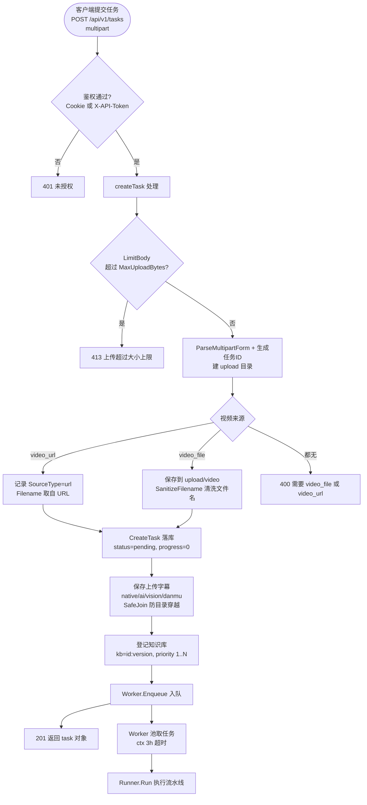

# 视频被接受处理流程图

> 依据后端真实实现绘制（`backend/internal/api/api_tasks.go`、`backend/internal/worker/worker.go`、`backend/internal/pipeline/pipeline.go`）。
> 说明阶段与 `task_stages` 一一对应：import / audio / asr / frame / vision / fuse / summary。
>
> **注意**：本文描述的是**当前 v1 实现**。单任务处理的**目标设计**（10 阶段：新增 intake/glossary/quality，产出用语库与来源台账/质检报告）见 [单任务处理计划](plans/README.md)，落地后需回写本文。

## 1. 总览（接受 → 排队 → 处理 → 产出）

## 2. 流水线内部（Runner.Run）

```mermaid
flowchart TD
    S([Run 开始<br/>GetTask · MkdirAll 目录 · SetTaskStarted]) --> P1

    subgraph P1[阶段1 import 导入]
      I1{SourceType=url?} -- 是 --> I2[withRetry 下载视频→upload/video]
      I1 -- 否 --> I3[用已有 VideoPath]
      I2 --> I4{有视频源?}
      I3 --> I4
      I4 -- 否 --> IF[fail: 没有视频源]
      I4 -- 是 --> I5[FinishStage import done]
    end

    I5 --> P2[阶段2 audio 抽音<br/>ffmpeg ExtractAudio→audio.wav<br/>ProbeDuration 取时长]

    P2 --> U[读取已上传字幕<br/>native/ai/vision/danmu 解析]

    U --> Q1{需要ASR?<br/>ASRProfile>0 且<br/>开启或缺少人工/AI字幕}
    Q1 -- 是 --> A1[阶段3 asr<br/>SplitAudio 切片→有界并发转写<br/>UpdateStageProgress 分片进度]
    A1 --> A2{有识别结果?}
    A2 -- 是 --> A3["写 asr.srt · 记 subtitle(generated)"]
    A2 -- 否/切分失败 --> A4[FinishStage asr skipped]
    A3 --> Q2
    A4 --> Q2
    Q1 -- 否 --> Q2

    Q2{需要识图?<br/>VisionProfile>0 且<br/>GenerateVision<br/>或 ReadingProfile>0}
    Q2 -- 是 --> F1[阶段4 frame<br/>ExtractFrames 按间隔抽帧]
    F1 --> F2{GenerateVision 且有帧?}
    F2 -- 是 --> V1[阶段5 vision<br/>逐帧并发 Vision 识别<br/>UpdateStageProgress 识图进度]
    V1 --> V2["写 vision.srt · 记 subtitle(generated)"]
    F2 -- 否 --> Q3
    V2 --> Q3
    Q2 -- 否 --> Q3

    Q3[阶段6 fuse 融合] --> Q3a[汇总各来源 Source:<br/>native→ai→asr→uploadedVision→生成的vision]
    Q3a --> Q3b[Fuse 合并去重排序<br/>ApplyTerms 领域术语纠错]
    Q3b --> Q3c[写 fused.srt · 生成统一稿 unifiedText]
    Q3c --> DM{有弹幕?}
    DM -- 是 --> DM1[CleanDanmu + SummarizeDanmu]
    DM -- 否 --> Q4
    DM1 --> Q4

    Q4[阶段7 summary 总结] --> G1[选 summary 方案<br/>可选 reading 方案]
    G1 --> G2{reading_depth T>0 且有帧?}
    G2 -- 是 --> G3[多轮回看: 模型提时间点问题<br/>→ neighborFrames 识图作答<br/>→ 结论拼入上下文]
    G3 --> G2
    G2 -- 否 --> G4[最终 prompt: 统一稿+弹幕+偏好+回看结论<br/>要求返回 JSON summary_md/knowledge_md]
    G4 --> G5[解析 JSON · 兜底默认摘要]
    G5 --> G6[写 output/summary.md · output/knowledge.md<br/>UpdateTaskCost · SetTaskFinished done]
    G6 --> E([任务完成 status=done progress=100])
```

## 3. 阶段与产物对照

| 阶段(task_stages) | 触发条件 | 主要动作 | 产出 |
|---|---|---|---|
| import | 必做 | 下载 URL 视频 / 使用上传视频 | upload/video |
| audio | 必做 | ffmpeg 抽取音轨、探测时长 | work/audio.wav |
| asr | ASRProfile>0 且(开启 or 缺人工/AI字幕) | 切片有界并发转写 | subs/asr.srt |
| frame | 需识图或需回看 | 按间隔抽帧 | work/frames/ |
| vision | GenerateVision 且有帧 | 逐帧并发识图 | subs/vision.srt |
| fuse | 必做 | 多来源融合去重+术语纠错 | subs/fused.srt、统一稿 |
| summary | 必做 | (可选多轮回看)+生成两份 Markdown | output/summary.md、output/knowledge.md |

## 4. 进度与状态

- **进度聚合**：`tasks.progress` 按 `task_stages` 加权实时聚合（import10 / audio10 / asr25 / frame10 / vision15 / fuse10 / summary20 = 100）；阶段每次开始/更新/结束都会回写。
- **失败处理**：任一阶段出错调用 `fail(stage,...)`，该阶段记 failed，任务置 `status=failed`；`summary` 失败不会清零已得进度，而是保留聚合值。
- **跳过**：ASR 无可用切分音频、或无需识图时，对应阶段标 `skipped`（按完成计入进度）。
- **并发**：ASR 分片、vision 帧均以 `MaxConcurrency` 有界并发，带指数退避重试(withRetry，最多 3 次)。

## 5. 产物下载（GET /tasks/{id}/files/{name}）

`summary.md` / `knowledge.md` / `fused.srt` / `asr.srt` / `vision.srt`，均需鉴权（Cookie 或 X-API-Token）；未生成的返回 404。
